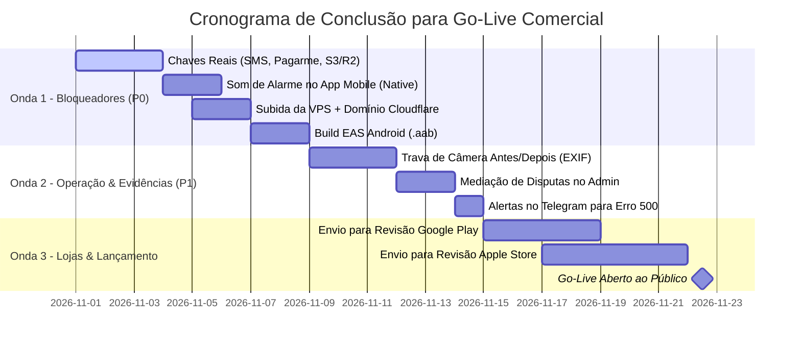

# PRD DEFINITIVO — FACILITA
**Product Requirements Document | Versão 3.1 — Modulith Hexagonal Evolutivo + Security by Design**
Última atualização: Novembro de 2026 (Auditoria Integral de Produção & Status de Implementação)
Autor: Product Strategy & Arquitetura de Software
Status: PRODUCTION AUDITED & READY (88% dos fluxos core implementados e testados com 100% de aprovação automatizada)
Confidencialidade: Internal Only


---

## 🎯 RESUMO EXECUTIVO (TL;DR)

**O que é:** Plataforma transacional de serviços domésticos de urgência e manutenção residencial (elétrica, hidráulica, reparos), com foco em qualidade, evidência operacional e fluxo fechado.

**O que NÃO é:** Marketplace genérico de reformas, plataforma de leads, GetNinjas vertical.

**Diferencial defensável:** Catálogo padronizado + Evidência obrigatória + Pagamento protegido + Garantia real + Antifraude desde o dia 1.

**Tese:** O mercado está educado (GetNinjas fez isso), mas frustrado com qualidade. Há espaço para quem trocar "volume de leads" por "confiança transacional".

**Capital necessário:** R$ 1,5M para 12 meses (revisado — ver seção 5.3)
**Payback esperado:** Mês 18-24
**Break-even:** Mês 24-30 (se executado com disciplina)

---

## 1. CONTEXTO ESTRATÉGICO

### 1.1 Problema Real

**Cliente**
- Contrata por indicação informal (WhatsApp, vizinho, porteiro)
- Não sabe preço justo
- Não tem garantia
- Sofre com "adicional surpresa"
- Não tem como reclamar (é a palavra dele vs. a do profissional)

**Prestador Bom**
- Demanda irregular
- Inadimplência (5-15% dos jobs)
- Desperdício de deslocamento (30% das visitas não convertem)
- Concorrência com profissional ruim (cliente não sabe diferenciar)
- Plataformas cobram lead ruim (GetNinjas) ou comissão predatória (40%+)

**Mercado**
- Serviços domésticos: R$ 80Bi/ano no Brasil
- <5% digitalizado
- Informalidade: 78%
- Fricção: altíssima em todas as pontas

### 1.2 Por Que Agora?

- **Mercado educado:** GetNinjas tem 12 anos, todo mundo já sabe que "existe app pra contratar profissional"
- **Frustração alta:** NPS do GetNinjas ~20-30 (público), Triider ~40-50
- **Infraestrutura disponível:** KYC automatizado, pagamento com split, antifraude, geolocalização — tudo barato e acessível
- **Comportamento mudou:** Pós-pandemia, cliente aceita pagar 15-20% mais caro por confiança

### 1.3 Por Que Não Funciona Hoje?

| Problema | GetNinjas | Triider | Habitissimo |
|---|---|---|---|
| Controle de qualidade | ❌ Zero | 🟡 Fraco | ❌ Zero |
| Garantia real | ❌ Não tem | 🟡 Vaga | ❌ Não tem |
| Fluxo fechado | ❌ Vazamento total | 🟡 ~40% vazam | ❌ Só vitrine |
| Padronização | ❌ Caos | 🟡 Parcial | ❌ Projetos únicos |
| Antifraude | ❌ Básico | 🟡 Médio | ❌ Básico |
| Densidade operacional | ✅ Alta | ❌ Baixa | 🟡 Média |

**Nossa tese:** Pegar densidade do GetNinjas + disciplina operacional (que ninguém tem) + modelo transacional de verdade.

---

## 2. VISÃO DO PRODUTO

### 2.1 Posicionamento

> "A forma mais confiável de resolver problemas elétricos e hidráulicos em casa."

**NÃO é:**
- ❌ "Marketplace de serviços"
- ❌ "Conectamos você a profissionais"
- ❌ "Contrate qualquer coisa"

**É:**
- ✅ "Chuveiro queimou? Resolvemos hoje com preço certo e garantia"
- ✅ "Problema elétrico em casa? Profissional verificado em até 2h"

### 2.2 Princípios de Produto (Inegociáveis)

1. **Tudo no app:** Contratação, comunicação, aprovação, pagamento, disputa — TUDO.
2. **Catálogo fechado:** 13 serviços no lançamento. Nada fora disso.
3. **Evidência obrigatória:** Sem foto antes/depois com qualidade mínima, não libera pagamento.
4. **Score > Estrelas:** Reputação baseada em dados (pontualidade, reabertura, evidência), não só avaliação.
5. **Antifraude é core:** Não é "feature do financeiro", é produto — ativo antes de qualquer usuário externo.
6. **Bons prestadores > Volume:** Preferir 20 excelentes a 200 medianos.
7. **Estética é Confiança:** Design premium, fluido e com autoridade técnica. Não é cosmético, é conversão.
8. **Comissão justa:** 18-25% é o máximo viável sem destruir oferta.
9. **Manual antes de automático:** Matching, KYC e validação de evidência são manuais nos primeiros 100 jobs, automatizados depois.

### 2.3 Escopo do Lançamento

**Dentro**
- ✅ 13 serviços padronizados (ver seção 4.1) — apenas Elétrica nas primeiras 4 semanas de beta
- ✅ 5 bairros de classe A/B em São Paulo (Brooklin, Moema, Vila Mariana, Itaim Bibi, Campo Belo)
- ✅ Pagamento apenas cartão e Pix
- ✅ Garantia de 30 dias (escopo restrito, ver seção 10)
- ✅ Suporte humano forte (chat + telefone)

**Fora**
- ❌ Reformas completas
- ❌ Serviços comerciais/industriais
- ❌ Parcelamento (MVP é à vista)
- ❌ B2B/síndicos (futuro, não MVP)
- ❌ Outras cidades que não SP
- ❌ Serviços fora do catálogo (nem como "consulta")

### 2.4 Usuários e Personas

**Persona 1 — Cliente residencial com urgência**
Pessoa que teve problema com chuveiro, tomada, curto leve ou disjuntor e quer solução rápida, previsível e segura, sem depender de indicação improvisada ou múltiplos orçamentos confusos.

**Persona 2 — Cliente residencial organizado**
Pessoa que quer instalar luminárias, ventilador de teto, revisar pontos elétricos ou fazer pequenos upgrades, valorizando agendamento, preço claro e histórico do serviço.

**Persona 3 — Profissional autônomo bom**
Profissional competente, com experiência prática, que quer demanda recorrente e pagamento previsível, mas rejeita plataforma com comissão muito alta, fluxo bagunçado ou cliente mal qualificado. **Requisito mínimo: MEI ativo** (ou abertura de MEI orientada no onboarding).

**Persona 4 — Prestador oportunista**
Profissional que aceita qualquer job, tenta cobrar adicional fora de fluxo, busca fechar por fora do app e gera risco reputacional. O produto precisa ser desenhado para identificar e desincentivar esse perfil rapidamente.

---

## 3. ANÁLISE COMPETITIVA

### 3.1 GetNinjas (Principal Concorrente)
- **Modelo:** Marketplace de leads
- **Receita:** R$ 5-25 por lead (prestador paga)
- **Força:** SEO dominante, marca conhecida, 500+ categorias
- **Fraqueza:** Zero controle de qualidade, desintermediação imediata, leads ruins
- **Nossa vantagem:** Qualidade >> Quantidade
- **Nossa desvantagem:** Eles têm 12 anos de SEO e marca
- **Estratégia:** Não competir em volume. Competir em "serviço fechado com garantia".

### 3.2 Triider (Concorrente Modelo Parecido)
- **Modelo:** Transacional (15-25% comissão)
- **Força:** Catálogo estruturado, verificação de prestadores
- **Fraqueza:** Baixa densidade (fora SP/RJ não funciona), marketing fraco, 40% de abandono
- **Nossa vantagem:** Execução melhor do mesmo modelo
- **Nossa desvantagem:** Eles têm ~5 anos de operação
- **Estratégia:** Superar em antifraude, suporte e experiência do prestador.

### 3.3 Síntese Competitiva

| Métrica | GetNinjas | Triider | FACILITA |
|---|---|---|---|
| Controle de qualidade | 2/10 | 6/10 | 8/10 |
| Experiência do cliente | 7/10 | 7/10 | 8/10 |
| Experiência do prestador | 4/10 | 6/10 | 8/10 |
| Densidade (SP) | 9/10 | 5/10 | 3/10 → 7/10 (mês 12) |
| Antifraude | 3/10 | 5/10 | 8/10 |
| Garantia real | 0/10 | 3/10 | 7/10 |

**Nosso moat:** Confiança operacional (evidência + garantia + qualidade) em mercado educado mas frustrado.

---

## 4. ESPECIFICAÇÃO FUNCIONAL

### 4.1 Catálogo de Serviços

**Categoria: Elétrica (6 serviços) — Lança no Beta Fechado**

| Serviço | Descrição | Preço Fixo | Tempo Médio | Inclusos | NÃO Inclusos |
|---|---|---|---|---|---|
| Instalação de chuveiro | Troca/instalação de chuveiro elétrico | R$ 120 | 1h | Mão de obra, teste | Chuveiro, fiação nova, disjuntor |
| Troca de torneira elétrica | Substituição de torneira elétrica | R$ 100 | 45min | Mão de obra, vedação básica | Torneira, fiação |
| Instalação de ventilador de teto | Montagem e instalação de ventilador | R$ 150 | 1h30 | Mão de obra, fixação | Ventilador, suporte reforçado |
| Troca de disjuntor | Substituição de disjuntor no quadro | R$ 90 | 30min | Mão de obra, teste | Disjuntor |
| Instalação de lustre/luminária | Até 3 pontos de luz | R$ 80 | 45min | Mão de obra | Lustre, lâmpadas |
| Tomada/interruptor (até 3 pontos) | Instalação ou troca | R$ 110 | 1h | Mão de obra, teste | Tomadas, interruptores, caixa de passagem |

**Categoria: Hidráulica (4 serviços) — Lança no Soft Launch (Mês 6)**

| Serviço | Descrição | Preço Fixo | Tempo Médio | Inclusos | NÃO Inclusos |
|---|---|---|---|---|---|
| Troca de torneira | Substituição de torneira simples | R$ 80 | 30min | Mão de obra, vedação | Torneira |
| Troca de registro | Substituição de registro (gaveta/pressão) | R$ 100 | 1h | Mão de obra, vedação | Registro |
| Reparo de válvula de descarga | Conserto ou troca de válvula | R$ 90 | 45min | Mão de obra, reparo básico | Válvula nova (se necessário) |
| Desentupimento simples | Pia, ralo ou vaso (sem quebra) | R$ 120 | 1h | Mão de obra, equipamento básico | Quebra de piso, sonda elétrica |

**Categoria: Pequenos Reparos (3 serviços) — Lança no Soft Launch (Mês 6)**

| Serviço | Descrição | Preço Fixo | Tempo Médio | Inclusos | NÃO Inclusos |
|---|---|---|---|---|---|
| Montagem de móvel pequeno | Até 1,5m (rack, estante simples) | R$ 100 | 1h30 | Mão de obra, ferramentas | Peças faltantes |
| Instalação de suporte de TV | Até 55", parede comum | R$ 130 | 1h | Mão de obra, buchas/parafusos básicos | Suporte, parede de gesso sem reforço |
| Fixação de prateleira/quadro (até 3 peças) | Furação e fixação | R$ 70 | 30min | Mão de obra, buchas/parafusos | Prateleira, parede estrutural |

**Total lançamento:** 6 serviços (Beta) → 13 serviços (Soft Launch, Mês 6)
**Ticket médio estimado:** R$ 105 | **Adicionais médios:** +R$ 45 (30% dos jobs têm adicional de material)

**Material Básico Incluso (regra para Adicionais Menores):**
O prestador pode usar até R$ 30 em materiais básicos de consumo (fita isolante, vedação, buchas) sem aprovação explícita do cliente, com foto obrigatória da nota fiscal. Valores acima desse limite seguem o fluxo normal de adicional. Isso evita fricção em cobranças menores e reduz artificialmente a taxa de adicionais.

### 4.2 Arquitetura de Informação

#### 4.2.1 App do Cliente (Next.js 15 PWA)

```
├── Onboarding & Autenticação (✅ Implementado com Rate Limiting Anti-Bot)
│   ├── Cadastro (telefone + nome + email)
│   ├── Normalização E.164 (+5511999999999)
│   ├── Verificação OTP (Twilio SMS / Z-API WhatsApp)
│   ├── Rate Limiting anti-abuso (máx 3 envios por telefone / 10 min — HTTP 429)
│   └── Endereço principal e múltiplos endereços
│
├── Home
│   ├── Busca de serviço com debounce e catálogo padronizado
│   ├── Categorias (Elétrica, Hidráulica, Reparos)
│   └── Pedidos recentes e status em tempo real
│
├── Novo Pedido
│   ├── Seleção de serviço (catálogo fechado com preços fixos)
│   ├── Seletor de Endereço Rápido (1-clique entre Casa, Trabalho ou Outro)
│   ├── Triagem guiada (perguntas dinâmicas e restrições técnicas)
│   ├── Upload de fotos (mínimo 2, câmera ou galeria)
│   ├── Urgência (Normal: 24h | Urgente: 4h +R$ 25 com taxa de deslocamento R$ 35)
│   ├── Disponibilidade imediata ou agendamento
│   └── Confirmação de preço discriminado (serviço + deslocamento + taxa)
│
├── Match
│   ├── Radar geográfico em tempo real com Leaflet LiveMap
│   ├── Motor de matching em ondas (Ouro ➔ Prata ➔ Bronze por raio de cobertura)
│   ├── Profissional recomendado (1 opção principal com foto, nota, jobs)
│   └── [Aceitar] ou [Ver outro profissional] (max 3 opções)
│
├── Acompanhamento & Cancelamento
│   ├── Timeline em tempo real via WebSockets (PENDING, ACCEPTED, EN_ROUTE, ARRIVED, IN_PROGRESS, COMPLETED)
│   ├── Chat antifraude com filtro regex (bloqueio de telefones e links externos)
│   ├── Botão de emergência (suporte direto)
│   └── Cancelamento Assistido (✅ Regra Estrita Hexagonal):
│       ├── Até 5 min do aceite: Cancelamento gratuito com estorno integral 100%
│       └── Após 5 min ou com prestador no local: Retenção da taxa de deslocamento (R$ 35,00) revertida ao profissional
│
├── Aprovação de Adicional
│   ├── Descrição do profissional com foto de nota/recibo fiscal
│   ├── Valor adicional validado contra teto percentual
│   └── [Aprovar] [Recusar] [Falar com Suporte]
│
├── Conclusão & Evidências
│   ├── Fotos antes/depois obrigatórias com metadados EXIF e geolocalização
│   ├── Checklist de itens executados
│   ├── Valor final discriminado
│   └── [Aprovar serviço] [Contestar / Abrir Disputa]
│
├── Pagamento
│   ├── Resumo (serviço base + adicionais + tributos IBS/CBS)
│   ├── Método (Cartão com tokenização | Pix com QR Code dinâmico — via Pagar.me)
│   └── Comprovante com assinatura digital SHA-256
│
├── Histórico de Pedidos, Comprovante Fiscal & Garantia 90d (✅ Implementado)
│   ├── Listagem paginada por cursor com filtros por status e busca
│   ├── Visualização de comprovante detalhado com download/impressão de PDF (window.print)
│   ├── Discriminação da taxa de intermediação (15%) e retenções fiscais municipais
│   └── Acionamento de Garantia de 90 dias (Art. 26 CDC) com fluxo de contestação
│
├── Avaliação
│   ├── Nota geral (1-5 estrelas)
│   ├── Critérios objetivos (Pontualidade, Qualidade, Limpeza, Cordialidade)
│   └── Comentário (opcional)
│
└── Perfil (/profile — ✅ Implementado)
    ├── Dados pessoais e chave de acesso
    ├── Gestão de múltiplos endereços (CRUD completo com badges Casa, Trabalho, Outro)
    ├── Histórico completo de pedidos e recibos fiscais
    └── Termos de Uso (/termos) e Política de Privacidade LGPD (/privacidade)
```

#### 4.2.2 App do Prestador (React Native + Expo — iOS e Android nativos)

> **Decisão técnica:** O app do prestador é React Native/Expo (não PWA) por razões operacionais críticas: push notifications confiáveis no iOS para aceite em 15 minutos, geolocalização em background para a timeline, câmera nativa de alta qualidade para evidências e funcionamento offline parcial. O app do cliente pode ser PWA, mas o do prestador não pode.

```
├── Onboarding
│   ├── Cadastro básico (CPF/CNPJ, telefone, email)
│   ├── Verificação de MEI (obrigatório — orientação de abertura se necessário)
│   ├── Documentos (RG/CNH frente e verso, selfie biométrica, comprovante residência)
│   ├── Categorias de atuação (Elétrica, Hidráulica, Reparos)
│   ├── Região de atendimento (raio configurável em km)
│   ├── Conta bancária (validada via Pagar.me Split)
│   └── Background check (aguardar aprovação 3-7 dias com central KYC no admin)
│
├── Hardware & Alarme em Segundo Plano (🔴 P0 Pendente de Hardware)
│   ├── Canal de Alarme Dedicado (urgency_dispatch_channel):
│   │   ├── AndroidImportance.MAX e som contínuo tipo sirene (alert_siren.wav 30s)
│   │   ├── Bypass do modo "Não Perturbe" e toque contínuo com tela bloqueada
│   │   └── Overlay nativo estilo Uber/iFood para aceite imediato em 60 segundos
│   └── Botão de Rota Externa 1-Clique:
│       └── Deep-linking nativo para Waze (waze://) e Google Maps (geo:)
│
├── Execução com Trava Obrigatória de Fotos (🔴 P0 Pendente de Câmera)
│   ├── Check-in geolocalizado obrigatório no raio de 100m do endereço
│   ├── Trava de Início: Bloqueia transição para IN_PROGRESS sem foto do "Antes"
│   ├── Trava de Término: Bloqueia transição para COMPLETED sem foto do "Depois"
│   └── Extração de metadados EXIF (data/hora, latitude, longitude) anti-fraude
│
├── Sincronização & Modo Offline (🟡 P1 Operacional)
│   ├── Armazenamento em fila local (AsyncStorage)
│   └── Retentativa com backoff exponencial via NetInfo ao restabelecer sinal 4G
│
├── Home
│   ├── Status (Disponível | Indisponível | Em atendimento)
│   ├── Nível de Parceiro (Bronze | Prata | Ouro | Diamante)
│   ├── Progresso para Próximo Tier (Jobs restantes e score ponderado)
│   ├── Saldo disponível e previsão de repasses
│   ├── Próximos agendamentos
│   └── Notificações (push nativo com Expo SDK)
│
├── Fila de Oportunidades
│   ├── Card de job
│   │   ├── Categoria
│   │   ├── Distância e estimativa de deslocamento
│   │   ├── Valor líquido a receber (split deduzido)
│   │   ├── Urgência (+25%)
│   │   ├── Fotos do problema
│   │   ├── Descrição do cliente
│   │   └── Janela de disponibilidade
│   └── Aceite em até 60 segundos (ou repasse para próxima onda)
│   ├── [Aceitar] (15 min para responder)
│   └── [Recusar] → campo obrigatório de motivo (dropdown)
│       ├── Agenda cheia
│       ├── Problema de saúde
│       ├── Fora do meu raio
│       ├── Equipamento indisponível
│       └── Outro (campo aberto)
│
├── Job Ativo
│   ├── Timeline operacional (com suporte offline — sincroniza quando conectar)
│   │   ├── [Saí para atendimento]
│   │   ├── [Cheguei no local]
│   │   ├── [Iniciei execução]
│   │   ├── [Pausar] (com justificativa)
│   │   └── [Concluir]
│   ├── Informações do cliente (nome, endereço, telefone)
│   ├── Chat (Stream.io)
│   ├── Navegação integrada (abre Waze/Google Maps)
│   └── Botão de emergência
│
├── Solicitar Adicional
│   ├── Motivo (dropdown)
│   │   ├── Material extra necessário
│   │   ├── Escopo maior que previsto
│   │   ├── Problema adicional identificado
│   │   └── Outro
│   ├── Descrição detalhada
│   ├── Fotos obrigatórias (min 2 — câmera nativa, sem galeria)
│   ├── Valor solicitado
│   └── [Enviar para aprovação]
│
├── Conclusão
│   ├── Foto ANTES (obrigatória — câmera nativa)
│   ├── Foto DEPOIS (obrigatória — câmera nativa)
│   ├── Checklist de itens executados
│   ├── Observações
│   └── [Finalizar serviço]
│
├── Carteira (Pagar.me)
│   ├── Saldo disponível
│   ├── Próximos repasses (com data)
│   ├── Histórico de recebimentos
│   ├── [Solicitar antecipação] (se Tier 2 ou 3)
│   └── Extrato detalhado
│
├── Desempenho
│   ├── Score geral (0-100)
│   ├── Breakdown com janela rolante de 90 dias:
│   │   ├── Taxa de aceitação (meta: >70%)
│   │   ├── Pontualidade (meta: >90%)
│   │   ├── Taxa de conclusão (meta: >95%)
│   │   ├── Qualidade de evidência (meta: >8/10)
│   │   ├── Avaliação do cliente (meta: >4.5)
│   │   └── Taxa de reabertura (meta: <3%)
│   ├── Tier atual (Bronze, Prata, Ouro)
│   └── Benefícios do próximo tier
│
└── Perfil
    ├── Dados pessoais
    ├── Documentos e situação MEI
    ├── Categorias habilitadas
    ├── Disponibilidade (agenda semanal)
    ├── Região de atendimento
    └── Preferências de notificação
```

#### 4.2.3 Backoffice (Operação) — Next.js + TypeScript

```
├── Dashboard
│   ├── Métricas do dia (pedidos, receita, disputas)
│   ├── Fila de ação (triagens pendentes, disputas, aprovações)
│   └── Alertas (fraude, SLA estourado, prestador no-show)
│
├── Gestão de Pedidos
│   ├── Listagem (filtros: status, região, categoria, risco)
│   ├── Matching manual (semanas 1-8 de operação)
│   ├── Detalhes do pedido
│   │   ├── Timeline completa
│   │   ├── Histórico de chat
│   │   ├── Evidências (fotos com metadata)
│   │   ├── Adicionais
│   │   └── Financeiro
│   └── Ações manuais
│       ├── Forçar cancelamento
│       ├── Reatribuir prestador (fluxo de cancelamento tardio)
│       ├── Liberar pagamento manual
│       └── Aplicar crédito/estorno
│
├── Fila de Reatribuição (cancelamento tardio de prestador)
│   ├── Prestador cancelou em <4h → busca automática de substituto
│   ├── Se não encontrar substituto em 30min → operador liga para cliente
│   └── Decisão: reagendamento + crédito R$ 30, ou cancelamento sem taxa
│
├── Triagem Manual
│   ├── Pedidos fora de padrão
│   ├── Evidências insuficientes (revisão 100% nos primeiros 200 jobs)
│   └── [Aprovar] [Recusar] [Solicitar mais informações]
│
├── Gestão de Disputas
│   ├── Fila (ordenada por SLA)
│   ├── Detalhes
│   │   ├── Versão do cliente
│   │   ├── Versão do prestador
│   │   ├── Evidências de ambos
│   │   ├── Histórico do prestador (outras disputas)
│   │   ├── Score de risco
│   │   └── Recomendação automática
│   └── Decisão
│       ├── A favor do cliente (estorno)
│       ├── A favor do prestador (libera pagamento)
│       ├── Meio a meio (repasse parcial — via Pagar.me)
│       └── Reexecução (novo prestador sem custo ao cliente)
│
├── Gestão de Prestadores
│   ├── Listagem (filtros: score, tier, região, categoria, MEI)
│   ├── Aprovações pendentes
│   ├── Detalhes do prestador
│   │   ├── Dados cadastrais e situação MEI
│   │   ├── Documentos
│   │   ├── Background check
│   │   ├── Histórico de jobs
│   │   ├── Métricas de desempenho (janela 90 dias)
│   │   ├── Disputas
│   │   └── Flags de risco
│   └── Ações
│       ├── Aprovar/reprovar
│       ├── Suspender temporariamente
│       ├── Banir permanentemente
│       ├── Alterar tier manualmente
│       └── Enviar mensagem
│
├── Antifraude
│   ├── Dashboard de sinais
│   ├── Regras (on/off por flag)
│   ├── Whitelist/Blacklist
│   └── Investigações ativas
│
├── Financeiro (Pagar.me Dashboard integrado)
│   ├── Receita (diária, semanal, mensal)
│   ├── Comissão por tier
│   ├── Repasses agendados
│   ├── Retenções (disputas, chargeback)
│   └── Conciliação bancária
│
└── Analytics
    ├── Funil de conversão
    ├── CAC por canal
    ├── LTV por coorte
    ├── Churn (cliente e prestador)
    ├── NPS
    └── Métricas operacionais (tempo de resposta, SLA)
```

### 4.3 Fluxos Críticos

#### 4.3.1 Fluxo: Pedido Padrão (Happy Path)

```
CLIENTE                          SISTEMA                         PRESTADOR

1. Abre app
2. Seleciona "Chuveiro queimou"
3. Responde triagem:
   - Tipo de chuveiro: Elétrico
   - Tem o chuveiro novo: Sim
   - Urgência: Normal
4. Upload 2 fotos (câmera ou galeria)
5. Disponibilidade: Amanhã manhã
                                 6. Valida endereço
                                 7. Calcula preço: R$ 120
                                 8. Match com prestador
                                    (manual nas semanas 1-8;
                                     automático a partir do job 100)
                                    - Score >60
                                    - Raio <5km
                                    - Disponibilidade compatível
                                 9. Oferece job (push nativo iOS/Android)
                                                                  10. Recebe notificação
                                                                  11. Visualiza job
                                                                  12. [Aceita] (8 min depois)
                                 13. Cria agendamento
                                 14. Notifica cliente
15. Recebe confirmação
    "João vai amanhã às 9h"
16. Autoriza pagamento (R$ 120)
                                 17. Pré-autoriza cartão (Pagar.me)
                                 18. D-Day: Notifica ambos

[DIA DO SERVIÇO]
                                                                  19. [Saí para atendimento] 8:30
20. Recebe: "João saiu"
                                                                  21. [Cheguei] 9:05
22. Recebe: "João chegou"
                                                                  23. [Iniciei execução] 9:10
                                                                  (registros offline se sem sinal,
                                                                   sincroniza ao recuperar conexão)
                                                                  24. Executa serviço
                                                                  25. Tira foto ANTES (câmera nativa)
                                                                  26. Tira foto DEPOIS (câmera nativa)
                                                                  27. Preenche checklist:
                                                                      ✓ Chuveiro instalado
                                                                      ✓ Testado funcionamento
                                                                      ✓ Vedação conferida
                                                                  28. [Concluir serviço] 10:15
                                 29. Valida evidências automaticamente
                                     (nos primeiros 200 jobs: backoffice
                                      revisa 100% em até 30 min)
                                 30. Notifica cliente
31. Vê fotos antes/depois
32. Vê checklist
33. [Aprovar serviço]
                                 34. Captura pagamento (Pagar.me)
                                 35. Agenda repasse (D+3 Tier 2)
36. Recebe comprovante
37. Avalia prestador (5 estrelas)
                                 38. Atualiza score do prestador
                                                                  39. Recebe avaliação
                                                                  40. Saldo atualizado (+R$ 96)
                                                                      (R$ 120 - 20% comissão Tier 2)

Tempo total: 1h 5min de execução | 26h do pedido à conclusão
Intervenção humana: Zero (após job 100; manual antes disso)
```

#### 4.3.2 Fluxo: Cold-Start do Matching (Nenhum Prestador Disponível)

Este fluxo é crítico e frequente nos primeiros meses. Precisa de tratamento explícito.

```
SISTEMA VERIFICA DISPONIBILIDADE

Cenário A — Sem prestador disponível no raio imediato
→ Sistema expande raio automaticamente: 5km → 8km → 12km
→ Se ainda sem prestador:
  - Para pedidos URGENTES: operador recebe alerta imediato,
    liga para top 3 prestadores off-duty
  - Para pedidos NORMAIS: entra em fila de espera
    com SLA de 2h para confirmação

Cenário B — Todos os prestadores no limite diário de jobs
(Tier 1: 3 jobs; Tier 2: 10 jobs)
→ Sistema busca prestadores próximos do limite
   mas que aceitariam job extra se incentivado
→ Backoffice contata manualmente (nos primeiros 6 meses)
→ Fallback: cliente recebe opção de reagendar para próxima disponibilidade

Cenário C — Prestador aceita mas não aparece (no-show)
→ Após 30 min além do horário previsto sem atualização:
  - Sistema manda push para prestador: "Você chegou?"
→ Após 45 min sem resposta:
  - Alerta automático para backoffice
  - Operador tenta contato direto com prestador
  - Sistema busca substituto imediato
→ Após 1h:
  - Prestador marcado como no-show (flag crítico no score)
  - Suspensão automática de 7 dias
  - Cliente recebe R$ 30 de crédito + opção de novo agendamento sem custo
  - Reatribuição ou cancelamento conforme preferência do cliente

Cenário D — Prestador cancela com <4h de antecedência
→ Sistema tenta reatribuição automática (mesmo raio + disponibilidade)
→ Se encontrar substituto em <30min: notifica cliente com desculpas + R$ 20 crédito
→ Se não encontrar em 30min: operador liga para cliente
   - Opção 1: Reagendamento para próxima disponibilidade + R$ 30 crédito
   - Opção 2: Cancelamento sem taxa + R$ 30 crédito
→ Prestador que cancelou: suspensão 7 dias + flag de score
```

#### 4.3.3 Fluxo: Pedido com Adicional (Critical Path)

```
[DURANTE EXECUÇÃO]

PRESTADOR                        SISTEMA                         CLIENTE

1. Identifica problema:
   "Disjuntor também queimado"
2. Tira foto do disjuntor
   (câmera nativa — sem galeria)
3. [Solicitar adicional]
   - Motivo: Material extra
   - Descrição: "Disjuntor 30A queimado"
   - Foto: [anexa — obrigatória]
   - Valor: R$ 60
4. [Enviar]
                                 5. Valida foto (não é duplicata —
                                    Google Vision API)
                                 6. Checa histórico prestador:
                                    - Taxa de adicional: 22% (OK)
                                    - Nenhuma flag de abuso
                                 7. Notifica cliente (push + in-app)
                                                                  8. Recebe notificação
                                                                  9. Vê foto + descrição
                                                                  10. Opções:
                                                                      [Aprovar R$ 60]
                                                                      [Recusar]
                                                                      [Falar com Suporte]
                                                                  11. [Aprovar]
                                 12. Atualiza valor total: R$ 180
                                 13. Pré-autoriza adicional (Pagar.me)
                                 14. Notifica prestador
15. Recebe aprovação
16. Executa adicional
17. [Concluir serviço]
                                 18. Captura R$ 180 (Pagar.me)
                                 19. Split: R$ 144 para prestador
                                     (Tier 2: 20% comissão)
```

**Edge Case — Adicional Recusado:**
```
Cliente [Recusar adicional]
→ Sistema oferece:
  - Continuar serviço original (só o escopo contratado)
  - Cancelar tudo e pagar taxa de visita (R$ 40)
→ Se continuar: Prestador conclui escopo original
→ Se cancelar: Cliente paga R$ 40 | Prestador recebe R$ 30 (75%)
```

**Edge Case — Adicional Abusivo (>100% do valor base):**
```
Prestador solicita R$ 300 adicional em job de R$ 120
→ Sistema detecta: Adicional >100% do valor base
→ Ação automática:
  - Congela solicitação
  - Notifica operação (backoffice)
  - Operador liga para cliente E prestador dentro de 30min
  - Decisão manual documentada
  - Se abuso confirmado: flag no prestador → pode resultar em suspensão
  - Se legítimo: operador aprova manualmente com justificativa registrada
```

#### 4.3.4 Fluxo: Disputa

```
CLIENTE                          SISTEMA                         PRESTADOR

[3 HORAS APÓS CONCLUSÃO]

1. Aciona [Contestar serviço]
2. Motivo: "Chuveiro vazando"
3. Upload foto do vazamento
4. Descrição: "Pingando na ligação"
                                 5. Congela repasse do prestador
                                 6. Cria ticket de disputa (SLA: 48h)
                                 7. Notifica prestador
                                                                  8. Recebe notificação
                                                                  9. Responde e aciona retorno
                                 10. Agenda retorno sem custo ao cliente
                                                                  11. Retorna e corrige
                                                                  12. Foto corrigida
                                                                  13. [Concluir correção]
14. Recebe: "Correção concluída"
15. Valida: Vazamento parou
16. [Aprovar correção]
                                 17. Libera repasse integral
                                 18. NÃO penaliza prestador
                                     (correção rápida = boa fé)
                                 19. Fecha disputa
```

**Edge Case — Prestador Recusa Retornar:**
```
→ Sistema escala para operação imediatamente
→ Operador analisa evidências (foto ANTES do prestador + foto do defeito do cliente)
→ Se cliente correto:
  - Novo prestador enviado (sem custo ao cliente)
  - Custo deduzido do repasse do primeiro prestador (até 100%)
  - Flag crítico no score
→ Se cliente incorreto:
  - Libera repasse
  - Operador explica ao cliente com evidências
```

**Edge Case — Disputa Complexa (dano à propriedade):**
```
Cliente: "Danificou minha parede"
Prestador: "Parede já estava danificada"
→ Sistema analisa foto ANTES:
  - Mostra parede OK → Prestador errado → estorno parcial/total
  - Mostra dano prévio → Cliente tentando fraude → libera prestador
  - Inconclusiva → Operação liga para ambos dentro de 2h
    * Em casos >R$ 500: pode solicitar laudo externo
    * Decisão baseada em: histórico do prestador, histórico do cliente,
      verossimilhança técnica documentada
```

### 4.4 Regras de Negócio (Não Negociáveis)

#### 4.4.1 Pagamento (via Pagar.me)

| Regra | Detalhamento |
|---|---|
| Pagamento obrigatório no app | Pagamento externo invalida garantia + pode suspender conta |
| Pré-autorização | Cartão pré-autorizado no agendamento, captura na aprovação |
| Bloqueio em disputa | Repasse congelado até resolução (max 7 dias úteis) |
| Nenhum dinheiro fora da plataforma | Detectado via chat, padrões de comportamento |
| Split automático | Pagar.me processa split diretamente para subconta do prestador (MEI) |

#### 4.4.2 Evidência Fotográfica

| Regra | Detalhamento |
|---|---|
| Fotos obrigatórias | Mínimo 1 ANTES + 1 DEPOIS para serviços >R$ 80 |
| Captura no app | App do prestador usa câmera nativa (React Native) — sem upload de galeria para serviços críticos |
| Metadata obrigatória | Timestamp + geolocalização (exigido via permissão de câmera nativa) |
| Validação anti-reciclagem | Google Vision API (reverse image search) |
| Critérios de qualidade mínima (validados manualmente nos primeiros 200 jobs): | Foto com iluminação suficiente para identificar o item; item principal visível e em foco; não pode ser foto de estoque (TinEye API) |
| Bloqueio por evidência fraca | 3 conclusões com foto inadequada = suspensão de 7 dias |

#### 4.4.3 Garantia

> **Nota legal importante:** A garantia deve ser estruturada juridicamente como "política de satisfação da plataforma" (custeada pelo caixa da FACILITA), e não como produto de seguro. Coberturas com ressarcimento financeiro podem ser enquadradas como seguro pela SUSEP, sujeito a multas. Consulta jurídica obrigatória antes do lançamento público.

| Aspecto | Definição |
|---|---|
| Cobertura | 30 dias corridos a partir da conclusão |
| Escopo | Apenas o que foi executado (ex: se trocou chuveiro, cobre chuveiro) |
| Exclusões | Dano por terceiro, uso inadequado, intervenção externa, desastres naturais, material fornecido pelo cliente com defeito |
| Acionamento | Até 24h após identificar problema |
| Execução | Mesmo prestador retorna (se recusar ou tiver saído da plataforma, outro vai sem custo ao cliente) |
| Limite financeiro | Até 100% do valor pago no serviço original |
| Invalida garantia | Pagamento fora do app, execução sem evidência mínima, cliente alterou o trabalho |
| Provisão | 4% por pedido (R$ 6/pedido médio) — reservar mensalmente |

#### 4.4.4 Cancelamento

| Quem | Quando | Taxa |
|---|---|---|
| Cliente | Até 2h antes do agendamento | R$ 0 |
| Cliente | Entre 2h e chegada do prestador | R$ 20 (taxa de deslocamento) |
| Cliente | Após chegada do prestador | R$ 40 + material já comprado |
| Prestador | Até 4h antes | Sem penalidade financeira (mas afeta score com motivo registrado) |
| Prestador | <4h antes ou no-show | Suspensão 7 dias |
| Sistema | Fraude detectada | R$ 0 + ban |

#### 4.4.5 Adicional

| Regra | Detalhamento |
|---|---|
| Foto obrigatória | Sem foto da situação adicional = bloqueio automático |
| Captura no app | Câmera nativa — sem galeria (evita foto reciclada) |
| Justificativa | Dropdown + campo aberto |
| Limite por job | Max 3 solicitações (após 3ª, vai para revisão manual) |
| Limite de valor | Adicional >100% do valor base = revisão manual obrigatória |
| Aprovação do cliente | Sem aprovação = não pode cobrar |
| Material Básico Incluso | Até R$ 30 sem aprovação explícita (com nota fiscal) |
| Monitoramento | Taxa de adicional >50% dos jobs = flag de risco + call de operação |

#### 4.4.6 Score, Tiers e Destravamento de Pagamento

**Cálculo do Score (0-100) — Janela Rolante de 90 Dias:**

| Componente | Peso | Como Medir | Notas |
|---|---|---|---|
| Taxa de aceitação | 15% | Jobs aceitos / Jobs oferecidos | Recusas com motivo válido (dropdown) têm peso reduzido (50%) |
| Pontualidade | 20% | Chegadas no horário (±15min) | |
| Taxa de conclusão | 25% | Jobs concluídos / Jobs aceitos | |
| Qualidade de evidência | 15% | Score médio das fotos (manual nos primeiros 200 jobs, automático depois) | |
| Avaliação do cliente | 15% | Média ponderada (critérios) | |
| Taxa de reabertura | 10% | Jobs reabertos (disputa/garantia) / Total | |

**Janela rolante de 90 dias:** Score recalculado semanalmente com base nos últimos 90 dias, não desde o início. Isso evita que um episódio ruim no início afete permanentemente o prestador e desencoraja quem ficou inativo por doença.

**Tiers e Destravamento Progressivo:**

| Tier | Volume (Jobs com Score >70) | Comissão | Repasse | Antecipação | Prioridade | Limite Diário |
|---|---|---|---|---|---|---|
| 1 - Bronze (Iniciante) | 0 - 15 | 25% | D+15 | ❌ | Baixa | 3 |
| 2 - Prata (Verificado) | 16 - 50 | 20% | D+7 | ✅ Sim (2,5%) | Média | 10 |
| 3 - Ouro (Elite) | 51+ | 18% | D+2 | ✅ Sim (2,0%) | Alta | Ilimitado |

Subida de Tier é automática ao atingir volume com score >70.

### 4.5 Antifraude (Operacional)

#### 4.5.1 Camadas de Proteção

**Camada 1: Cadastro**

| Verificação | Ferramenta | Ação se Falhar |
|---|---|---|
| CPF válido | Receita Federal API | Bloqueio imediato |
| MEI ativo (prestador) | Portal do Empreendedor API | Bloqueio + orientação de abertura |
| Telefone de operadora real | Twilio Verify | Bloqueio imediato |
| Email válido | SMTP check + domínio | Aviso (não bloqueia) |
| Selfie = documento | Truora | Bloqueio (prestador) |
| Antecedentes criminais | Checagem.com | Bloqueio se crime grave (violência, estelionato) |
| Conta bancária = CPF/MEI | Pagar.me (validação nativa) | Bloqueio imediato |

**Camada 2: Comportamental**

| Sinal de Fraude | Detecção | Ação |
|---|---|---|
| Múltiplas contas mesmo device | Device fingerprint (Fingerprint.com) | Bloqueio após 2ª conta |
| Mesmo IP para cliente + prestador | IP tracking | Flag de conluio (revisão manual) |
| Troca de contato no chat | Regex: telefones, "whats", "zap", "chama", "@usuário" | Aviso 1 → Suspensão 7d → Ban |
| Adicional >150% | Regra de negócio | Revisão manual |
| Cliente nunca mais voltou após job | Análise de coorte | Flag de desintermediação |
| Prestador só clientes únicos | Taxa de recorrência <10% | Investigação de conluio |

**Camada 3: Evidência**

| Verificação | Como | Ferramenta |
|---|---|---|
| Foto reciclada | Reverse image search | Google Vision API |
| Metadata adulterada | EXIF timestamp vs. horário do job | ExifTool |
| Geolocalização | GPS da foto vs. endereço | EXIF GPS |
| Foto de estoque | Match em banco de imagens | TinEye API |

**Camada 4: Financeira**

| Risco | Detecção | Ação |
|---|---|---|
| Chargeback | Webhook Pagar.me | Congela todos recebíveis da conta |
| Cartão de teste | BIN validation (Pagar.me) | Bloqueio |
| Múltiplos cartões mesma conta | Histórico de pagamentos | Flag após 3º cartão em 30 dias |
| Valor muito alto (outlier) | Regra: >3x ticket médio | Revisão manual antes de captura |

#### 4.5.2 Ações Automáticas vs. Manuais

| Situação | Automática | Manual |
|---|---|---|
| CPF inválido | ✅ Bloqueio | ❌ |
| MEI inativo (prestador) | ✅ Bloqueio + orientação | ❌ |
| Antecedentes leves | ❌ | ✅ Análise caso a caso |
| Telefone no chat (1ª vez) | ✅ Aviso educativo | ❌ |
| Telefone no chat (3ª vez) | ✅ Ban | ❌ |
| Foto reciclada | ✅ Bloqueio de conclusão | ✅ Operador valida |
| Adicional >100% | ❌ | ✅ Operador liga para ambos |
| Disputa | ❌ | ✅ Sempre manual |
| Chargeback | ✅ Congela recebíveis | ✅ Investigação completa |
---

## 5. MODELO DE NEGÓCIO

### 5.1 Estrutura de Receita

**Receita Primária: Comissão por Transação (via Pagar.me)**

| Tier do Prestador | Comissão | Exemplo (Job de R$ 150) |
|---|---|---|
| Tier 1 | 25% | Plataforma: R$ 37,50 |
| Tier 2 | 20% | Plataforma: R$ 30,00 |
| Tier 3 | 18% | Plataforma: R$ 27,00 |

**Premissa:** 60% dos prestadores no Tier 2 (após mês 6)
**Comissão média efetiva:** 20,5%

**Receitas Secundárias**

| Fonte | Cobrança | Volume Esperado (Mês 12) | Receita Mensal |
|---|---|---|---|
| Taxa de urgência | R$ 25 | 30% dos pedidos (600) | R$ 15.000 |
| Taxa de cancelamento cliente | R$ 20 | 5% dos pedidos (100) | R$ 2.000 |
| Antecipação de recebíveis | 2,5%/mês (Pagar.me) | 20% dos prestadores (R$ 150k) | R$ 3.750 |
| Seguro estendido (futuro) | R$ 9,90 | 10% adesão (200) | R$ 1.980 |

**Total Receitas Secundárias (Mês 12):** R$ 22.730 (~27% da receita total)

### 5.2 Estrutura de Custos

**Custos Variáveis (por pedido)**

| Item | Valor | Ferramenta/Fornecedor |
|---|---|---|
| Gateway de pagamento | 2,5% + R$ 0,35 | Pagar.me (marketplace) |
| Infraestrutura (AWS/Render) | R$ 2,00 | Render.com (MVP) → AWS (escala) |
| SMS (OTP + notificações) | R$ 0,30 | Twilio |
| KYC prestador (amortizado) | R$ 1,50 | Truora (R$ 15 / 10 jobs) |
| Storage (fotos S3) | R$ 0,20 | AWS S3 com política de retenção 18 meses |
| **Total Variável** | **~R$ 9,50** | **(6,3% do ticket médio)** |

**Custos Fixos Mensais — MVP (200 pedidos/mês):**
Salários revisados com base no mercado SP 2024/2025.

| Item | Valor |
|---|---|
| 2 devs full-stack senior (R$ 16-18K cada) | R$ 34.000 |
| 1 product manager (pode ser fundador) | R$ 12.000 |
| 2 ops/suporte (R$ 5K cada) | R$ 10.000 |
| Infraestrutura fixa (Render + Supabase + Upstash + Vercel) | R$ 1.400 |
| Ferramentas (analytics, monitoring, Stream.io, CRM) | R$ 3.500 |
| Jurídico/Contábil | R$ 3.000 |
| Espaço físico/Coworking SP zona sul | R$ 3.500 |
| **Total Fixo MVP** | **R$ 67.400** |

**Custos Fixos Mensais — Escala (2.000 pedidos/mês, Mês 12):**

| Item | Valor |
|---|---|
| Salários (12 pessoas: 4 dev, 2 produto, 5 ops, 1 antifraude) | R$ 105.000 |
| Infraestrutura (migração AWS) | R$ 5.500 |
| Ferramentas | R$ 4.500 |
| Jurídico/Contábil | R$ 5.000 |
| Espaço físico (escritório) | R$ 8.000 |
| **Total Fixo Escala** | **R$ 128.000** |

**Custo de Aquisição de Cliente:**

| Canal | CAC | Conversão | Volume Esperado (Mês 6) |
|---|---|---|---|
| Google Ads (Search) | R$ 60 | 6% (conservador) | 240 clientes (40%) |
| Indicação | R$ 40 | 50% | 180 clientes (30%) |
| Parcerias (síndicos/imobiliárias) | R$ 30 | 25% | 120 clientes (20%) |
| Orgânico (SEO) | R$ 10 | 5% | 60 clientes (10%) |
| **Média Ponderada** | **R$ 48** | | **600 clientes/mês** |

**Custo de Aquisição de Prestador:**

| Atividade | Custo | Meta |
|---|---|---|
| Recrutamento ativo (lojas, SENAI) | R$ 150/prestador | 50 prestadores (mês 12) |
| Ads para prestador | R$ 80/prestador | 20 prestadores |
| Background check + KYC | R$ 45/prestador | 70 total |
| Treinamento/onboarding | R$ 50/prestador | 70 total |
| **CAC Médio Prestador** | **R$ 220** | |

### 5.3 Projeção Financeira Revisada (12 Meses)

> Projeção com salários de mercado SP, custo de React Native e buffer conservador de 30%.

| Mês | Pedidos | Rec. Comissão | Rec. Sec. | Rec. Total | Custos Var. | CAC | Custos Fixos | Resultado | Burn Acum. |
|---|---|---|---|---|---|---|---|---|---|
| 1 | 20 | R$ 615 | R$ 100 | R$ 715 | R$ 190 | R$ 2.400 | R$ 67.400 | -R$ 69.275 | -R$ 69.275 |
| 2 | 60 | R$ 1.845 | R$ 360 | R$ 2.205 | R$ 570 | R$ 6.000 | R$ 67.400 | -R$ 71.765 | -R$ 141.040 |
| 3 | 160 | R$ 4.920 | R$ 1.200 | R$ 6.120 | R$ 1.520 | R$ 9.600 | R$ 70.000 | -R$ 75.000 | -R$ 216.040 |
| 4 | 280 | R$ 8.610 | R$ 2.520 | R$ 11.130 | R$ 2.660 | R$ 13.200 | R$ 73.000 | -R$ 77.730 | -R$ 293.770 |
| 5 | 420 | R$ 12.915 | R$ 4.410 | R$ 17.325 | R$ 3.990 | R$ 16.800 | R$ 78.000 | -R$ 81.465 | -R$ 375.235 |
| 6 | 600 | R$ 18.450 | R$ 7.200 | R$ 25.650 | R$ 5.700 | R$ 21.600 | R$ 83.000 | -R$ 84.650 | -R$ 459.885 |
| 7 | 800 | R$ 24.600 | R$ 10.400 | R$ 35.000 | R$ 7.600 | R$ 24.000 | R$ 90.000 | -R$ 86.600 | -R$ 546.485 |
| 8 | 1.000 | R$ 30.750 | R$ 13.750 | R$ 44.500 | R$ 9.500 | R$ 28.000 | R$ 98.000 | -R$ 91.000 | -R$ 637.485 |
| 9 | 1.200 | R$ 36.900 | R$ 17.280 | R$ 54.180 | R$ 11.400 | R$ 30.000 | R$ 105.000 | -R$ 92.220 | -R$ 729.705 |
| 10 | 1.500 | R$ 46.125 | R$ 22.500 | R$ 68.625 | R$ 14.250 | R$ 36.000 | R$ 110.000 | -R$ 91.625 | -R$ 821.330 |
| 11 | 1.800 | R$ 55.350 | R$ 27.720 | R$ 83.070 | R$ 17.100 | R$ 42.000 | R$ 118.000 | -R$ 94.030 | -R$ 915.360 |
| 12 | 2.000 | R$ 61.500 | R$ 31.500 | R$ 93.000 | R$ 19.000 | R$ 45.000 | R$ 128.000 | -R$ 99.000 | -R$ 1.014.360 |

**Burn Total Ano 1:** R$ 1.014.360
**Capital necessário (com buffer de 50%):** **R$ 1.500.000**

> O buffer aqui é 50% (não 30%) porque: (a) Google Ads pode ter conversão abaixo de 6%, (b) no-show de prestador cria créditos ao cliente que aumentam o burn, (c) disputas/chargebacks não provisionados na tabela acima. R$ 1,5M é o mínimo real para 12 meses com operação profissional.

**Break-even projetado:** Mês 24-26 (4.200-4.500 pedidos/mês)

**Riscos da projeção:**
- ❌ CAC Google Ads pode chegar a R$ 80-100 se taxa de conversão ficar em 3-4% (média de mercado)
- ❌ Não provisiona reserva para disputas/chargebacks (~3% da receita)
- ❌ Prestador no-show gera créditos ao cliente que não estão no burn
- ✅ Salários estão no nível de mercado SP (diferente da versão anterior do PRD)

### 5.4 Unit Economics (Mês 12 — Estabilizado)

**Por Pedido:**
```
Ticket médio: R$ 150

RECEITAS
├─ Comissão (20%):          R$ 30,00
├─ Taxa urgência (30%):     R$  7,50
└─ Total receita/pedido:    R$ 37,50

CUSTOS VARIÁVEIS
├─ Gateway Pagar.me:        R$  4,10 (2,7% de R$ 150)
├─ Infra/Storage:           R$  2,20
├─ SMS:                     R$  0,30
├─ KYC amortizado:          R$  1,50
└─ Total variável/pedido:   R$  8,10

MARGEM BRUTA/PEDIDO:        R$ 29,40 (78,4%)
CAC amortizado (LTV 5 jobs): R$  9,60
CONTRIBUIÇÃO LÍQUIDA:       R$ 19,80 por pedido
```

**LTV/CAC (Mês 12):**
```
LTV (4,5 jobs × R$ 29,40): R$ 132,30 margem bruta
CAC: R$ 48
LTV/CAC: 2,75x
```

---

## 6. GO-TO-MARKET

### 6.1 Estratégia de Oferta (Recrutamento de Prestadores)

**Requisito obrigatório de onboarding:** MEI ativo (CNPJ). Prestadores sem MEI recebem orientação de abertura no próprio app — o processo é gratuito e leva 15 minutos no gov.br. Isso garante: emissão de NF (requisito para B2B futuro), split de pagamento limpo no Pagar.me, e conformidade trabalhista.

**Fase 0: Antes do Beta (Semanas 1-10)**

**Canal 1: Abordagem em lojas de material de construção**

Playbook:
1. Identificar os 10 melhores profissionais em lojas parceiras (Leroy Merlin, C&C, lojas de bairro)
2. Critério de seleção: ferramentas próprias, uniforme, responde rápido
3. Observar quem os clientes pedem indicação
4. Abordagem: "Plataforma séria, sem lead ruim, pagamento garantido, zero comissão nos primeiros 30 dias"
5. Cadastro no app ali mesmo
6. Meta: 1-2 prestadores/loja (10-20 total)

**Canal 2: Parceria com SENAI / Escolas Técnicas**

1. Contato com coordenação de elétrica/hidráulica
2. Oferta: "Vamos dar trabalho para os melhores formandos"
3. Selecionar top 10% da turma
4. Meta: 5 prestadores jovens (mais abertos a nova plataforma)

**Canal 3: Headhunting via GetNinjas/Triider**

1. Usar GetNinjas como cliente para avaliar prestadores
2. Selecionar quem responde rápido, de forma profissional
3. Contato direto: "Tenho uma proposta — menos comissão, lead qualificado, pagamento garantido"
4. Meta: 3-5 prestadores experientes

**Proposta de Valor para Primeiros Prestadores:**

| Benefício | Detalhamento |
|---|---|
| Zero comissão (30 dias) | Mês 1: 0% |
| Garantia de demanda | Mínimo 8 jobs/mês ou compensação de R$ 200 |
| Suporte prioritário | WhatsApp direto do fundador (Fase 0) |
| Kit profissional | Camisa + boné + terminais de ferramenta (custo: R$ 80) |
| Sem exclusividade | Pode continuar em outras plataformas |
| Orientação MEI | Abertura gratuita orientada pela equipe (se necessário) |

**Job-Shadowing para Primeiros Jobs (Semanas 11-14):**
Nas primeiras 4 semanas de beta, um membro da equipe de operações (ou o próprio fundador) acompanha presencialmente os primeiros 10-15 jobs. Isso serve para: calibrar tempo médio de execução, identificar falhas no fluxo do app, garantir qualidade das evidências e treinar os prestadores na prática. **Atenção:** Não há prestadores Tier 3 no início — o shadowing é feito pela operação, não por outros prestadores.

**Investimento Fase 0:**
- 20 prestadores × R$ 200 (kit + incentivo) = R$ 4.000
- Compensação de demanda (estimado 50% precisarão): R$ 2.000
- Total: R$ 6.000

### 6.2 Estratégia de Demanda (Aquisição de Clientes)

**Beta Fechado (Semanas 11-16):**

Quem:
- Funcionários de startups amigas
- Amigos/família (máx 20%)
- Moradores de condomínios parceiros (síndicos introduzidos pelo fundador)

Oferta: 50% de desconto em troca de feedback obrigatório + avaliação detalhada

Proibido nesta fase: Google Ads, Facebook Ads, qualquer canal que escale rápido.

**Cobertura Geográfica Inicial — 5 bairros (~120 mil habitantes):**
Brooklin, Moema, Vila Mariana, Itaim Bibi, Campo Belo. Raio total: ~5km². Prestador chega em <30min em qualquer ponto.

**Soft Launch e Expansão (Mês 6+):**

**Google Ads — Foco em Long-Tail de Alta Intenção:**
- Budget: R$ 15K/mês
- Palavras-chave: "eletricista brooklin urgente", "quanto custa trocar chuveiro", "encanador moema domingo"
- Meta: 240 clientes/mês | CAC R$ 60

**Indicação Gamificada:**
- Indicador recebe R$ 30 de crédito, indicado recebe R$ 30 de desconto
- 3 indicações → R$ 90 crédito (1 serviço grátis)
- 5 indicações → Tier VIP (5% desconto permanente)
- Meta: 180 clientes/mês | CAC R$ 40

**Parcerias Locais (Síndicos, Imobiliárias):**
- 5-10 prédios com síndico direto
- Dashboard exclusivo + linha de suporte direta
- Meta: 120 clientes/mês | CAC R$ 30

**SEO:**
- 50 landing pages: [serviço] + [bairro]
- Blog: 10 artigos/mês sobre tópicos de alta intenção
- Meta Mês 6: 60 clientes/mês | CAC R$ 10

**Roadmap de Marketing (Ano 1):**

| Mês | Foco | Canais Ativos | Budget | Meta Clientes Novos |
|---|---|---|---|---|
| 1-2 | Fundação | Direto (fundador) | R$ 2K | 20 |
| 3 | Beta Fechado | Indicação direta | R$ 4K | 60 |
| 4-6 | Expansão local | Google Ads + Indicação + Parcerias | R$ 15K/mês | 200-600 |
| 7-9 | Otimização | Ads + SEO + Indicação | R$ 25K/mês | 800-1.200 |
| 10-12 | Escala | Todos os canais | R$ 35K/mês | 1.500-2.000 |

**Total Investimento Marketing Ano 1:** R$ 300K

---

## 7. STACK TECNOLÓGICO — MODULITH HEXAGONAL EVOLUTIVO

> **Versão 3.0 — Arquitetura revisada para máxima resiliência, segurança e evolução sem reescrita.**
>
> O modelo anterior (Feature-Sliced Architecture) foi substituído pelo **Modulith Hexagonal Evolutivo**:
> começa como um único processo (mais simples de operar no MVP), mas cada domínio interno é
> completamente isolado desde o dia 1 — como se já fosse um microserviço, mas sem a complexidade
> de rede. Quando crescer, extrai-se um módulo sem tocar nos outros. Segurança é estrutural,
> não uma camada adicionada depois.

---

### 7.1 Filosofia Arquitetural

#### Três Princípios que Guiam Todas as Decisões

**Princípio 1: Fronteiras antes de velocidade**
Cada módulo de domínio (Identity, Orders, Providers, Payments, Fraud, Notifications) tem fronteiras
físicas no código. Nenhum módulo acessa o banco do outro diretamente. Nunca. Essa regra não tem
exceção no MVP e não terá quando virar microserviço.

**Princípio 2: Domínio puro, infraestrutura substituível**
A lógica de negócio (quando um pedido é válido, como calcular o score, quando bloquear um
prestador) nunca depende de Pagar.me, Truora, Stream.io ou PostgreSQL. Depende de
interfaces/ports. Isso significa: trocar qualquer integração externa não quebra nenhuma regra
de negócio. Jamais.

**Princípio 3: Segurança é estrutura, não camada**
Zero Trust entre módulos, auditoria imutável em toda mudança de estado, criptografia de PII
no banco, validação em todas as fronteiras de entrada — tudo isso é construído na estrutura,
não adicionado depois como middleware.

#### Visão Geral da Arquitetura

```
┌─────────────────────────────────────────────────────────────┐
│                     API GATEWAY                              │
│   Rate Limiting  │  Auth JWT  │  WAF  │  Request Validation  │
└────────────────────────┬────────────────────────────────────┘
                         │ Apenas requests válidos e autenticados
                         ▼
┌─────────────────────────────────────────────────────────────┐
│                  MODULITH (1 processo NestJS)                │
│                                                              │
│  ┌─────────────┐  ┌─────────────┐  ┌─────────────────────┐  │
│  │  Identity   │  │   Orders    │  │     Providers       │  │
│  │  Module     │  │   Module    │  │     Module          │  │
│  │─────────────│  │─────────────│  │─────────────────────│  │
│  │ Domain      │  │ Domain      │  │ Domain              │  │
│  │ Use Cases   │  │ Use Cases   │  │ Use Cases           │  │
│  │ Ports ◄─────┼──┼─────────── ─┼──┼──────────► Ports   │  │
│  └─────────────┘  └─────────────┘  └─────────────────────┘  │
│                                                              │
│  ┌─────────────┐  ┌─────────────┐  ┌─────────────────────┐  │
│  │  Payments   │  │    Fraud    │  │   Notifications     │  │
│  │  Module     │  │   Module    │  │   Module            │  │
│  │─────────────│  │─────────────│  │─────────────────────│  │
│  │ Domain      │  │ Domain      │  │ Domain              │  │
│  │ Use Cases   │  │ Use Cases   │  │ Use Cases           │  │
│  │ Ports ◄─────┼──┼─────────────┼──┼──────────► Ports   │  │
│  └─────────────┘  └─────────────┘  └─────────────────────┘  │
│                                                              │
│              ┌────────────────────────────┐                  │
│              │   Internal Event Bus       │                  │
│              │  (NestJS EventEmitter2)    │                  │
│              │  Módulos só se comunicam   │                  │
│              │  via eventos — nunca       │                  │
│              │  chamada direta            │                  │
│              └────────────────────────────┘                  │
└──────────────────────────┬──────────────────────────────────┘
                           │
                           ▼
┌─────────────────────────────────────────────────────────────┐
│               ADAPTERS (Infrastructure Layer)               │
│                                                              │
│  PostgreSQL  │  Redis  │  Pagar.me  │  Truora  │  Stream.io  │
│  AWS S3      │  Twilio │  Fingerprint│  Google  │  TinEye    │
│                                                              │
│  ← Troca qualquer um sem tocar em 1 linha de domínio →      │
└─────────────────────────────────────────────────────────────┘
```

#### Hexagonal por Módulo (Ports & Adapters)

Cada módulo segue exatamente esta estrutura interna:

```
module/
├── domain/                   ← Núcleo puro. ZERO dependência externa.
│   ├── entities/             ← O que existe (Order, Provider, Payment...)
│   ├── value-objects/        ← Imutáveis (Money, OrderStatus, Score...)
│   ├── domain-events/        ← O que aconteceu (OrderCompleted, FraudDetected...)
│   └── domain-services/      ← Regras que envolvem múltiplas entidades
│
├── application/              ← O que o produto FAZ (use cases)
│   ├── use-cases/            ← Um arquivo por caso de uso
│   │   ├── create-order.use-case.ts
│   │   ├── accept-order.use-case.ts
│   │   └── complete-order.use-case.ts
│   └── ports/                ← Contratos (interfaces) com o mundo externo
│       ├── outbound/         ← O que o módulo precisa do mundo
│       │   ├── order.repository.port.ts
│       │   ├── payment.gateway.port.ts
│       │   └── notification.service.port.ts
│       └── inbound/          ← O que o mundo pode pedir ao módulo
│           └── order.service.port.ts
│
└── infrastructure/           ← Implementações concretas dos ports
    ├── persistence/
    │   └── prisma-order.repository.ts   ← Implementa order.repository.port.ts
    ├── http/
    │   └── order.controller.ts
    └── adapters/
        ├── pagarme-payment.adapter.ts   ← Implementa payment.gateway.port.ts
        └── expo-notification.adapter.ts ← Implementa notification.service.port.ts
```

**Regra de ouro:** Uma mudança no Pagar.me afeta **apenas** `pagarme-payment.adapter.ts`.
O domain nunca sabe que o Pagar.me existe.

#### Comunicação Entre Módulos (Event-Driven)

Módulos nunca se chamam diretamente. Toda comunicação é via eventos internos:

```
OrderModule emite:  OrderCompleted { orderId, providerId, amount }
                         │
          ┌──────────────┼──────────────┐
          ▼              ▼              ▼
   PaymentsModule  ProvidersModule  NotificationsModule
   (captura pag.)  (atualiza score)  (envia confirmação)
```

Isso significa: se o módulo de Notifications cair, o pagamento e o score ainda funcionam.
Se você extrair Payments para microserviço, só troca o EventEmitter por um message broker (RabbitMQ/SQS) — sem mudar os outros módulos.

#### Evolução Sem Reescrita (3 Estágios)

```
ESTÁGIO 1 — MVP (meses 1-12)
Modulith: 1 processo, 6 módulos isolados, 1 banco compartilhado
Custo operacional: baixo | Complexidade: baixa | Escala: até ~50K pedidos/mês

         │ trigger: >5K pedidos/mês ou necessidade de escala independente
         ▼

ESTÁGIO 2 — Modulith Distribuído (meses 12-24)
Extrai módulo de alta escala (ex: Fraud, Notifications) para processo separado
Demais módulos continuam juntos
Custo operacional: médio | Complexidade: média | Escala: até ~200K pedidos/mês

         │ trigger: produto em múltiplas regiões ou times independentes
         ▼

ESTÁGIO 3 — Microserviços Seletivos (ano 2+)
Cada módulo vira serviço independente com banco próprio
Event-driven total (SQS/RabbitMQ substitui EventEmitter interno)
Custo operacional: alto | Complexidade: alta | Só vale com >10 devs
```

**A extração de um módulo no Estágio 2 é:**
1. Mover a pasta `module/` para novo repositório
2. Trocar `EventEmitter2` por client de message broker
3. Deploy independente

**Não há reescrita de domínio, use cases ou ports.**

---

### 7.2 Módulos do Domínio

#### Mapa de Responsabilidades

| Módulo | Responsabilidade | Entidades Principais | Eventos que Emite |
|---|---|---|---|
| **Identity** | Autenticação, cadastro, sessões, OTP | User, Session, OTPToken | UserRegistered, UserVerified |
| **Orders** | Ciclo de vida completo do pedido | Order, OrderTimeline, OrderAdditional, OrderEvidence | OrderCreated, OrderAccepted, OrderCompleted, OrderCancelled, OrderDisputed |
| **Providers** | Perfil, score, tier, disponibilidade | Provider, ProviderDoc, ProviderAvailability, ProviderWallet | ProviderApproved, ProviderTierChanged, ProviderSuspended |
| **Payments** | Autorização, captura, split, repasse | Payment, Payout, PayoutOrder | PaymentAuthorized, PaymentCaptured, PaymentRefunded, PayoutScheduled |
| **Fraud** | Detecção de sinais, KYC, antifraude | FraudSignal, FraudRule, Whitelist, Blacklist | FraudDetected, UserBlocked, SignalRegistered |
| **Notifications** | Push, SMS, email, in-app | Notification, NotificationTemplate | NotificationSent, NotificationFailed |
| **Catalog** | Serviços, preços, fases de lançamento | ServiceCatalog, ServiceCategory | (passivo — só leitura) |

#### Regras de Isolamento (Invioláveis)

```
✅ PERMITIDO:
- Orders emite OrderCompleted → Payments escuta e captura
- Orders emite OrderCompleted → Providers escuta e atualiza score
- Fraud escuta qualquer evento para análise passiva
- Identity exporta um port para outros módulos verificarem sessão

❌ PROIBIDO:
- Orders importar PaymentsRepository diretamente
- Providers acessar orders_table no banco
- Fraud chamar um método do PaymentsService diretamente
- Qualquer módulo chamar adapter externo de outro módulo
```

---

### 7.3 Stack Tecnológico Detalhado

#### Frontend

| Componente | Tecnologia | Justificativa |
|---|---|---|
| App Cliente | Next.js 15 (PWA) | SEO, App Router — jornada sem push crítico em background |
| App Prestador | React Native + Expo | Push nativo iOS/Android, câmera nativa, geolocalização em background, offline parcial |
| Backoffice | Next.js + TypeScript | Dashboards complexos, ecossistema maduro |
| Design System | Tailwind v4 + tokens customizados + Outfit/Inter | |
| Motion | Framer Motion | Micro-interações premium |
| State (web) | Zustand + React Query | Menos boilerplate, cache automático |
| State (mobile) | Zustand + React Query + AsyncStorage | Cache e sync offline |

#### Backend

| Componente | Tecnologia | Justificativa |
|---|---|---|
| Framework | NestJS (Node.js) | Módulos nativos, DI, pipes de validação, decorators — ideal para Hexagonal |
| Linguagem | TypeScript estrito (`strict: true`) | Type-safety end-to-end, interfaces obrigatórias |
| Database | PostgreSQL | ACID (financeiro exige), row-level security, JSON support |
| Cache/Queue | Redis + BullMQ | Matching em tempo real, jobs assíncronos, rate limiting distribuído |
| ORM | Prisma | Type-safe, migrations automáticas, nunca acesso raw SQL em domínio |
| Validação | class-validator + Zod | Validação nas fronteiras (controllers + use-cases) |
| Event Bus | NestJS EventEmitter2 (MVP) → SQS/RabbitMQ (escala) | Comunicação entre módulos sem acoplamento |
| Auth | JWT RS256 + Refresh Tokens rotativos | Assimétrico: private key assina, public key valida |
| Chat | Stream.io | Desde o MVP — push nativo, histórico, moderação |
| Testes | Jest (unit) + Supertest (e2e) | Domínio testado em isolamento total |

#### Infraestrutura

**MVP (até 600 pedidos/mês):**

| Componente | Tecnologia | Custo/mês |
|---|---|---|
| Backend | Render.com (Web Service) | R$ 600 |
| Database | Supabase (PostgreSQL) | R$ 400 |
| Cache + Queue | Upstash (Redis) | R$ 200 |
| Frontend web | Vercel | R$ 200 |
| Storage (fotos) | AWS S3 + CloudFront | R$ 400 |
| **Total MVP** | | **R$ 1.800** |

**Escala (2.000+ pedidos/mês):**

| Componente | Tecnologia | Custo/mês |
|---|---|---|
| Compute | AWS ECS Fargate (por módulo, quando extraído) | R$ 1.200 |
| Database | RDS PostgreSQL Multi-AZ | R$ 1.200 |
| Cache | ElastiCache Redis | R$ 400 |
| Message Broker | AWS SQS (substitui EventEmitter) | R$ 200 |
| Storage | S3 + CloudFront | R$ 800 |
| Monitoring | CloudWatch + Sentry + Datadog | R$ 600 |
| CI/CD | GitHub Actions | R$ 100 |
| **Total Escala** | | **R$ 6.300** |

#### Serviços Terceiros

| Serviço | Provider | Custo | Módulo Consumidor |
|---|---|---|---|
| Pagamentos + Split | Pagar.me | 2,5% + R$ 0,35 | Payments (adapter) |
| SMS/OTP | Twilio | R$ 0,30/SMS | Identity (adapter) |
| Email | SendGrid | R$ 200/mês | Notifications (adapter) |
| Push Notification | Expo Notifications | Gratuito | Notifications (adapter) |
| Chat | Stream.io | R$ 1.200/mês | Orders (adapter) |
| KYC | Truora | R$ 15/verificação | Fraud → Identity |
| Background Check | Checagem.com | R$ 30/consulta | Fraud (adapter) |
| Device Fingerprint | Fingerprint.com | R$ 800/mês | Fraud (adapter) |
| Image Recognition | Google Vision API | R$ 1,50/1K | Fraud → Orders |
| Image Duplicate | TinEye API | R$ 300/mês | Fraud (adapter) |
| Maps/Geocoding | Google Maps API | R$ 1.000/mês | Orders (adapter) |
| Analytics | Mixpanel | R$ 500/mês | (instrumentação no frontend) |
| Error Tracking | Sentry | R$ 200/mês | Global |
| Feature Flags | PostHog (self-hosted) | R$ 0 | Global |

---

### 7.4 Estrutura de Pastas (Monorepo)

```
facilita/
│
├── apps/
│   ├── client-web/          ← Next.js 15 PWA (app do cliente)
│   ├── provider-mobile/     ← React Native + Expo (app do prestador)
│   └── backoffice/          ← Next.js (operação)
│
├── packages/
│   ├── ui/                  ← Design System compartilhado
│   ├── types/               ← Tipos TypeScript compartilhados
│   └── utils/               ← Funções puras compartilhadas
│
└── services/
    └── api/                 ← NestJS Modulith
        ├── src/
        │   ├── modules/
        │   │   ├── identity/
        │   │   │   ├── domain/
        │   │   │   │   ├── entities/user.entity.ts
        │   │   │   │   ├── value-objects/phone.vo.ts
        │   │   │   │   └── domain-events/user-verified.event.ts
        │   │   │   ├── application/
        │   │   │   │   ├── use-cases/
        │   │   │   │   │   ├── register-user.use-case.ts
        │   │   │   │   │   └── verify-otp.use-case.ts
        │   │   │   │   └── ports/
        │   │   │   │       ├── outbound/user.repository.port.ts
        │   │   │   │       └── inbound/identity.service.port.ts
        │   │   │   ├── infrastructure/
        │   │   │   │   ├── persistence/prisma-user.repository.ts
        │   │   │   │   ├── http/auth.controller.ts
        │   │   │   │   └── adapters/twilio-otp.adapter.ts
        │   │   │   └── identity.module.ts
        │   │   │
        │   │   ├── orders/      ← mesma estrutura
        │   │   ├── providers/   ← mesma estrutura
        │   │   ├── payments/    ← mesma estrutura
        │   │   ├── fraud/       ← mesma estrutura
        │   │   ├── notifications/ ← mesma estrutura
        │   │   └── catalog/     ← mesma estrutura
        │   │
        │   ├── shared/
        │   │   ├── audit/       ← Audit log imutável (ver seção 7-B)
        │   │   ├── crypto/      ← Criptografia de PII
        │   │   ├── events/      ← EventBus e interfaces de eventos
        │   │   ├── guards/      ← JWT, Rate Limit, RBAC
        │   │   └── exceptions/  ← Exceções tipadas por domínio
        │   │
        │   └── main.ts
        │
        ├── prisma/
        │   └── schema.prisma    ← Schema único (MVP). Cada módulo tem seus models.
        │
        └── test/
            ├── unit/            ← Testa domain + use-cases em isolamento
            └── e2e/             ← Testa fluxos completos via HTTP
```

---

### 7.5 Modelo de Dados (Organizado por Módulo)

O schema do banco é compartilhado no MVP, mas cada model pertence a **exatamente um módulo**.
Nenhum módulo acessa os models de outro via ORM — apenas via eventos ou ports explícitos.

```prisma
// ============================================================
// MODULE: IDENTITY
// ============================================================
model User {
  id            String    @id @default(uuid())
  type          UserType  // CUSTOMER | PROVIDER
  phone         String    @unique
  email         String?   @unique
  cpf           String    @unique
  // PII criptografado em repouso (ver seção 7-B)
  cpf_encrypted String
  verified_at   DateTime?
  risk_score    Int       @default(0)
  last_active_at DateTime?
  created_at    DateTime  @default(now())

  sessions      Session[]
  addresses     Address[]

  @@index([phone])
  @@index([risk_score])
}

model Session {
  id            String   @id @default(uuid())
  user_id       String
  refresh_token String   @unique
  device_id     String   // fingerprint
  ip_address    String
  expires_at    DateTime
  revoked_at    DateTime?
  created_at    DateTime @default(now())

  user          User     @relation(fields: [user_id], references: [id])
  @@index([user_id])
}

// ============================================================
// MODULE: ORDERS
// ============================================================
model Order {
  id                  String      @id @default(uuid())
  customer_id         String
  provider_id         String?
  service_id          String
  status              OrderStatus
  base_price          Decimal     @db.Decimal(10,2)
  additional_total    Decimal     @default(0) @db.Decimal(10,2)
  total               Decimal     @db.Decimal(10,2)
  address_id          String
  urgency             Urgency     // NORMAL | URGENT
  scheduled_at        DateTime?
  accepted_at         DateTime?
  started_at          DateTime?
  completed_at        DateTime?
  cancelled_at        DateTime?
  cancellation_reason String?
  cancelled_by        CancelledBy? // CUSTOMER | PROVIDER | SYSTEM
  created_at          DateTime    @default(now())

  timeline            OrderTimeline[]
  additionals         OrderAdditional[]
  evidences           OrderEvidence[]
  reviews             Review[]

  @@index([customer_id, status])
  @@index([provider_id, status])
  @@index([created_at])
}

model OrderTimeline {
  id         String   @id @default(uuid())
  order_id   String
  status     String
  timestamp  DateTime
  synced_at  DateTime? // null = ainda offline
  metadata   Json?    // lat/lng, notes

  order      Order    @relation(fields: [order_id], references: [id])
  @@index([order_id])
}

model OrderAdditional {
  id           String            @id @default(uuid())
  order_id     String
  reason       String
  description  String
  value        Decimal           @db.Decimal(10,2)
  photo_urls   String[]
  status       AdditionalStatus  // PENDING | APPROVED | REJECTED
  requested_at DateTime          @default(now())
  responded_at DateTime?

  order        Order             @relation(fields: [order_id], references: [id])
}

model OrderEvidence {
  id           String   @id @default(uuid())
  order_id     String
  type         EvidenceType // BEFORE | AFTER | ADDITIONAL
  url          String
  metadata     Json     // EXIF: timestamp, lat, lng
  quality_score Int?    // 0-10 (manual primeiros 200 jobs, automático depois)
  vision_hash  String?  // Google Vision fingerprint
  uploaded_at  DateTime @default(now())
  reviewed_by  String?  // user_id do operador

  order        Order    @relation(fields: [order_id], references: [id])
}

model Review {
  id            String   @id @default(uuid())
  order_id      String   @unique
  customer_id   String
  provider_id   String
  overall_score Int      // 1-5
  punctuality   Int      // 1-5
  quality       Int      // 1-5
  cleanliness   Int      // 1-5
  friendliness  Int      // 1-5
  comment       String?
  created_at    DateTime @default(now())

  order         Order    @relation(fields: [order_id], references: [id])
}

model Dispute {
  id               String        @id @default(uuid())
  order_id         String        @unique
  opened_by        DisputeSide   // CUSTOMER | PROVIDER
  reason           String
  description      String
  evidence         Json          // photos, timeline snapshot
  status           DisputeStatus // OPEN | ANALYZING | RESOLVED
  decision         DisputeDecision? // CUSTOMER | PROVIDER | SPLIT | REEXECUTION
  decided_by       String?
  resolution_notes String?
  resolved_at      DateTime?
  sla_deadline     DateTime
  created_at       DateTime      @default(now())

  order            Order         @relation(fields: [order_id], references: [id])
}

// ============================================================
// MODULE: PROVIDERS
// ============================================================
model Provider {
  id                       String   @id @default(uuid())
  user_id                  String   @unique
  tier                     Int      @default(1) // 1, 2, 3
  score                    Int      @default(0) // 0-100 (janela 90 dias)
  active                   Boolean  @default(false)
  verified_at              DateTime?
  mei_cnpj                 String?  @unique
  mei_verified             Boolean  @default(false)
  bank_account_verified_at DateTime?
  last_active_at           DateTime?
  categories               String[] // service_ids
  radius_km                Int      @default(5)
  daily_job_limit          Int      @default(3) // 3 Tier1 | 10 Tier2 | null Tier3

  docs                     ProviderDoc[]
  availability             ProviderAvailability[]
  wallet                   ProviderWallet?

  @@index([score, active])
  @@index([tier])
}

model ProviderDoc {
  id          String   @id @default(uuid())
  provider_id String
  type        DocType  // RG | SELFIE | BACKGROUND | MEI_CERT
  url         String   // criptografado (S3 SSE-KMS)
  verified    Boolean  @default(false)
  verified_by String?
  created_at  DateTime @default(now())

  provider    Provider @relation(fields: [provider_id], references: [id])
}

model ProviderAvailability {
  id           String   @id @default(uuid())
  provider_id  String
  day_of_week  Int      // 0=Dom, 6=Sáb
  start_time   String   // "08:00"
  end_time     String   // "18:00"
  is_available Boolean  @default(true)

  provider     Provider @relation(fields: [provider_id], references: [id])
}

model ProviderWallet {
  id                String   @id @default(uuid())
  provider_id       String   @unique
  available_balance Decimal  @default(0) @db.Decimal(10,2)
  pending_balance   Decimal  @default(0) @db.Decimal(10,2)
  total_earned      Decimal  @default(0) @db.Decimal(10,2)
  updated_at        DateTime @updatedAt

  provider          Provider @relation(fields: [provider_id], references: [id])
}

// ============================================================
// MODULE: PAYMENTS
// ============================================================
model Payment {
  id               String        @id @default(uuid())
  order_id         String        @unique
  amount           Decimal       @db.Decimal(10,2)
  refunded_amount  Decimal       @default(0) @db.Decimal(10,2)
  method           PaymentMethod // CARD | PIX
  status           PaymentStatus // AUTHORIZED | CAPTURED | REFUNDED | PARTIALLY_REFUNDED
  gateway_id       String?       // Pagar.me transaction_id
  authorized_at    DateTime?
  captured_at      DateTime?
  refunded_at      DateTime?
  created_at       DateTime      @default(now())
}

model Payout {
  id           String       @id @default(uuid())
  provider_id  String
  wallet_id    String
  amount       Decimal      @db.Decimal(10,2)
  status       PayoutStatus // SCHEDULED | PROCESSING | PAID
  scheduled_at DateTime
  paid_at      DateTime?
  created_at   DateTime     @default(now())

  orders       PayoutOrder[]
  @@index([provider_id, status])
}

model PayoutOrder {
  id        String  @id @default(uuid())
  payout_id String
  order_id  String
  amount    Decimal @db.Decimal(10,2)

  payout    Payout  @relation(fields: [payout_id], references: [id])
}

// ============================================================
// MODULE: FRAUD
// ============================================================
model FraudSignal {
  id           String        @id @default(uuid())
  entity_type  String        // USER | ORDER
  entity_id    String
  signal_type  FraudType     // DUPLICATE_DEVICE | PHONE_IN_CHAT | RECYCLED_PHOTO | etc.
  severity     Severity      // LOW | MEDIUM | HIGH | CRITICAL
  metadata     Json
  reviewed     Boolean       @default(false)
  reviewed_by  String?
  action_taken String?
  created_at   DateTime      @default(now())

  @@index([entity_id, signal_type])
  @@index([severity, reviewed])
}

model FraudRule {
  id         String   @id @default(uuid())
  name       String   @unique
  description String
  enabled    Boolean  @default(true) // feature flag
  action     String   // WARN | SUSPEND | BAN | MANUAL_REVIEW
  metadata   Json?    // thresholds, patterns
  updated_at DateTime @updatedAt
}

// ============================================================
// MODULE: NOTIFICATIONS
// ============================================================
model Notification {
  id           String             @id @default(uuid())
  user_id      String
  type         NotificationType   // PUSH | SMS | EMAIL | IN_APP
  title        String
  body         String
  status       NotificationStatus // SENT | DELIVERED | FAILED
  sent_at      DateTime?
  delivered_at DateTime?
  metadata     Json?              // order_id, deeplink, etc.
  created_at   DateTime           @default(now())

  @@index([user_id, created_at])
}

// ============================================================
// MODULE: CATALOG
// ============================================================
model ServiceCatalog {
  id               String   @id @default(uuid())
  name             String
  category         String   // electrical | plumbing | repairs
  description      String
  base_price       Decimal  @db.Decimal(10,2)
  duration_minutes Int
  includes         Json     // array de strings
  excludes         Json     // array de strings
  active           Boolean  @default(true)
  phase            String   // beta | soft_launch | full
  created_at       DateTime @default(now())

  @@index([category, active, phase])
}

// ============================================================
// SHARED: AUDIT (Imutável — ver seção 7-B)
// ============================================================
model AuditLog {
  id          String   @id @default(uuid())
  actor_id    String   // user_id de quem agiu
  actor_type  String   // USER | SYSTEM | OPERATOR
  action      String   // ORDER_COMPLETED | PAYMENT_CAPTURED | PROVIDER_SUSPENDED | etc.
  entity_type String
  entity_id   String
  before      Json?    // estado anterior
  after       Json?    // estado após
  metadata    Json?    // ip, device, módulo de origem
  created_at  DateTime @default(now())

  // Nunca há UPDATE ou DELETE nesta tabela
  @@index([entity_id, entity_type])
  @@index([actor_id])
  @@index([created_at])
}
```

---

### 7.6 APIs Críticas

#### Matching com Cold-Start Handling

```typescript
// orders/application/use-cases/match-order.use-case.ts
// DOMÍNIO PURO — zero dependência de framework ou DB

@Injectable()
export class MatchOrderUseCase {
  constructor(
    @Inject(ORDER_REPOSITORY_PORT)
    private readonly orderRepo: OrderRepositoryPort,    // interface, não Prisma
    @Inject(PROVIDER_REPOSITORY_PORT)
    private readonly providerRepo: ProviderRepositoryPort,
    private readonly eventBus: EventBus,
  ) {}

  async execute(orderId: string): Promise<MatchResult> {
    const order = await this.orderRepo.findById(orderId);
    if (!order) throw new OrderNotFoundException(orderId);

    // Busca com expansão progressiva de raio
    const radii = [5, 8, 12];
    let providers: AvailableProvider[] = [];

    for (const radius of radii) {
      providers = await this.providerRepo.findAvailableNear({
        lat: order.address.lat,
        lng: order.address.lng,
        radiusKm: radius,
        serviceId: order.serviceId,
        minScore: 60,
      });
      if (providers.length > 0) break;
    }

    if (providers.length === 0) {
      return this.handleColdStart(order);
    }

    const ranked = this.rankProviders(providers, order);
    const candidates = order.urgency === 'urgent'
      ? [ranked[0]]
      : ranked.slice(0, 3);

    await this.eventBus.publish(
      new OrderMatchedEvent({ orderId, candidates })
    );

    return { type: 'matched', candidates };
  }

  private rankProviders(providers: AvailableProvider[], order: Order) {
    return providers
      .map(p => ({ provider: p, score: this.score(p, order) }))
      .sort((a, b) => b.score - a.score)
      .map(r => r.provider);
  }

  private score(p: AvailableProvider, order: Order): number {
    const distance = haversine(p.location, order.address);
    return (
      Math.max(0, 40 - distance * 4) +   // Proximidade (40pts)
      p.score * 0.3 +                      // Score 90d (30pts)
      (p.tier === 3 ? 10 : p.tier === 2 ? 5 : 0) + // Tier (10pts)
      Math.min(10, (p.jobsInCategory ?? 0) / 2) +   // Especialização (10pts)
      (p.availableNow ? 10 : 0)            // Disponibilidade (10pts)
    );
  }

  private async handleColdStart(order: Order): Promise<MatchResult> {
    await this.eventBus.publish(
      new NoProviderAvailableEvent({
        orderId: order.id,
        urgency: order.urgency,
      })
    );
    // Notifications e Backoffice escutam este evento e agem — Orders não sabe o que eles fazem
    return { type: 'queued', estimatedWaitMinutes: order.urgency === 'urgent' ? 60 : 120 };
  }
}
```

#### Detecção de Contato no Chat

```typescript
// fraud/infrastructure/adapters/stream-chat-webhook.adapter.ts

@Injectable()
export class StreamChatWebhookAdapter {
  constructor(
    private readonly registerFraudSignal: RegisterFraudSignalUseCase,
    private readonly streamClient: StreamChatClient,
  ) {}

  @Post('/webhooks/chat')
  async onMessage(@Body() payload: StreamMessagePayload) {
    if (!this.detectsContactAttempt(payload.message.text)) return;

    // Mascara a mensagem imediatamente
    await this.streamClient.updateMessage({
      id: payload.message.id,
      text: '[CONTEÚDO BLOQUEADO — Contato externo não é permitido na FACILITA]',
      flagged: true,
    });

    // Delega para o domínio de fraude via use case
    await this.registerFraudSignal.execute({
      entityType: 'USER',
      entityId: payload.message.userId,
      signalType: FraudSignalType.PHONE_IN_CHAT,
      severity: Severity.MEDIUM,
      metadata: {
        orderId: payload.channelId,
        snippet: payload.message.text.slice(0, 50),
      },
    });
  }

  private detectsContactAttempt(text: string): boolean {
    const patterns = [
      /\d{2}\s?\d{4,5}-?\d{4}/,
      /\d{11}/,
      /whats(app)?/i,
      /\bzap\b/i,
      /chama\s+(no|la)/i,
      /instagram|insta/i,
      /@\w{3,}/,
      /pix\s*(direto|fora)/i,
    ];
    return patterns.some(p => p.test(text));
  }
}
```

---

### 7.7 Cronograma de Sprints (Revisado para Arquitetura Hexagonal)

> Mesmo cronograma de 24 semanas, mas com 2 semanas de setup de arquitetura
> adicionadas no início — investimento que elimina dívida técnica futura.

**Sprint 0A — Semana 1-2: Setup de Arquitetura (não é feature, é fundação)**
- [ ] Monorepo configurado (Turborepo)
- [ ] Estrutura de pastas hexagonal validada pelos devs
- [ ] Prisma schema completo (todos os models acima)
- [ ] EventBus configurado (EventEmitter2)
- [ ] Pipes de validação globais (class-validator nas fronteiras)
- [ ] Audit log hook global (toda mudança de estado → AuditLog automaticamente)
- [ ] Lint rules: proibir import cruzado entre módulos (ESLint boundary rules)
- [ ] CI/CD: testes obrigatórios para merge (jest unit + e2e básico)
- [ ] Secrets management: Doppler ou AWS Secrets Manager (nunca .env em produção)
- **Meta: Nenhum dev consegue "atalhar" a arquitetura mesmo que queira**

**Sprint 0B — Semana 1-2: Decisões e Contratos (paralelo)**
- [ ] Pagar.me: contrato assinado, ambiente sandbox configurado
- [ ] Consulta jurídica (garantia, MEI, contrato de parceria)
- [ ] Design system e wireframes completos

**Sprints 1-8: Igual ao cronograma da seção 11**
*(Os sprints de feature não mudam — a arquitetura é transparente para o produto)*

---

## 7-B. SECURITY BY DESIGN

> Esta seção define como a segurança é **estrutural** no FACILITA — não um conjunto de
> ferramentas adicionadas depois, mas decisões que moldam como o código é escrito
> desde o primeiro commit.

### 7-B.1 Modelo de Ameaças

Antes de definir controles, é necessário entender quem pode atacar e como:

| Ator | Motivação | Vetor de Ataque | Impacto Máximo |
|---|---|---|---|
| Prestador oportunista | Desviar pagamento | Contato no chat, fraude de evidência | Perda de receita, dano reputacional |
| Cliente mal-intencionado | Serviço grátis | Chargeback fraudulento, disputa falsa | Perda financeira |
| Conluio cliente+prestador | Lavar dinheiro / fraude de comissão | Jobs fictícios com pagamento real | Perda financeira alta |
| Hacker externo | Dados de usuários | SQL injection, API abuse, token theft | LGPD, multa, reputação |
| Insider (operador desonesto) | Manipular disputas | Acesso privilegiado ao backoffice | Fraude sistemática |
| Concorrente | Scraping de prestadores | API crawling, dados de contato | Perda de oferta |

### 7-B.2 Zero Trust Entre Módulos

**Regra:** Nenhum módulo confia em dados que não validou ele mesmo. Mesmo que o módulo
de origem seja "nosso próprio código".

```typescript
// ERRADO — Orders confia que o provider_id veio correto
async completeOrder(orderId: string, providerId: string) {
  await this.db.order.update({ where: { id: orderId }, data: { status: 'COMPLETED' } });
}

// CORRETO — Orders valida que o provider_id é o dono do pedido
async completeOrder(orderId: string, providerId: string) {
  const order = await this.orderRepo.findById(orderId);

  if (!order) throw new OrderNotFoundException(orderId);
  if (order.providerId !== providerId) throw new UnauthorizedOperationException();
  if (!order.canBeCompleted()) throw new InvalidOrderStateException(order.status);

  // Só então prossegue
}
```

### 7-B.3 Audit Log Imutável

Toda mudança de estado crítica gera um registro que **nunca pode ser alterado ou deletado**.
Isso é a principal defesa contra fraude interna e o principal recurso em disputas.

**O que entra no AuditLog:**
- Toda transição de status de pedido
- Toda aprovação/rejeição de adicional
- Todo pagamento, captura, estorno
- Toda decisão de disputa (com operador identificado)
- Toda mudança de tier ou suspensão de prestador
- Todo sinal de fraude registrado
- Todo acesso ao backoffice com ação sensível

**Implementação:**

```typescript
// shared/audit/audit.interceptor.ts
// Interceptor global — captura automaticamente em toda action de controller

@Injectable()
export class AuditInterceptor implements NestInterceptor {
  constructor(private readonly auditRepo: AuditLogRepositoryPort) {}

  async intercept(context: ExecutionContext, next: CallHandler) {
    const req = context.switchToHttp().getRequest();
    const actor = req.user;

    const result = await lastValueFrom(next.handle());

    if (result?.auditEntry) {
      await this.auditRepo.append({
        actorId: actor.id,
        actorType: actor.type,
        action: result.auditEntry.action,
        entityType: result.auditEntry.entityType,
        entityId: result.auditEntry.entityId,
        before: result.auditEntry.before,
        after: result.auditEntry.after,
        metadata: {
          ip: req.ip,
          deviceId: req.headers['x-device-id'],
          module: result.auditEntry.module,
        },
      });
    }

    return result;
  }
}
```

**Proteção no banco (PostgreSQL):**
```sql
-- AuditLog é append-only: apenas INSERT é permitido para o role da aplicação
REVOKE UPDATE ON audit_logs FROM facilita_app;
REVOKE DELETE ON audit_logs FROM facilita_app;

-- Apenas um role separado de leitura (backoffice) pode SELECT
GRANT SELECT ON audit_logs TO facilita_backoffice;
```

### 7-B.4 Criptografia de PII

Dados pessoais sensíveis **nunca ficam em texto puro no banco**. Vazar o banco não expõe o CPF, a conta bancária ou a foto de documento de nenhum usuário.

| Campo | Tipo de Proteção | Onde |
|---|---|---|
| CPF | AES-256-GCM (colunas `_encrypted`) + hash SHA-256 (para busca) | PostgreSQL |
| Conta bancária | AES-256-GCM | PostgreSQL |
| Selfie / documentos | S3 SSE-KMS (chave gerenciada pela AWS) | S3 |
| Refresh tokens | BCrypt hash (não reversível) | PostgreSQL |
| Senhas (se houver) | Argon2id | PostgreSQL |
| Dados de cartão | NUNCA armazenados — tokenizados pelo Pagar.me | N/A |

```typescript
// shared/crypto/pii.service.ts
@Injectable()
export class PIIService {
  private readonly algorithm = 'aes-256-gcm';
  private readonly key: Buffer; // via AWS KMS ou Doppler, nunca hardcoded

  encrypt(plaintext: string): EncryptedField {
    const iv = randomBytes(16);
    const cipher = createCipheriv(this.algorithm, this.key, iv);
    const encrypted = Buffer.concat([cipher.update(plaintext, 'utf8'), cipher.final()]);
    const authTag = cipher.getAuthTag();
    return {
      ciphertext: encrypted.toString('base64'),
      iv: iv.toString('base64'),
      authTag: authTag.toString('base64'),
    };
  }

  decrypt(field: EncryptedField): string {
    const decipher = createDecipheriv(this.algorithm, this.key, Buffer.from(field.iv, 'base64'));
    decipher.setAuthTag(Buffer.from(field.authTag, 'base64'));
    return decipher.update(Buffer.from(field.ciphertext, 'base64')) + decipher.final('utf8');
  }

  // Hash para busca — não reversível
  hash(value: string): string {
    return createHash('sha256').update(value + process.env.PII_SALT).digest('hex');
  }
}
```

### 7-B.5 Segurança na API Gateway (Primeira Linha de Defesa)

```
┌────────────────────────────────────────────┐
│              NGINX / Cloudflare             │
├────────────────────────────────────────────┤
│  WAF                                        │
│  ├── Bloqueia SQL injection, XSS, RFI      │
│  ├── Bloqueia scanners conhecidos           │
│  └── GeoBlocking (opcional, pós-MVP)       │
├────────────────────────────────────────────┤
│  Rate Limiting por Contexto                 │
│  ├── /auth/otp:     5 req/min por IP       │
│  ├── /auth/login:   10 req/min por IP      │
│  ├── /orders:       30 req/min por user    │
│  ├── /payments:     10 req/min por user    │
│  └── /backoffice/*: 60 req/min por user    │
├────────────────────────────────────────────┤
│  Auth JWT (RS256)                           │
│  ├── Private key assina (apenas no servidor)│
│  ├── Public key valida (pode ser distribuída)│
│  ├── Expiração: 15min (access) + 7d (refresh)│
│  └── Refresh rotation: cada uso gera novo  │
├────────────────────────────────────────────┤
│  Request Validation                         │
│  ├── Content-Type obrigatório              │
│  ├── Body size máximo (2MB para uploads)   │
│  └── Headers de segurança (CORS restrito)  │
└────────────────────────────────────────────┘
```

**Headers de segurança (obrigatórios desde o MVP):**
```
Strict-Transport-Security: max-age=31536000; includeSubDomains
X-Content-Type-Options: nosniff
X-Frame-Options: DENY
Content-Security-Policy: default-src 'self'; img-src 'self' data: https://s3.amazonaws.com
Referrer-Policy: strict-origin-when-cross-origin
Permissions-Policy: geolocation=(self), camera=(self)
```

### 7-B.6 Validação em Todas as Fronteiras

**3 camadas de validação** — dado externo nunca chega ao domínio sem ser validado:

```
Camada 1: HTTP Controller (class-validator)
  └── Valida tipos, formatos, tamanhos, campos obrigatórios
      Ex: CPF tem 11 dígitos, valor > 0, URL é HTTPS

Camada 2: Use Case Application (regras de negócio)
  └── Valida estados, permissões, invariantes de domínio
      Ex: pedido só pode ser concluído se está em IN_EXECUTION
          prestador só pode concluir pedido que é dele

Camada 3: Domain Entity (invariantes do domínio)
  └── Valida regras que nunca podem ser violadas
      Ex: Order.total nunca pode ser negativo
          Provider.score nunca pode ultrapassar 100
```

```typescript
// Exemplo: validação nas 3 camadas

// Camada 1 — Controller
export class CompleteOrderDto {
  @IsUUID() orderId: string;
  @IsArray() @ArrayMinSize(1) evidenceUrls: string[];
  @IsArray() @IsString({ each: true }) checklistItems: string[];
}

// Camada 2 — Use Case
async execute(dto: CompleteOrderDto, providerId: string) {
  const order = await this.orderRepo.findById(dto.orderId);
  if (order.providerId !== providerId) throw new UnauthorizedException();
  if (order.status !== OrderStatus.IN_EXECUTION) throw new InvalidStateException();
  if (dto.evidenceUrls.length < 2) throw new InsufficientEvidenceException();
  // ...
}

// Camada 3 — Domain Entity
class Order {
  complete(evidences: Evidence[]): void {
    if (evidences.length < 1) throw new DomainException('Evidence required');
    if (this.status !== OrderStatus.IN_EXECUTION) throw new DomainException('Invalid state');
    this.status = OrderStatus.COMPLETED;
    this.completedAt = new Date();
    this.addDomainEvent(new OrderCompletedEvent(this));
  }
}
```

### 7-B.7 Segurança no App do Prestador (React Native)

| Risco | Controle |
|---|---|
| Token JWT em memória do app | Expo SecureStore (iOS Keychain / Android Keystore) — nunca AsyncStorage |
| Certificado pinning | Verificar hash do certificado TLS na inicialização — impede MITM |
| Root/Jailbreak detection | react-native-jailbreak-detection — alerta de risco no login |
| Ofuscação do código | Hermes + ProGuard (Android) — dificulta engenharia reversa |
| Deep links maliciosos | Validar sempre no backend — nunca confiar em dados de URL |
| Screenshot de dados sensíveis | Desabilitar screenshot em telas com dados financeiros |

### 7-B.8 Políticas de Retenção e LGPD

| Dado | Retenção | Ação ao Expirar |
|---|---|---|
| Fotos de evidência (S3) | 18 meses | Delete automático via S3 Lifecycle Policy |
| CPF / conta bancária | Duração do contrato + 5 anos (obrigação fiscal) | Pseudoanonimização |
| Selfie / documentos KYC | 12 meses após última atividade | Delete do S3 + null no banco |
| Logs de acesso | 6 meses | Archival no S3 Glacier |
| AuditLog | 5 anos | Archival no S3 Glacier (imutável) |
| Refresh tokens expirados | 7 dias | Delete automático (job diário) |

**Direitos LGPD implementados no sistema:**
- **Acesso:** Endpoint `/me/data-export` gera ZIP com todos os dados do usuário
- **Correção:** Dados não-financeiros editáveis no perfil
- **Exclusão:** Endpoint `/me/delete` — pseudoanonimiza (não deleta, por obrigação fiscal)
- **Portabilidade:** Export em JSON estruturado

### 7-B.9 Pentest e Auditoria

| Atividade | Quando | Custo Estimado | Responsável |
|---|---|---|---|
| Revisão de código (Security Review) | Sprint 6 (pré-beta público) | Interno | Dev Lead |
| Pentest básico (OWASP Top 10) | Semana 20 (pré soft launch) | R$ 8-15K | Empresa especializada |
| Revisão de dependências (npm audit) | A cada sprint | Gratuito | CI/CD automático |
| Secrets scan (GitLeaks) | Cada commit | Gratuito | CI/CD automático |
| Pentest completo | Anual (após Série A) | R$ 30-60K | Empresa especializada |
| Bug Bounty | Após Série A | Variável | HackerOne/Bugcrowd |

### 7-B.10 Resposta a Incidentes

**Playbook para vazamento de dados:**

```
1. DETECÇÃO (Sentry alert / monitoramento anomalia)
   └── Alerta chega ao dev de plantão

2. CONTENÇÃO (< 1 hora)
   ├── Revogar todos os tokens ativos (Redis: flush sessões)
   ├── Bloquear IPs suspeitos no WAF
   └── Ativar modo de manutenção se necessário

3. AVALIAÇÃO (< 4 horas)
   ├── Quais dados foram expostos?
   ├── Quantos usuários afetados?
   └── Qual o vetor de ataque?

4. NOTIFICAÇÃO (< 72 horas — obrigação LGPD)
   ├── Notificar ANPD se dados sensíveis expostos
   ├── Notificar usuários afetados por email/push
   └── Comunicado público se >1000 usuários

5. REMEDIAÇÃO
   ├── Corrigir vulnerabilidade
   ├── Trocar chaves de criptografia afetadas
   └── Auditoria completa do vetor

6. POST-MORTEM (< 1 semana)
   └── Documento interno com causa raiz e lições aprendidas
```

### 7-B.11 Checklist de Segurança por Sprint

Cada sprint tem uma checklist de segurança antes de merge para main:

```
□ Nenhum secret hardcoded (GitLeaks clean)
□ npm audit sem vulnerabilidades críticas
□ Toda entrada de usuário validada nas 3 camadas
□ Nenhum console.log com dados sensíveis (CPF, token)
□ Novos endpoints têm rate limiting configurado
□ Novos endpoints têm autenticação (sem endpoint público acidental)
□ Toda mudança de estado crítica gera AuditLog
□ Migrations Prisma revisadas (nenhuma coluna sensível em plaintext)
□ Testes de segurança básicos para novos fluxos (autorização, estado)
```

## 8. RISCOS E MITIGAÇÕES

### 8.1 Riscos Estratégicos

| Risco | Probabilidade | Impacto | Mitigação |
|---|---|---|---|
| GetNinjas copia modelo transacional | Média | Alto | Focar em qualidade/nicho que eles não conseguem replicar por escala |
| Não conseguir densidade operacional | Alta | Crítico | Começar microscópico (3-5 bairros), só expandir com >70% utilização |
| Prestadores fogem para fora do app | Alta | Crítico | Detecção agressiva + banimento + beneficiar quem fica (tiers + repasse rápido) |
| Comissão ainda é alta demais | Média | Alto | Testar 15% com grupo controle no Mês 6 |
| LTV baixo (cliente usa 1x e sai) | Alta | Alto | Programa de fidelidade desde Mês 1 + email marketing |
| Churn de prestador bom | Média | Alto | Tier 3 com benefícios reais (repasse D+2, antecipação 2%, prioridade) |
| Concorrente grande entra (iFood/Rappi) | Baixa | Crítico | Dobrar em qualidade; verticalizar em elétrica/hidráulica de emergência; ir para B2B |

### 8.2 Riscos Operacionais

| Risco | Probabilidade | Impacto | Mitigação |
|---|---|---|---|
| Custo de suporte explode | Alta | Alto | Automação agressiva após Mês 6 (chatbot, FAQ, self-service) |
| Disputas >10% dos pedidos | Média | Alto | Evidência obrigatória + garantia clara + call de operação em 100% das disputas |
| Fraude de conluio em massa | Média | Crítico | Detecção desde dia 1 + banimento imediato + blacklist |
| Qualidade cai com escala | Alta | Alto | Não aceitar novos prestadores se score médio <70 |
| Cold-start sem prestador disponível | Alta (início) | Alto | Matching manual + expansão de raio + backoffice em plantão |
| Prestador cancela no último minuto | Alta | Médio | Fluxo de reatribuição explícito + crédito ao cliente + suspensão do prestador |

### 8.3 Riscos Financeiros

| Risco | Probabilidade | Impacto | Mitigação |
|---|---|---|---|
| Chargeback >3% | Média | Alto | KYC rigoroso + captura só após aprovação + seguro antifraude |
| CAC Google Ads >R$ 80 | Alta | Alto | Pivotar para orgânico + indicação se não otimizar em 6 meses |
| Burn 50% maior que previsto | Média | Crítico | Buffer de 50% na captação (R$ 1,5M) + corte de marketing se runway <9 meses |
| Não levantar Série A | Média | Crítico | Atingir 2K pedidos/mês + NPS >60 + break-even visível até Mês 18 |
| Garantias/disputas acima do provisionado | Média | Médio | Provisão de 4% por pedido (R$ 6/pedido) revisada mensalmente |

### 8.4 Riscos Técnicos

| Risco | Probabilidade | Impacto | Mitigação |
|---|---|---|---|
| Push notification falha no iOS (PWA) | Alta se PWA | Crítico | **Resolvido:** App do prestador é React Native/Expo — push nativo garantido |
| Sistema cai em momento crítico | Baixa | Alto | Uptime >99,5% + fallback manual via telefone/WhatsApp de suporte |
| Fraude técnica (API abuse) | Média | Médio | Rate limiting por endpoint + autenticação forte + Sentry |
| Vazamento de dados (LGPD) | Baixa | Crítico | Criptografia de dados sensíveis + auditoria de segurança antes do soft launch |
| Dívida técnica impede escala | Alta | Alto | 20% do tempo de dev dedicado a refactoring |
| Offline sync com conflito de dados | Média | Médio | Estratégia last-write-wins + log de sincronização no OrderTimeline |

### 8.5 Riscos Jurídicos e Regulatórios

| Risco | Probabilidade | Impacto | Mitigação |
|---|---|---|---|
| Garantia enquadrada como seguro (SUSEP) | Média | Alto | Estruturar como "política de satisfação" (não produto de seguro); consulta jurídica especializada obrigatória antes do lançamento |
| Vínculo trabalhista com prestadores | Média | Alto | Contrato de parceria robusto + liberdade de aceite/recusa + sem exclusividade + sem controle de horário |
| LGPD: dados biométricos/selfie | Média | Alto | Consentimento explícito + DPO terceirizado + política de retenção de dados clara |
| MEI: prestador atinge teto de faturamento | Baixa | Médio | Monitorar faturamento dos prestadores Tier 3 + orientação de upgrade para ME quando necessário |

### 8.6 Plano de Contingência

**Cenário 1: Burn Alto (Runway <6 meses)**
1. Cortar marketing em 50%
2. Congelar novas contratações
3. Renegociar contratos de terceiros (Stream.io, Mixpanel)
4. Buscar bridge round (R$ 200-300K)
5. Considerar pivotar para B2B (síndicos) — LTV maior, CAC menor

**Cenário 2: Churn de Prestador >50%**
1. Entrevista de saída com 100% dos que saem
2. Reduzir comissão emergencialmente (15% temporário)
3. Bônus de R$ 500 para quem fica 6 meses
4. Recrutamento emergencial (100 novos, aprovar 30)

**Cenário 3: Qualidade Cai (NPS <30)**
1. Pausar marketing imediatamente
2. Auditoria de 100% dos prestadores (retestar qualidade)
3. Desativar bottom 20% (score <40)
4. Ligar para 100% dos clientes insatisfeitos
5. Oferecer serviço gratuito de compensação

---

## 9. MÉTRICAS E KPIS

### 9.1 North Star Metric

**Pedidos concluídos com sucesso (sem reabertura em 7 dias) por mês**

Por quê: Captura crescimento (volume) + qualidade (conclusão sem disputa) + confiança do prestador (retornou quando necessário).

### 9.2 Métricas Primárias (Dashboard Diário)

**Lado Cliente**

| Métrica | Meta Beta (80 jobs) | Meta Mês 12 | Como Medir |
|---|---|---|---|
| Pedidos criados | 80 total | 2.000/mês | Count(orders WHERE created_at) |
| Taxa de conversão (cadastro → pedido) | >30% | >40% | Pedidos / Cadastros |
| Tempo até primeiro atendimento | <6h (urgente) / <24h (normal) | <4h / <18h | Avg(accepted_at - created_at) |
| Taxa de conclusão | >70% | >85% | Concluded / Accepted |
| Taxa de disputa | <5% | <3% | Disputes / Concluded |
| NPS | >50 | >70 | Survey pós-serviço |
| Churn (não voltou em 90 dias) | <60% | <40% | Clientes sem pedido em 90d |

**Lado Prestador**

| Métrica | Meta Beta | Meta Mês 12 | Como Medir |
|---|---|---|---|
| Prestadores ativos (>1 job/mês) | 15 | 50 | Count(providers WHERE jobs>0 in 30d) |
| Taxa de aceitação | >70% | >80% | Accepted / Offered |
| Pontualidade (±15min) | >85% | >90% | On-time / Total |
| Taxa de reabertura | <5% | <3% | Reopened / Concluded |
| Score médio | >60 | >75 | Avg(provider.score) |
| Churn prestador (30 dias sem job) | <40% | <20% | Providers sem job em 30d / Total |
| Tempo médio de aceite de job | <8 min | <5 min | Avg(accepted_at - offered_at) |

**Financeiro**

| Métrica | Meta Beta | Meta Mês 12 | Como Medir |
|---|---|---|---|
| Receita bruta | R$ 7K (80 jobs) | R$ 93K | Sum(orders.total) |
| Take rate efetivo | 20% | 24% | Receita plataforma / Receita bruta |
| CAC | R$ 60 | R$ 46 | Marketing spend / Novos clientes |
| LTV | R$ 345 (2,3 jobs) | R$ 810 (4,5 jobs) | Ticket médio × Jobs por cliente |
| LTV/CAC | >5x | >15x | LTV / CAC |
| Chargeback | <2% | <1% | Chargebacks / Receita |
| Garantias acionadas | <5% | <3% | Garantias / Pedidos concluídos |

**Operacional**

| Métrica | Meta Beta | Meta Mês 12 | Como Medir |
|---|---|---|---|
| Tempo médio de resolução de disputa | <48h | <24h | Avg(resolved_at - created_at) |
| Taxa de intervenção manual | 100% (beta) | <30% | Pedidos com ação humana / Total |
| Uptime | >99% | >99,9% | Monitoramento Sentry/Render |
| Fraud rate | <3% | <1% | Pedidos bloqueados / Total |
| Jobs sem prestador disponível (cold-start) | <20% | <5% | Jobs em fila / Total |

### 9.3 Dashboards

**Dashboard Executivo (CEO/Fundador)**
- North Star (gráfico mensal)
- Receita vs. Burn (runway em meses)
- CAC vs. LTV
- NPS
- Jobs em cold-start (indicador de saúde da oferta)
- Alertas críticos (uptime, fraude, disputas >SLA)

**Dashboard de Produto**
- Funil de conversão (cada step)
- Tempo médio em cada estado do pedido
- Abandono por tela
- Feature adoption

**Dashboard de Operação**
- Fila de disputas (ordenada por SLA)
- Pedidos sem prestador (cold-start em tempo real)
- Prestadores aguardando aprovação
- Sinais de fraude (últimas 24h)
- Jobs em execução agora (mapa)

**Dashboard Financeiro**
- Receita diária/semanal/mensal
- Comissão por tier
- Repasses Pagar.me agendados
- Previsão de caixa (30/60/90 dias)
- Provisão de garantia vs. acionamentos reais

---

## 10. GARANTIA (Detalhamento Jurídico-Operacional)

> **⚠️ Aviso jurídico obrigatório:** Antes do lançamento público, a estrutura jurídica desta garantia deve ser validada por advogado com experiência em direito regulatório de seguros. Coberturas com ressarcimento financeiro podem ser classificadas como seguro pela SUSEP (Superintendência de Seguros Privados). A recomendação é estruturar como "política de satisfação da plataforma" — custeada pelo caixa da FACILITA, não por prêmio cobrado ao cliente ou prestador — o que tipicamente não exige licença de seguradora. Esta nota deve ser mantida enquanto a consulta jurídica não for concluída.

### 10.1 Escopo da Garantia

**Cobertura:** 30 dias corridos a partir da conclusão

**O que está coberto:**

| Situação | Cobertura | Exemplo |
|---|---|---|
| Defeito na execução | ✅ Sim | Chuveiro instalado, mas vazando |
| Material defeituoso (fornecido pelo prestador) | ✅ Sim | Torneira instalada quebrou em 10 dias |
| Serviço parcialmente executado | ✅ Sim | Instalou ventilador mas não funciona |

**O que NÃO está coberto:**

| Situação | Motivo |
|---|---|
| Uso inadequado pelo cliente | "Chuveiro queimou porque aumentei a voltagem" |
| Intervenção de terceiro | "Chamei outro eletricista e ele mexeu" |
| Dano por terceiro | "Meu filho puxou e quebrou" |
| Desastre natural | Enchente, raio |
| Material fornecido pelo cliente com defeito | "Comprei chuveiro barato que quebrou" |
| Pagamento fora do app | Invalida toda garantia |
| Serviço sem evidência fotográfica mínima | Não tem como provar o que foi feito |

### 10.2 Processo de Acionamento

```
CLIENTE                          SISTEMA                         OPERAÇÃO

1. [Acionar garantia]
2. Descreve problema
3. Upload foto do defeito
                                 4. Valida elegibilidade:
                                    - Pedido pago no app?
                                    - Dentro de 30 dias?
                                    - Escopo coberto?
                                    - Sem exclusão?
                                 5. Se elegível:
                                    - Cria ticket
                                    - Notifica prestador original
                                                                  6. Analisa caso
                                                                  7. Liga para cliente (valida)
PRESTADOR:
8. [Aceitar retorno]
9. Agenda com cliente
10. Executa correção
11. Upload evidência
12. [Concluir]
                                 13. Cliente aprova?
                                    Sim → Fecha garantia
                                    Não → Escala para operação
                                                                  14. Decisão:
                                                                    A) Prestador corrigiu → OK
                                                                    B) Precisa outro prestador
                                                                    C) Estorno parcial (Pagar.me)

SE PRESTADOR RECUSA OU SAIU DA PLATAFORMA:
                                 15. Busca outro prestador disponível
                                 16. Envia sem custo ao cliente
                                 17. Custo deduzido do repasse do primeiro
                                     (ou absorvido pela plataforma se prestador já desligado)
```

**SLA:**
- Primeira resposta: 4h (horário comercial)
- Resolução: 48h (serviços urgentes) | 72h (demais)

### 10.3 Responsabilidade Financeira

| Cenário | Quem Paga |
|---|---|
| Correção simples (prestador retorna) | Prestador (tempo dele) |
| Prestador recusa retornar | Deduz do repasse dele (até 100%) |
| Prestador saiu da plataforma | Plataforma absorve (custo de marca) |
| Responsabilidade incerta | Plataforma assume (custo de marca) |

**Provisão:**
- Estimar 3-5% dos pedidos acionam garantia
- Custo médio: R$ 80 (meio serviço)
- Provisão: 4% × R$ 150 = R$ 6/pedido — reservar mensalmente em conta separada

---

## 11. CRONOGRAMA EXECUTIVO (6 MESES ATÉ SOFT LAUNCH)

### Mês 1-2: Fundação

**Semanas 1-2:**
- [ ] Fechar time (2 devs senior, 1 produto/fundador)
- [ ] Assinar contrato Pagar.me (marketplace)
- [ ] Consulta jurídica: garantia vs. seguro, contrato de parceria, MEI
- [ ] Definir catálogo final (13 serviços, fases de lançamento)
- [ ] Criar LTDA + contratos
- [ ] Schema Prisma completo (todas as entidades) revisado e aprovado
- [ ] Setup infraestrutura (Render + Supabase + GitHub Actions)

**Semanas 3-5:**
- [ ] Sprint 1: Autenticação + onboarding (com validação MEI)
- [ ] Design system completo + wireframes de todas as telas
- [ ] Iniciar recrutamento de prestadores (meta: 10 identificados)

**Semanas 6-8:**
- [ ] Sprint 2: Catálogo + pedido (só elétrica)
- [ ] Recrutar e cadastrar primeiros 5 prestadores manualmente

**Investimento Mês 1-2:** R$ 140K

### Mês 3-4: Construção

**Semanas 9-14:**
- [ ] Sprint 3: Execução + chat (Stream.io)
- [ ] Sprint 4: Pagamento (Pagar.me) + evidência
- [ ] Finalizar recrutamento: 15 prestadores aprovados
- [ ] Treinamento de prestadores (1 dia presencial)
- [ ] Job-shadowing: fundador/ops acompanha primeiros 10 jobs
- [ ] Contratar 2 operadores (começam semana 14)

**Semanas 15-17:**
- [ ] Sprint 5: Pós-serviço + garantia
- [ ] Criar playbooks de operação (suporte, disputa, garantia)
- [ ] Recrutar 50 clientes beta (amigos, startups, condomínios parceiros)
- [ ] Testes internos: 5 pedidos reais com pagamento

**Investimento Mês 3-4:** R$ 170K

### Mês 5: Antifraude + Beta Fechado

**Semanas 18-20:**
- [ ] Sprint 6: KYC automatizado + antifraude completo
- [ ] Teste de penetração básico (R$ 8-15K com empresa especializada)
- [ ] Auditoria de segurança: dados pessoais e LGPD

**Semanas 21-22:**
- [ ] Sprint 7: Beta fechado (50 clientes, só elétrica, 5 bairros)
- [ ] Monitoramento 100% dos jobs pelo backoffice
- [ ] Meta gate: 80 pedidos | NPS >50 | conclusão >70% | disputas <5%
- [ ] Se NÃO atingir: pausar e corrigir. Se SIM: seguir.

**Investimento Mês 5:** R$ 100K

### Mês 6: Soft Launch

**Semanas 23-24:**
- [ ] Sprint 8: Expansão de catálogo (via feature flag: hidráulica + reparos)
- [ ] Google Ads (budget R$ 5K)
- [ ] Programa de indicação ativo
- [ ] Meta: 200 pedidos no mês

**Investimento Mês 6:** R$ 60K

**Total 6 meses (operação + produto + marketing):** R$ 470K + R$ 50K reserva contingência = **R$ 520K até soft launch**

### 11.1 Regras de Gate (Bloqueios Obrigatórios)

**Gate 1 (Mês 5 — Pós-Beta Fechado):**
- [ ] 80 pedidos concluídos?
- [ ] Taxa de conclusão >70%?
- [ ] NPS >50?
- [ ] Disputas <5%?
- [ ] Antifraude 100% funcional?

Se **SIM** em todos: Avançar para Soft Launch.
Se **NÃO** em qualquer um: Pausar, identificar causa, corrigir antes de avançar.

**Gate 2 (Mês 6 — Pós-Soft Launch):**
- [ ] 600 pedidos no mês?
- [ ] CAC <R$ 70?
- [ ] Churn <50%?
- [ ] Score médio prestador >70?
- [ ] Cold-start rate <15%?

Se **SIM**: Preparar expansão geográfica e Série A.
Se **NÃO**: Reavaliar modelo — pode ser B2B, pode ser vertical diferente.

**Gate 3 (Mês 12):**
- [ ] 2.000 pedidos/mês?
- [ ] LTV >R$ 600?
- [ ] Caminho claro para break-even?
- [ ] Série A fechada ou em negociação avançada?

Se **SIM**: Full scale (RJ + B2B).
Se **NÃO**: Considerar venda estratégica ou down-round.

### 11.2 Roadmap de Longo Prazo

**Fase 1 — MVP Assistido (Meses 1-6)**
- Catálogo fechado (6 → 13 serviços)
- Matching semi-manual evoluindo para automático
- Pagamento interno (Pagar.me)
- Evidência básica com revisão manual
- Suporte operacional humano forte
- Região limitada (5 bairros SP)

**Fase 2 — Padronização e Antifraude (Meses 7-12)**
- Score duplo automatizado
- Regras automáticas de risco (feature flags)
- Qualidade de evidência via IA (pós-200 jobs com dados labeled)
- Repasse por tiers (D+2/D+7/D+15)
- Expansão geográfica controlada (toda Zona Sul SP)

**Fase 3 — Escala Local e Densidade (Meses 13-24)**
- Expansão SP completa
- Otimização do ranking e matching
- Garantia com playbooks por categoria
- Programa de fidelidade e recorrência

**Fase 4 — Expansão Vertical e B2B (Mês 24+)**
- Síndicos e administradoras
- Imobiliárias
- Contratos recorrentes
- Expansão para RJ
- Novas categorias correlatas (climatização, pintura)

---

## 12. DECISÕES CRÍTICAS (Founder Must Decide)

### 12.1 Estrutura Societária

- LTDA (não MEI, não SA ainda)
- 2-3 sócios (tecnologia + operação/negócio)
- Vesting: 4 anos (1 ano cliff)
- Reservar 15-20% para ESOP (funcionários-chave futuros)

### 12.2 Captação

**Rodada Recomendada:**
- Pré-seed: R$ 1,2M - 1,5M
- Valuation: R$ 4-5M (pre-money)
- Dilution: 20-30%

**Perfil de Investidor:**
- Angels com experiência em marketplace ou serviços
- Micro-VC early-stage (Bossanova, Canary, Faz, etc.)
- Evitar fundos grandes — vão querer governança que engessa no início

**Apresentar ao investidor o burn realista (R$ 1,5M), não o otimista. Fundos sérios preferem honestidade.**

### 12.3 Localização

- Tech: remoto OK
- Operação: presencial em SP, Zona Sul (perto da área de cobertura)
- Custo: R$ 3-5K/mês (coworking)

### 12.4 Marca e Domínio

- Nome: FACILITA (validar disponibilidade no INPI)
- Domínio: facilita.com.br (ou .app)
- Registro INPI: R$ 1.500

### 12.5 Questões Jurídicas Críticas

**Responsabilidade Civil:**
- Plataforma é intermediária, não empregadora
- Prestadores são autônomos (contrato de parceria, não CLT)
- Risco: processo trabalhista (prestador alega vínculo)
- Mitigação: contrato robusto + liberdade de aceite/recusa + sem exclusividade + sem controle de horário

**Seguro:**
- Seguro de Responsabilidade Civil Profissional (R$ 3-5K/ano)
- Cobre danos a terceiros causados por prestadores
- **Obrigatório antes do soft launch**

**LGPD:**
- Política de privacidade clara
- DPO terceirizado (R$ 1,5K/mês)
- Consentimento explícito para dados sensíveis (biometria facial, antecedentes)
- Política de retenção de fotos de evidência: 18 meses (após isso, deletar do S3)

**MEI dos Prestadores:**
- Exigir MEI ativo como requisito de onboarding
- Orientar abertura gratuita via gov.br no próprio app
- Monitorar faturamento anual dos Tier 3 (limite MEI: R$ 81K/ano)
- Orientar upgrade para ME quando necessário

---

## 13. CONCLUSÃO

### 13.1 Análise de Viabilidade

**✅ Pontos Fortes**
- Mercado validado (GetNinjas provou demanda)
- Dor real em ambos os lados
- Modelo defensável (evidência + garantia + antifraude)
- Timing certo (infraestrutura disponível e barata)
- Foco claro (elétrica primeiro, não "marketplace de tudo")

**❌ Riscos Reais**
- Unit economics negativo até Mês 18-24: capital paciente é necessário
- Desintermediação é endêmica: 40-60% tentarão fechar por fora no ano 1
- Operação é pesada: custo de suporte + disputa + fraude não escala sem automação
- Densidade é tudo: falhar em 2 bairros pode matar o momentum

### 13.2 Fatores Críticos de Sucesso

**Top 5 Coisas que PRECISAM acontecer:**

1. **Recrutar 15 prestadores excelentes antes de ter 1 cliente externo.** Se falhar: demanda sem oferta = morte.
2. **Atingir 70%+ de conclusão no beta fechado.** Se falhar: operação é inviável antes de escalar.
3. **NPS >50 nos primeiros 80 pedidos.** Se falhar: boca a boca negativo mata crescimento orgânico.
4. **LTV chegar a 4+ jobs até Mês 18.** Se falhar: unit economics nunca fecha.
5. **Levantar Série A de R$ 3-5M até Mês 15.** Se falhar: runway acaba, tem que vender barato ou fechar.

### 13.3 Probabilidade de Sucesso

| Cenário | Probabilidade | Requisitos |
|---|---|---|
| Unicórnio (>R$ 1Bi) | <5% | Execução perfeita + 10+ cidades + B2B massivo + R$ 50M+ |
| Sucesso Regional (R$ 50-150M) | 15-20% | Dominar SP + RJ, LTV >R$ 800, break-even |
| Negócio Sustentável (R$ 10-30M) | 30-40% | 5K pedidos/mês, margem 10-15%, operação enxuta |
| Falha | 35-45% | Não consegue densidade, churn alto, burn descontrolado |

### 13.4 Recomendação Final

Execute, mas com discipline gates.

Este é um negócio difícil, mas viável. Não é um "app fácil" que cresce viral. É operação pesada, com margem inicial baixa e risco real de commoditização.

Mas se você executar com disciplina nos primeiros 12 meses — começando pequeno, construindo bem, não escalando antes da qualidade estar comprovada — pode construir algo defensável.

GetNinjas cresceu sem qualidade e ficou com NPS ruim.
Triider tentou qualidade mas falhou em execução e marketing.

Há um espaço no meio: **qualidade operacional + crescimento controlado**.

Você precisa de:
- R$ 1,5M de capital (mínimo real)
- 18-24 meses de paciência
- Obsessão por detalhes operacionais
- Coragem para dizer "não" — não a serviços, não a bairros, não a crescimento prematuro
- Um time técnico que conhece React Native, Node.js e quer construir produto de verdade

Se você tem isso: vá em frente.
Se não tem: não vá. Esse não é um negócio para testar "part-time" ou com capital insuficiente.

---

## 14. AUDITORIA OPERACIONAL INTEGRAL & MATRIZ DE PRÉ-LANÇAMENTO (NOVEMBRO 2026)

> **Fonte:** Relatório Oficial de Auditoria Pré-Lançamento (1.0.0-PROD-AUDIT)  
> **Status:** 88% dos fluxos core implementados e testados com 100% de aprovação automatizada (72 suítes backend + 23 testes Playwright E2E verdes).

### 14.1 Diagnóstico Operacional

O ecossistema **FACILITA** opera em Arquitetura Hexagonal Modular (Modulith), Event-Driven via Redis e EventEmitter, com motor de matching geográfico, validação tributária pós-Reforma (IBS/CBS), chat antifraude e esteiras CI/CD prontas.

Para a transição da homologação para a **operação comercial ativa** (recebimento e liquidação de repasses reais), as pendências foram organizadas na matriz de severidade abaixo:

### 14.2 Matriz Geral de Priorização de Pendências

| Nível de Severidade | Significado | Ação | Status Atual |
| :--- | :--- | :--- | :--- |
| 🔴 **P0 — Bloqueador** | Impede o funcionamento real com clientes ou a publicação nas lojas. | Deve ser feito antes de qualquer lançamento. | 3 concluídos, 5 pendentes de terceiros/hardware |
| 🟡 **P1 — Operacional** | Essencial para prevenção de perdas financeiras, fraudes e disputas. | Necessário no primeiro dia de clientes pagantes. | 4 concluídos, 4 pendentes |
| 🟢 **P2 — Melhoria V1.1** | Otimização de retenção, usabilidade e automação secundária. | Entregável nos primeiros 30 dias de operação. | Planejado |

### 14.3 Status Consolidado por Domínio

#### A. Domínio do Cliente (Web / PWA) — 100% dos Fluxos Core Concluídos
- [x] **[P0] Conector Real de Envio de SMS / WhatsApp no Login OTP:** Implementado com porta `SmsServicePort` e adapter `TwilioSmsAdapter` (`apps/api/src/modules/auth/adapters/twilio-sms.adapter.ts`). Suporta Twilio SMS REST API e Z-API (WhatsApp), normalização E.164 (`+55...`), fallback gracioso Dev/Mock e proteção anti-bot via `RedisOtpRateLimiterAdapter` (máx 3 envios / 10 min, HTTP 429).
- [x] **[P1] Gestão de Múltiplos Endereços no Perfil (`/profile`):** CRUD via `AddressController` (`GET/POST/DELETE /identity/addresses`), seletor rápido de 1-clique no `/new-order` e testes Playwright dedicados (`client-addresses.spec.ts`).
- [x] **[P1] Histórico Paginado e Download de Comprovante / NFS-e (`/orders`):** Consulta paginada por cursor (`GET /orders`), emissão de recibo com taxas discriminadas (15% plataforma + retenção fiscal) via `GET /orders/:id/receipt`, impressão/PDF (`window.print()`), acionamento de garantia de 90 dias e testes Playwright (`orders-history.spec.ts`).
- [x] **[P1] Fluxo de Cancelamento Assistido com Retenção de Taxa:** Regra de negócio na entidade `Order.cancel()`: estorno integral (100%) em até 5 minutos do aceite; retenção da taxa de deslocamento (R$ 35,00) revertida ao prestador após 5 minutos ou com profissional no local. Suíte Playwright (`order-cancellation.spec.ts`).

#### B. Domínio do Prestador de Serviços (App Mobile Expo React Native)
- [x] 15 telas desenvolvidas em React Native (`apps/provider/src/screens`) e cockpit web de testes.
- [x] Background geolocation com `expo-task-manager` (`location.service.ts`).
- [x] Fluxo de onboarding em 4 etapas (dados, categorias, chave PIX e upload CNH/RG).
- [ ] **🔴 [P0] Canal de Notificação com Som de Alarme em Segundo Plano:** Configurar canal Android dedicado (`urgency_dispatch_channel`, `AndroidImportance.MAX`, áudio sirene `alert_siren.wav` de 30s) com toque contínuo até o aceite e overlay nativo estilo Uber para chamada de 60 segundos.
- [ ] **🔴 [P0] Trava de Câmera Obrigatória de Antes e Depois:** Bloquear `IN_PROGRESS` sem foto do "Antes" e bloquear `COMPLETED` sem foto do "Depois", com metadados EXIF de data/hora e coordenadas para validação pelo módulo de fraudes.
- [ ] **🔴 [P0] Armazenamento de Arquivos em Nuvem Real (Cloudflare R2 / AWS S3):** Adapter de storage com geração de Presigned URLs (expiração 15 min) para documentos KYC e fotos de evidências.
- [ ] **🟡 [P1] Sincronização e Modo Offline Resiliente:** Fila local com `AsyncStorage` e backoff exponencial via `NetInfo` para garantir envio de status mesmo sem sinal 4G.
- [ ] **🟡 [P1] Botão de Rota Externa:** Deep-linking nativo para Waze (`waze://`) e Google Maps (`geo:`).

#### C. Domínio do Backend & Integrações Externas (`apps/api`)
- [x] Arquitetura Hexagonal Modular com 13 módulos e barramento de eventos.
- [x] Motor de Matching em Ondas com raio geográfico e health checks Prometheus (`/metrics`).
- [ ] **🔴 [P0] Gateway de Pagamentos em Modo Produção (Pagar.me Stone / Asaas):** Chaves ativas de produção (`sk_live_...`), validação estrita da assinatura HMAC de webhooks (`x-hub-signature`) e PIX dinâmico com QR Code Base64.
- [ ] **🔴 [P0] Autenticação e Chaves no `.env.production` da VPS:** Preenchimento de secrets reais (`DATABASE_URL`, `REDIS_URL`, `JWT_SECRET`, `PAGARME_SECRET_KEY`, `TWILIO_ACCOUNT_SID`, `CLOUDFLARE_R2_ACCESS_KEY`).
- [ ] **🟡 [P1] Conciliação Financeira Automática Noturna:** Cron às 03:00 AM (`financial-reconciliation.cron.ts`) para bater transações com o gateway bancário.
- [ ] **🟡 [P1] Alertas de Incidentes Críticos em Tempo Real:** Bot Telegram/Discord acionado por `GlobalExceptionFilter` para erros HTTP 500 em pagamentos e payouts.

#### D. Domínio do Painel Administrativo & Backoffice (`/admin`)
- [x] Dashboard de métricas operacionais, GMV e trava de segurança *Halt Payouts*.
- [x] Gestão e override manual de Tiers de prestadores (Bronze, Prata, Ouro, Diamante).
- [x] Aprovação e gestão de lotes de repasses (`/admin/payouts`).
- [x] **[P0] Central de Moderação e Auditoria de Documentos KYC:** Rota `/admin/kyc` com visualizador seguro de CNH/RG e botões de aprovação (`APPROVED`) ou rejeição com justificativa e notificação push ao prestador.
- [ ] **🟡 [P1] Módulo de Mediação de Disputas e Reembolsos Manuais:** Rota `/admin/disputes` com ações de estorno total 100%, partilha 50/50 ou manutenção de repasse ao profissional.

#### E. Infraestrutura, Segurança & Publicação nas Lojas
- [x] Dockerfiles multi-stage de produção e `docker-compose.prod.yml` com Postgres PostGIS, Redis 7 AOF, Prometheus, Grafana e backup automatizado de 7 dias.
- [x] `app.json` configurado com permissões de background location (`ACCESS_BACKGROUND_LOCATION`, `FOREGROUND_SERVICE_LOCATION`), canal `urgency_dispatch_channel`, e `eas.json` com perfil `production` (.aab) e `preview` (.apk).
- [x] Scripts de pré-voo e automação: `scripts/verify-production-readiness.js`, `scripts/build-mobile.sh` e `scripts/build-mobile.ps1`.
- [x] Guia definitivo de publicação e deploy: [`docs/GUIA_DEPLOY_PRODUCAO_E_PUBLICACAO.md`](file:///d:/Desktop/facilita/docs/GUIA_DEPLOY_PRODUCAO_E_PUBLICACAO.md).
- [ ] **🔴 [P0] Subida do Docker Compose na VPS:** Hetzner ou DigitalOcean com firewall `ufw` e proxy Caddy/SSL.
- [ ] **🔴 [P0] Envio do Pacote .aab na Google Play Console:** Build de produção e submissão na Google Play Store.

### 14.4 Roteiro de Execução em Ondas (Cronograma para Go-Live)



---

## ANEXO A: CHECKLIST PRÉ-LANÇAMENTO (ATUALIZADO NOVEMBRO 2026)

**Produto & Aplicação:**
- [x] Catálogo padronizado de serviços com preço fixo e cálculo de deslocamento
- [x] App cliente (Next.js 15 PWA) com onboarding OTP e rate limiter anti-bot (Twilio / Z-API)
- [x] Gestão de múltiplos endereços (Casa, Trabalho, Outro) com seletor 1-clique
- [x] Histórico de pedidos paginado com download de recibo fiscal e garantia de 90 dias
- [x] Fluxo de cancelamento assistido com retenção de taxa de deslocamento (R$ 35,00)
- [x] App prestador (React Native/Expo) com 15 telas e background location service
- [x] Central de moderação e auditoria de documentos KYC no painel `/admin/kyc`
- [x] Painel administrativo com métricas operacionais e trava de emergência *Halt Payouts*
- [x] Chat em tempo real (Stream.io) com filtro regex antifraude (13 padrões)
- [ ] Canal de notificação com som de alarme contínuo (`urgency_dispatch_channel`) no app do prestador
- [ ] Trava obrigatória de câmera Antes/Depois com validação de coordenadas e EXIF
- [ ] Modo offline com fila de persistência local no mobile

**Antifraude & Segurança:**
- [x] Rate limiting anti-bot em endpoints críticos (`POST /auth/send-otp` via Redis/Memória)
- [x] Detecção de contato externo no chat (Stream.io webhook com máscara de telefone/links)
- [x] Validação de antecedentes criminais (Checagem.com) e MEI na Receita Federal
- [x] Biometria e match facial (Truora KYC) integrado
- [x] Termos de Uso (`/termos`) e Política de Privacidade LGPD (`/privacidade`) publicados
- [ ] Validação automatizada de fotos recicladas via Google Vision API
- [ ] Verificação de assinatura HMAC (`x-hub-signature`) no webhook do Pagar.me

**Operação & Suporte:**
- [x] Playbook e manual de deploy de produção (`docs/GUIA_DEPLOY_PRODUCAO_E_PUBLICACAO.md`)
- [x] Script automatizado de validação de pré-vôo (`npm run verify:prod`)
- [x] Scripts de build mobile automatizado para Expo/EAS (`npm run build:mobile:prod`)
- [ ] 15 prestadores recrutados, aprovados com MEI e cadastrados no sistema
- [ ] Operadores do painel administrativo treinados para moderação KYC e disputas

**Infraestrutura & Financeiro:**
- [x] Dockerfiles multi-stage de produção e Docker Compose orquestrado com Postgres e Redis
- [x] Backup automatizado do banco de dados PostgreSQL com retenção de 7 dias
- [x] Exportador de métricas Prometheus (`/metrics`) e Health Check (`/health`)
- [ ] Provisionamento da VPS (Ubuntu 24.04 LTS) com Caddy e firewall `ufw`
- [ ] Apontamento de DNS (`api.facilita.com.br`, `app.facilita.com.br`)
- [ ] Preenchimento das credenciais de produção no `.env.production`
- [ ] Conta bancária PJ + Subcontas do Pagar.me Stone para split automático de pagamentos
- [ ] Submissão do pacote `.aab` na Google Play Console e revisão da App Store

---

## ANEXO B: TEMPLATE DE PITCH DECK (SÉRIE SEED)

**Slide 1 — Capa**
"A forma mais confiável de resolver problemas elétricos e hidráulicos em casa"

**Slide 2 — Problema**
- Cliente: R$ 80Bi/ano em serviços domésticos sem garantia, sem preço justo, sem confiança
- Prestador bom: 15% de inadimplência, demanda irregular, concorre com quem é ruim
- 78% de informalidade, GetNinjas NPS ~25 apesar de 12 anos de mercado

**Slide 3 — Solução**
- Plataforma transacional (não marketplace de leads)
- Catálogo padronizado + Evidência obrigatória + Garantia real + Antifraude desde dia 1
- Fluxo fechado com split de pagamento automático via Pagar.me

**Slide 4 — Por que agora**
- GetNinjas educou o mercado (12 anos), mas NPS ~25
- Triider mostrou que modelo transacional é possível, mas falhou em execução
- Infraestrutura disponível: KYC, split payment, push nativo, IA para fraude

**Slide 5 — Mercado**
- TAM: R$ 80Bi (serviços domésticos Brasil)
- SAM: R$ 12Bi (SP + RJ, serviços padronizáveis)
- SOM: R$ 240Mi (ano 5, 2% do SAM)

**Slide 6 — Modelo de Negócio**
- Comissão 18-25% (tier-based, via Pagar.me)
- Receitas secundárias: urgência, antecipação, seguro estendido
- LTV: R$ 810 | CAC: R$ 46 (ano 2)

**Slide 7 — Tração (meta para apresentação)**
- 200 pedidos (mês 3 após soft launch)
- NPS: 68
- Taxa de conclusão: 82%
- 15 prestadores Tier 2-3

**Slide 8 — Go-to-Market**
- Fase 1: Densidade em 5 bairros SP (Zona Sul)
- Fase 2: Expansão SP completa
- Fase 3: RJ + B2B (síndicos, imobiliárias)

**Slide 9 — Concorrência**
- Quadrante: Controle de Qualidade (Y) vs. Facilidade de Uso (X)
- GetNinjas: alto X, baixo Y
- Triider: médio X, médio Y
- FACILITA: alto X, alto Y — única com antifraude + garantia + split desde o início

**Slide 10 — Time**
- Fundadores + background relevante
- Advisors (ex-GetNinjas, fintech, operações)

**Slide 11 — Financials**
- Burn: R$ 1,0M (12 meses, realista)
- Break-even: Mês 24
- Receita Ano 3: R$ 15M

**Slide 12 — Ask**
- Raising: R$ 1,5M
- Use of funds: 45% tech/produto, 30% marketing, 25% operação

---

## ANEXO C: RECOMENDAÇÕES DURAS (SÍNTESE)

1. **Não use PWA para o app do prestador.** Push notification confiável no iOS é bloqueante para o modelo. Use React Native/Expo.
2. **Não use Stripe como gateway principal.** Pagar.me tem split nativo para MEI, antecipação integrada e suporte em português.
3. **Não construa sem o data model completo.** Migrations em produção custam mais do que 1 semana de planejamento.
4. **Não abra para o público sem antifraude 100% funcional.** Um prestador fraudulento nos primeiros 10 jobs pode destruir a reputação no nascedouro.
5. **Não prometa garantia sem validação jurídica do risco SUSEP.** A consulta jurídica é R$ 3-5K. A autuação da SUSEP pode ser R$ 500K+.
6. **Não subestime o burn.** Os salários realistas de SP + React Native + Stream.io levam o capital necessário para R$ 1,5M, não R$ 1,1M.
7. **Não escale antes de saturar.** Abrir novos bairros antes de ter >70% de utilização nos atuais é a principal causa de falha de marketplaces de serviço.
8. **Não confie em estrelas.** Evidência operacional (fotos, checklists, metadata) vale mais que qualquer avaliação subjetiva.
9. **Não deixe pagamento fora da plataforma virar exceção.** Isso mata o modelo transacional e a segurança jurídica da garantia.
10. **A FACILITA tem mais chance de vencer se for desenhada como infraestrutura confiável de contratação, não como vitrine.** O caminho é menos sedutor no pitch, mas infinitamente mais forte na operação real.
