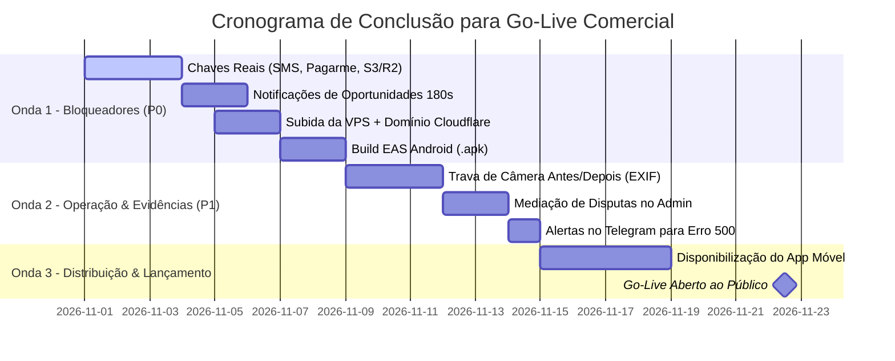

# PRD DEFINITIVO — FACILITA
**Product Requirements Document | Versão 4.1 — Fonte Única da Verdade (Resolução Integral das 112 Lacunas)**
Última atualização: Novembro de 2026 (Auditoria Integral Qwen 3.1 + Harmonização Canônica Gemini 4.1)
Autor: Product Strategy, Compliance Jurídico & Arquitetura de Software
Status: CANONICAL SOURCE OF TRUTH (Alinhamento integral entre Código, Negócio, Jurídico e Finanças)
Confidencialidade: Internal Only

---

## 🎯 RESUMO EXECUTIVO (TL;DR)

**O que é:** Plataforma transacional de serviços domésticos de urgência e manutenção residencial (elétrica, hidráulica, reparos), com foco em qualidade, evidência operacional e fluxo fechado.

**O que NÃO é:** Marketplace genérico de reformas, plataforma de leads, GetNinjas vertical.

**Diferencial defensável:** Catálogo padronizado + Evidência obrigatória (câmera ao vivo) + Pagamento protegido + Garantia real de 90 dias (CDC) + Antifraude estrutural desde o dia 1.

**Tese:** O mercado está educado (GetNinjas fez isso), mas frustrado com qualidade. Há espaço para quem trocar "volume de leads" por "confiança transacional".

**Capital necessário & Modelo de Lançamento:**
- **Modelo Enxuto de Lançamento (Bootstrapping / Web PWA):** Custo fixo ~R$ 800 a R$ 1.000/mês. **Break-even em 46 pedidos/mês**.
- **Modelo Estruturado c/ Equipe (Série Seed R$ 1,5M):** Folha de R$ 128K/mês, exigindo 7.318 pedidos/mês para break-even operacional (Mês 24-30), com payback ocorrendo após atingir o break-even acumulado.

---

## 1. CONTEXTO ESTRATÉGICO

### 1.1 Problema Real

**Cliente**
- Contrata por indicação informal (WhatsApp, vizinho, porteiro)
- Não sabe preço justo
- Não tem garantia
- Sofre com "adicional surpresa"
- Não tem como reclamar (é a palavra dele vs. a do profissional)

**Prestador Bom**
- Demanda irregular
- Inadimplência (5-15% dos jobs)
- Desperdício de deslocamento (30% das visitas não convertem)
- Concorrência com profissional ruim (cliente não sabe diferenciar)
- Plataformas cobram lead ruim (GetNinjas) ou comissão predatória (40%+)

**Mercado**
- Serviços domésticos: R$ 80Bi/ano no Brasil
- <5% digitalizado
- Informalidade: 78%
- Fricção: altíssima em todas as pontas

### 1.2 Por Que Agora?

- **Mercado educado:** GetNinjas tem 12 anos, todo mundo já sabe que "existe app pra contratar profissional"
- **Frustração alta:** NPS do GetNinjas ~20-30 (público), Triider ~40-50
- **Infraestrutura disponível:** KYC automatizado, pagamento com split, antifraude, geolocalização — tudo barato e acessível
- **Comportamento mudou:** Pós-pandemia, cliente aceita pagar 15-20% mais caro por confiança

### 1.3 Por Que Não Funciona Hoje?

| Problema | GetNinjas | Triider | Habitissimo |
|---|---|---|---|
| Controle de qualidade | ❌ Zero | 🟡 Fraco | ❌ Zero |
| Garantia real | ❌ Não tem | 🟡 Vaga | ❌ Não tem |
| Fluxo fechado | ❌ Vazamento total | 🟡 ~40% vazam | ❌ Só vitrine |
| Padronização | ❌ Caos | 🟡 Parcial | ❌ Projetos únicos |
| Antifraude | ❌ Básico | 🟡 Médio | ❌ Básico |
| Densidade operacional | ✅ Alta | ❌ Baixa | 🟡 Média |

**Nossa tese:** Pegar densidade do GetNinjas + disciplina operacional (que ninguém tem) + modelo transacional de verdade.

---

## 2. VISÃO DO PRODUTO

### 2.1 Posicionamento

> "A forma mais confiável de resolver problemas elétricos e hidráulicos em casa."

**NÃO é:**
- ❌ "Marketplace de serviços"
- ❌ "Conectamos você a profissionais"
- ❌ "Contrate qualquer coisa"

**É:**
- ✅ "Chuveiro queimou? Resolvemos hoje com preço certo e garantia"
- ✅ "Problema elétrico em casa? Profissional verificado em até 2h"

### 2.2 Princípios de Produto (Inegociáveis — Versão 4.1 Canônica)

1. **Tudo no app:** Contratação, comunicação, aprovação, pagamento, disputa — TUDO. Telefone real do cliente nunca é exposto (Call Proxy / Chat WebSocket).
2. **Catálogo fechado & Segurança Elétrica:** 5 serviços de Elétrica desenergizada no Beta (Semanas 1–4) e 13 serviços completos no Soft Launch. Serviços em quadros/disjuntores exigem NR-10 verificada; alta tensão, padrão e trifásico são terminantemente excluídos.
3. **Evidência obrigatória ao vivo:** 1 foto ANTES (libera início) + 1 foto DEPOIS (libera conclusão) para 100% dos serviços (inclusive ≤ R$ 80). Upload da galeria é estritamente bloqueado (câmera ao vivo com geolocalização e timestamp).
4. **Score & Autonomia (Blindagem CLT):** Prestador autônomo sem subordinação. Recusa de chamado tem impacto ZERO no score (sem coerção). Sem limites diários forçados (`daily_job_limit: null`). Sem vigilância contínua por GPS em segundo plano.
5. **Antifraude calibrado:** Regras comportamentais adaptadas para serviços residenciais de baixa frequência anual (1–2 jobs/ano), eliminando falsos positivos. Detecção focada em conluio, troca de contatos e pesquisa de saída "Ofereceu por fora?".
6. **Comissão justa e transparente:** 20% padrão (Tiers Bronze e Prata) e 18% (Tier Ouro). Refletida identicamente em contrato, recibo e split Pagar.me.
7. **Repasse Ágil via Pix:** Bronze D+3, Prata D+2, Ouro D+1 via Pix diretamente na subconta MEI (eliminando necessidade de antecipação com spread).
8. **Garantia Legal de 90 Dias:** 90 dias corridos conforme Art. 26, II do CDC, estruturada como Política de Reexecução e Satisfação da plataforma (sem cobrança de prêmio/seguro SUSEP).

### 2.3 Escopo do Lançamento

**Dentro**
- ✅ 13 serviços padronizados (ver seção 4.1) — apenas Elétrica desenergizada nas primeiras 4 semanas de beta
- ✅ 5 bairros de classe A/B em São Paulo (Brooklin, Moema, Vila Mariana, Itaim Bibi, Campo Belo)
- ✅ Pagamento apenas cartão tokenizado e Pix dinâmico (com pré-autorização / retenção confirmada em escrow)
- ✅ Garantia de 90 dias corridos (Art. 26 CDC — ver seção 10)
- ✅ Suporte humano forte com chamadas gravadas via Twilio Voice

**Fora**
- ❌ Reformas completas e alvenaria pesada
- ❌ Serviços comerciais/industriais, redes trifásicas, padrão de entrada e alta tensão
- ❌ Parcelamento no MVP (pagamento à vista no Pix ou Cartão 1x)
- ❌ Serviços fora do catálogo (nem sob consulta)

### 2.4 Usuários e Personas

**Persona 1 — Cliente residencial com urgência**
Pessoa que teve problema com chuveiro, tomada, curto leve ou disjuntor e quer solução rápida, previsível e segura, sem depender de indicação improvisada ou múltiplos orçamentos confusos.

**Persona 2 — Cliente residencial organizado**
Pessoa que quer instalar luminárias, ventilador de teto, revisar pontos elétricos ou fazer pequenos upgrades, valorizando agendamento, preço claro e histórico do serviço.

**Persona 3 — Profissional autônomo bom**
Profissional competente, com experiência prática, que quer demanda recorrente e pagamento previsível, mas rejeita plataforma com comissão muito alta, fluxo bagunçado ou cliente mal qualificado. **Requisito mínimo: MEI ativo** (ou abertura de MEI orientada no onboarding).

**Persona 4 — Prestador oportunista**
Profissional que aceita qualquer job, tenta cobrar adicional fora de fluxo, busca fechar por fora do app e gera risco reputacional. O produto precisa ser desenhado para identificar e desincentivar esse perfil rapidamente.

---

## 3. ANÁLISE COMPETITIVA

### 3.1 GetNinjas (Principal Concorrente)
- **Modelo:** Marketplace de leads
- **Receita:** R$ 5-25 por lead (prestador paga)
- **Força:** SEO dominante, marca conhecida, 500+ categorias
- **Fraqueza:** Zero controle de qualidade, desintermediação imediata, leads ruins
- **Nossa vantagem:** Qualidade >> Quantidade
- **Nossa desvantagem:** Eles têm 12 anos de SEO e marca
- **Estratégia:** Não competir em volume. Competir em "serviço fechado com garantia".

### 3.2 Triider (Concorrente Modelo Parecido)
- **Modelo:** Transacional (15-25% comissão)
- **Força:** Catálogo estruturado, verificação de prestadores
- **Fraqueza:** Baixa densidade (fora SP/RJ não funciona), marketing fraco, 40% de abandono
- **Nossa vantagem:** Execução melhor do mesmo modelo
- **Nossa desvantagem:** Eles têm ~5 anos de operação
- **Estratégia:** Superar em antifraude, suporte e experiência do prestador.

### 3.3 Síntese Competitiva

| Métrica | GetNinjas | Triider | FACILITA |
|---|---|---|---|
| Controle de qualidade | 2/10 | 6/10 | 8/10 |
| Experiência do cliente | 7/10 | 7/10 | 8/10 |
| Experiência do prestador | 4/10 | 6/10 | 8/10 |
| Densidade (SP) | 9/10 | 5/10 | 3/10 → 7/10 (mês 12) |
| Antifraude | 3/10 | 5/10 | 8/10 |
| Garantia real | 0/10 | 3/10 | 7/10 |

**Nosso moat:** Confiança operacional (evidência + garantia + qualidade) em mercado educado mas frustrado.

---

## 4. ESPECIFICAÇÃO FUNCIONAL

### 4.1 Catálogo de Serviços

**Categoria: Elétrica (6 serviços) — Lança no Beta Fechado**

| Serviço | Descrição | Preço Fixo | Tempo Médio | Inclusos | NÃO Inclusos |
|---|---|---|---|---|---|
| Instalação de chuveiro | Troca/instalação de chuveiro elétrico | R$ 120 | 1h | Mão de obra, teste | Chuveiro, fiação nova, disjuntor |
| Troca de torneira elétrica | Substituição de torneira elétrica | R$ 100 | 45min | Mão de obra, vedação básica | Torneira, fiação |
| Instalação de ventilador de teto | Montagem e instalação de ventilador | R$ 150 | 1h30 | Mão de obra, fixação | Ventilador, suporte reforçado |
| Troca de disjuntor (Exige NR-10) | Substituição de disjuntor no quadro | R$ 90 | 30min | Mão de obra, teste | Disjuntor (requer NR-10 verificada) |
| Instalação de lustre/luminária | Até 3 pontos de luz | R$ 80 | 45min | Mão de obra | Lustre, lâmpadas |
| Tomada/interruptor (até 3 pontos) | Instalação ou troca | R$ 110 | 1h | Mão de obra, teste | Tomadas, interruptores, caixa de passagem |

**Categoria: Hidráulica (4 serviços) — Lança no Soft Launch (Mês 6)**

| Serviço | Descrição | Preço Fixo | Tempo Médio | Inclusos | NÃO Inclusos |
|---|---|---|---|---|---|
| Troca de torneira | Substituição de torneira simples | R$ 80 | 30min | Mão de obra, vedação | Torneira |
| Troca de registro | Substituição de registro (gaveta/pressão) | R$ 100 | 1h | Mão de obra, vedação | Registro |
| Reparo de válvula de descarga | Conserto ou troca de válvula | R$ 90 | 45min | Mão de obra, reparo básico | Válvula nova (se necessário) |
| Desentupimento simples | Pia, ralo ou vaso (sem quebra) | R$ 120 | 1h | Mão de obra, equipamento básico | Quebra de piso, sonda elétrica |

**Categoria: Pequenos Reparos (3 serviços) — Lança no Soft Launch (Mês 6)**

| Serviço | Descrição | Preço Fixo | Tempo Médio | Inclusos | NÃO Inclusos |
|---|---|---|---|---|---|
| Montagem de móvel pequeno | Até 1,5m (rack, estante simples) | R$ 100 | 1h30 | Mão de obra, ferramentas | Peças faltantes |
| Instalação de suporte de TV | Até 55", parede comum | R$ 130 | 1h | Mão de obra, buchas/parafusos básicos | Suporte, parede de gesso sem reforço |
| Fixação de prateleira/quadro (até 3 peças) | Furação e fixação | R$ 70 | 30min | Mão de obra, buchas/parafusos | Prateleira, parede estrutural |

**Total lançamento:** 5 serviços de Elétrica desenergizada no Beta (Semanas 1–4) + Troca de disjuntor apenas para prestadores com NR-10 verificada ➔ 13 serviços no Soft Launch (Mês 6).  
**Ticket médio base:** R$ 160 | **Urgência média ponderada (+R$ 10):** R$ 170.

**Gestão de Materiais e Consumíveis:**
R$ 20,00 em materiais básicos de consumo (fita isolante, veda-rosca, buchas simples) já estão inclusos no preço base tabelado. Qualquer peça de reposição extra exige fotografia da nota fiscal via câmera ao vivo e aprovação prévia obrigatória do cliente antes da compra/instalação.

### 4.2 Arquitetura de Informação

#### 4.2.1 App do Cliente (Next.js 15 PWA)

```
├── Onboarding & Autenticação (✅ Implementado com Rate Limiting Anti-Bot)
│   ├── Cadastro simplificado (telefone + nome + email)
│   ├── Normalização E.164 (+5511999999999)
│   ├── Verificação OTP (Twilio SMS / Z-API WhatsApp)
│   ├── Rate Limiting anti-abuso (máx 3 envios por telefone / 10 min — HTTP 429)
│   └── Endereço principal e múltiplos endereços (com complemento obrigatório)
│
├── Home
│   ├── Busca de serviço com debounce e catálogo padronizado
│   ├── Categorias (Elétrica, Hidráulica, Reparos)
│   └── Pedidos recentes e status em tempo real
│
├── Novo Pedido
│   ├── Seleção de serviço (catálogo fechado com preços fixos)
│   ├── Seletor de Endereço Rápido (1-clique entre Casa, Trabalho ou Outro)
│   ├── Triagem guiada (perguntas dinâmicas e restrições técnicas de escopo)
│   ├── Upload de fotos da situação (câmera ao vivo obrigatória, upload de galeria desativado)
│   ├── Urgência (Normal: até 24h | Urgente: até 4h com taxa fixa de R$ 40,00)
│   ├── Disponibilidade imediata ou agendamento
│   └── Confirmação de preço discriminado (serviço + taxa de urgência)
│
├── Match
│   ├── Radar geográfico em tempo real com Leaflet LiveMap
│   ├── Motor de matching em ondas de 180s (Ouro ➔ Prata ➔ Bronze por raio de cobertura)
│   ├── Profissional recomendado (1 opção principal com foto, nota, jobs)
│   └── [Aceitar] ou [Ver outro profissional] (max 3 opções)
│
├── Acompanhamento & Cancelamento
│   ├── Timeline em tempo real via WebSockets (PENDING, ACCEPTED, EN_ROUTE, ARRIVED, IN_PROGRESS, COMPLETED)
│   ├── Chat antifraude com filtro regex (bloqueio de telefones e links externos)
│   ├── Call Proxy (Twilio Voice): ligação mascarada sem expor telefone real de nenhuma das partes
│   ├── Botão de emergência (discagem 192/193 e alerta crítico ao suporte)
│   └── Cancelamento Assistido (Regra Canônica v4.1):
│       ├── Até 5 min do aceite (urgente) OU até 2h antes do agendado: Cancelamento grátis com estorno integral 100%
│       └── Fora dessa janela: Retenção da taxa de R$ 35,00 (R$ 28,00 repassados ao prestador e R$ 7,00 taxa operacional)
│
├── Aprovação de Adicional
│   ├── Descrição do profissional com foto ao vivo de nota/recibo fiscal
│   ├── Valor adicional validado (qualquer valor > 100% do serviço base trava para moderação humana)
│   └── [Aprovar] [Recusar] [Falar com Suporte]
│
├── Conclusão & Evidências
│   ├── Fotos obrigatórias: 1 ANTES (para liberar início) + 1 DEPOIS (para liberar conclusão) em 100% dos serviços
│   ├── Metadados EXIF e geolocalização colhidos exclusivamente via câmera ao vivo
│   ├── Checklist de itens executados
│   ├── Valor final discriminado
│   └── [Aprovar serviço] [Contestar / Abrir Disputa]
│
├── Pagamento
│   ├── Resumo (serviço base + adicionais + tributos IBS/CBS)
│   ├── Método (Cartão com pré-autorização/retenção | Pix com QR Code dinâmico de 15 min e PAID_ESCROW)
│   └── Comprovante com assinatura digital SHA-256
│
├── Histórico de Pedidos, Comprovante Fiscal & Garantia 90d (✅ Implementado)
│   ├── Listagem paginada por cursor com filtros por status e busca
│   ├── Visualização de comprovante detalhado com download/impressão de PDF (window.print)
│   ├── Discriminação da comissão de intermediação da plataforma (20% Bronze/Prata ou 18% Ouro)
│   └── Acionamento de Garantia de 90 dias (Art. 26 CDC) a qualquer tempo dentro do prazo
│
├── Avaliação
│   ├── Nota geral (1-5 estrelas)
│   ├── Critérios objetivos (Pontualidade, Qualidade, Limpeza, Cordialidade)
│   ├── Pesquisa de conformidade ("O profissional propôs pagamento por fora?")
│   └── Comentário (opcional)
│
└── Perfil (/profile — ✅ Implementado)
    ├── Dados pessoais e chave de acesso
    ├── Gestão de múltiplos endereços (CRUD completo com badges Casa, Trabalho, Outro e complemento)
    ├── Histórico completo de pedidos e recibos fiscais
    └── Termos de Uso (/termos) e Política de Privacidade LGPD (/privacidade)
```

#### 4.2.2 App do Prestador (React Native + Expo — iOS e Android nativos)

> **Decisão técnica:** O app do prestador é React Native/Expo (ou PWA com suporte offline) por razões operacionais: push notifications confiáveis, câmera nativa de alta qualidade para evidências e funcionamento offline parcial com fila de sincronização. A geolocalização é coletada **exclusivamente sob ação explícita** (Saí, Cheguei, Evidência), eliminando rastreamento contínuo em segundo plano para afastar qualquer indício de subordinação e vigilância (CLT Art. 9º).

```
├── Onboarding
│   ├── Cadastro básico (CPF/CNPJ MEI ou Autônomo, telefone, email)
│   ├── Verificação de MEI ou Autônomo regularizado (Termo de Parceria e Mandato de Intermediação)
│   ├── Documentos (RG/CNH frente e verso, selfie biométrica, comprovante residência)
│   ├── Certificação NR-10 (obrigatória para habilitação em quadros/disjuntores elétricos)
│   ├── Categorias de atuação (Elétrica, Hidráulica, Reparos)
│   ├── Região de atendimento (raio configurável em km)
│   ├── Conta bancária para repasses Pix (validada via Pagar.me Split)
│   └── Background check com base legal estrita (aprovação em até 3-5 dias na central KYC)
│
├── Notificações & Ofertas (Blindagem Trabalhista CLT)
│   ├── Canal de Notificação Padrão (urgency_dispatch_channel):
│   │   ├── Notificação push sonora respeitando configurações e autonomia do prestador
│   │   └── Card de oportunidade com contagem regressiva de 180 segundos (3 minutos) por onda
│   └── Botão de Rota Externa 1-Clique:
│       └── Deep-linking nativo para Waze (waze://) e Google Maps (geo:)
│
├── Execução com Trava Obrigatória de Fotos (Câmera ao Vivo)
│   ├── Check-in com validação de proximidade pontual no momento da chegada
│   ├── Termo de Escopo Digital: Aceite de 1-clique do cliente e prestador no escopo antes do início
│   ├── Trava de Início: Bloqueia transição para IN_PROGRESS sem foto do "Antes"
│   ├── Trava de Término: Bloqueia transição para COMPLETED sem foto do "Depois"
│   └── Extração de metadados EXIF e GPS pontual para auditoria
│
├── Sincronização & Modo Offline (✅ Implementado)
│   ├── Armazenamento em fila local (AsyncStorage)
│   └── Retentativa com backoff exponencial via NetInfo ao restabelecer sinal 4G
│
├── Home
│   ├── Status (Disponível | Indisponível | Em atendimento — autonomia total de horários)
│   ├── Nível de Parceiro (Bronze | Prata | Ouro)
│   ├── Progresso para Próximo Tier (Jobs concluídos e score ponderado)
│   ├── Saldo disponível e previsão de repasses via Pix (D+3 Bronze, D+2 Prata, D+1 Ouro)
│   ├── Próximos agendamentos
│   └── Notificações push
│
├── Fila de Oportunidades
│   ├── Card de job
│   │   ├── Categoria e descrição técnica
│   │   ├── Distância e estimativa de deslocamento
│   │   ├── Valor líquido a receber (split deduzido com comissão de 20% ou 18%)
│   │   ├── Adicional de Urgência (R$ 40,00 fixo quando aplicável)
│   │   ├── Fotos do problema enviadas pelo cliente
│   │   └── Janela de atendimento
│   └── Resposta em até 180 segundos (3 minutos) por onda de oferta:
│       ├── [Aceitar] ➔ Lock atômico condicional no backend
│       └── [Recusar] ➔ Recusa livre SEM impacto no score de reputação
│
├── Job Ativo
│   ├── Timeline operacional (com suporte offline — sincroniza quando conectar)
│   │   ├── [Saí para atendimento]
│   │   ├── [Cheguei no local]
│   │   ├── [Iniciei execução] (após foto ANTES e aceite do escopo)
│   │   ├── [Pausar] (com justificativa)
│   │   └── [Concluir] (após foto DEPOIS)
│   ├── Dados do atendimento (nome do cliente e endereço com complemento obrigatório)
│   ├── Comunicação protegida: Telefone real ocultado; chat interno ou Call Proxy Twilio Voice
│   ├── Navegação integrada (Waze/Google Maps)
│   └── Botão de emergência (discagem rápida 192/193 e alerta crítico ao backoffice)
│
├── Solicitar Adicional
│   ├── Motivo (dropdown: Material extra, Escopo maior, Problema adicional imprevisto)
│   ├── Descrição detalhada
│   ├── Fotos obrigatórias (câmera ao vivo — sem galeria)
│   ├── Valor solicitado (qualquer adicional > 100% do serviço base trava para revisão manual)
│   └── [Enviar para aprovação do cliente]
│
├── Conclusão
│   ├── Foto ANTES (obrigatória — câmera ao vivo)
│   ├── Foto DEPOIS (obrigatória — câmera ao vivo)
│   ├── Checklist de itens executados
│   ├── Observações de campo
│   └── [Finalizar serviço]
│
├── Carteira (Repasses Pix via Pagar.me Split)
│   ├── Saldo disponível
│   ├── Próximos repasses Pix automáticos (Bronze D+3, Prata D+2, Ouro D+1)
│   ├── Histórico de recebimentos
│   └── Extrato detalhado
│
├── Desempenho & Score (Janela Rolante de 90 Dias)
│   ├── Score geral (0-100) — Prestador aprovado no KYC inicia com score = 65
│   ├── Breakdown de reputação:
│   │   ├── Taxa de aceitação: 0% de peso (recusa não penaliza o autônomo)
│   │   ├── Pontualidade: 25% de peso (chegadas no horário)
│   │   ├── Taxa de conclusão: 30% de peso (jobs concluídos / aceitos)
│   │   ├── Qualidade de evidência: 20% de peso (fotos nítidas e enquadradas)
│   │   ├── Avaliação do cliente: 15% de peso (avaliação objetiva)
│   │   └── Taxa de reabertura: 10% de peso (disputas procedentes)
│   ├── Tier atual (1=Bronze, 2=Prata, 3=Ouro)
│   └── Critérios para subir de nível (Prata: score ≥ 70; Ouro: score ≥ 80)
│
└── Perfil
    ├── Dados cadastrais e MEI/RPA
    ├── Certificados técnicos (NR-10 verificado)
    ├── Categorias habilitadas
    ├── Disponibilidade de agenda autônoma
    ├── Raio de atendimento configurável
    └── Preferências de notificação
```

#### 4.2.3 Backoffice (Operação) — Next.js + TypeScript

```
├── Dashboard
│   ├── Métricas do dia (pedidos, receita, disputas)
│   ├── Fila de ação (triagens pendentes, disputas, aprovações)
│   └── Alertas (fraude, SLA estourado, prestador no-show)
│
├── Gestão de Pedidos
│   ├── Listagem (filtros: status, região, categoria, risco)
│   ├── Matching manual (semanas 1-8 de operação)
│   ├── Detalhes do pedido
│   │   ├── Timeline completa
│   │   ├── Histórico de chat
│   │   ├── Evidências (fotos com metadata)
│   │   ├── Adicionais
│   │   └── Financeiro
│   └── Ações manuais
│       ├── Forçar cancelamento
│       ├── Reatribuir prestador (fluxo de cancelamento tardio)
│       ├── Liberar pagamento manual
│       └── Aplicar crédito/estorno
│
├── Fila de Reatribuição (cancelamento tardio de prestador)
│   ├── Prestador cancelou em <4h → busca automática de substituto
│   ├── Se não encontrar substituto em 30min → operador liga para cliente
│   └── Decisão: reagendamento + crédito R$ 30, ou cancelamento sem taxa
│
├── Triagem Manual
│   ├── Pedidos fora de padrão
│   ├── Evidências insuficientes (revisão 100% nos primeiros 200 jobs)
│   └── [Aprovar] [Recusar] [Solicitar mais informações]
│
├── Gestão de Disputas
│   ├── Fila (ordenada por SLA)
│   ├── Detalhes
│   │   ├── Versão do cliente
│   │   ├── Versão do prestador
│   │   ├── Evidências de ambos
│   │   ├── Histórico do prestador (outras disputas)
│   │   ├── Score de risco
│   │   └── Recomendação automática
│   └── Decisão
│       ├── A favor do cliente (estorno)
│       ├── A favor do prestador (libera pagamento)
│       ├── Meio a meio (repasse parcial — via Pagar.me)
│       └── Reexecução (novo prestador sem custo ao cliente)
│
├── Gestão de Prestadores
│   ├── Listagem (filtros: score, tier, região, categoria, MEI)
│   ├── Aprovações pendentes
│   ├── Detalhes do prestador
│   │   ├── Dados cadastrais e situação MEI
│   │   ├── Documentos
│   │   ├── Background check
│   │   ├── Histórico de jobs
│   │   ├── Métricas de desempenho (janela 90 dias)
│   │   ├── Disputas
│   │   └── Flags de risco
│   └── Ações
│       ├── Aprovar/reprovar
│       ├── Suspender temporariamente
│       ├── Banir permanentemente
│       ├── Alterar tier manualmente
│       └── Enviar mensagem
│
├── Antifraude
│   ├── Dashboard de sinais
│   ├── Regras (on/off por flag)
│   ├── Whitelist/Blacklist
│   └── Investigações ativas
│
├── Financeiro (Pagar.me Dashboard integrado)
│   ├── Receita (diária, semanal, mensal)
│   ├── Comissão por tier
│   ├── Repasses agendados
│   ├── Retenções (disputas, chargeback)
│   └── Conciliação bancária
│
└── Analytics
    ├── Funil de conversão
    ├── CAC por canal
    ├── LTV por coorte
    ├── Churn (cliente e prestador)
    ├── NPS
    └── Métricas operacionais (tempo de resposta, SLA)
```

### 4.3 Fluxos Críticos

#### 4.3.1 Fluxo: Pedido Padrão (Happy Path)

```
CLIENTE                          SISTEMA                         PRESTADOR

1. Abre app
2. Seleciona "Chuveiro queimou"
3. Responde triagem:
   - Tipo de chuveiro: Elétrico
   - Tem o chuveiro novo: Sim
   - Urgência: Normal
4. Upload 2 fotos da situação (câmera ao vivo)
5. Disponibilidade: Amanhã manhã
                                 6. Valida endereço com complemento obrigatório
                                 7. Calcula preço: R$ 120
                                 8. Match com prestador
                                    - Score ≥60 (prestadores novos nascem com 65)
                                    - Raio inicial <5km
                                    - Disponibilidade compatível
                                 9. Oferece job (notificação push)
                                                                  10. Recebe notificação
                                                                  11. Visualiza job e escopo
                                                                  12. [Aceita] (em até 180s / 3 min)
                                                                      ➔ Lock atômico condicional no backend
                                 13. Cria agendamento
                                 14. Notifica cliente
15. Recebe confirmação
    "João vai amanhã às 9h"
16. Autoriza pagamento (R$ 120)
                                 17. Pré-autoriza cartão ou gera Pix (15 min) em PAID_ESCROW
                                 18. D-Day: Notifica ambos

[DIA DO SERVIÇO]
                                                                  19. [Saí para atendimento] 8:30
20. Recebe: "João saiu"
                                                                  21. [Cheguei] 9:05
22. Recebe: "João chegou"
                                                                  23. Assinatura mútua do escopo contratado
                                                                  24. Tira foto ANTES (câmera ao vivo)
                                                                  25. [Iniciei execução] 9:10
                                                                  (registros offline se sem sinal,
                                                                   sincroniza ao recuperar conexão)
                                                                  26. Executa serviço
                                                                  27. Tira foto DEPOIS (câmera ao vivo)
                                                                  28. Preenche checklist:
                                                                      ✓ Chuveiro instalado
                                                                      ✓ Testado funcionamento
                                                                      ✓ Vedação conferida
                                                                  29. [Concluir serviço] 10:15
                                 30. Valida evidências
                                 31. Notifica cliente
32. Vê fotos antes/depois
33. Vê checklist
34. [Aprovar serviço]
                                 35. Captura pagamento ou liquida Escrow
                                 36. Agenda repasse Pix (D+3 Bronze, D+2 Prata, D+1 Ouro)
37. Recebe comprovante fiscal (comissão 20% ou 18%)
38. Avalia prestador (5 estrelas) + Pesquisa antifraude
                                 39. Atualiza score do prestador
                                                                  40. Recebe avaliação
                                                                  41. Saldo atualizado (+R$ 96 líquido no Tier 2)

Tempo total: 1h 5min de execução | 26h do pedido à conclusão
Intervenção humana: Zero no happy path automatizado

#### 4.3.2 Fluxo: Cold-Start do Matching (Nenhum Prestador Disponível)

Este fluxo é crítico e frequente nos primeiros meses. Tratamento canônico v4.1:

```
SISTEMA VERIFICA DISPONIBILIDADE

Cenário A — Sem prestador disponível no raio imediato
→ Sistema expande raio automaticamente: 5km → 8km → 12km (com taxa adicional transparente de R$ 3,00/km extra repassada 100% ao prestador)
→ Se ainda sem prestador:
  - Para pedidos URGENTES: alerta na central, operador contacta prestadores ativos na região
  - Para pedidos NORMAIS: entra em fila de espera com estimativa dinâmica calculada

Cenário B — Autonomia de Oferta (Sem Controle de Produção CLT)
→ daily_job_limit mantido como null no banco (sem travas coercitivas de produção)
→ Sistema prioriza prestadores livres na região por ondas de matching

Cenário C — Prestador aceita mas não aparece (no-show)
→ Após 30 min além do horário previsto sem atualização de chegada:
  - Push de confirmação para o prestador
→ Após 45 min sem resposta:
  - Alerta automático para backoffice e busca imediata de substituto
→ Após 1h sem justificativa:
  - Prestador marcado como no-show (despriorização algorítmica temporária de ofertas)
  - Cliente recebe estorno integral ou reagendamento sem custo + R$ 30 de crédito de cortesia

Cenário D — Prestador cancela com <4h de antecedência
→ Sistema tenta reatribuição automática (mesmo raio + disponibilidade)
→ Se encontrar substituto em <30min: notifica cliente com desculpas + R$ 20 crédito
→ Se não encontrar em 30min: operador liga para cliente (opção de reagendamento ou cancelamento sem taxa)
→ Prestador que cancelou: despriorização algorítmica na fila de ofertas
```

#### 4.3.3 Fluxo: Pedido com Adicional (Critical Path)

```
[DURANTE EXECUÇÃO]

PRESTADOR                        SISTEMA                         CLIENTE

1. Identifica problema imprevisto:
   "Disjuntor adicional queimado"
2. Tira foto ao vivo do disjuntor
   (câmera ao vivo — sem galeria)
3. [Solicitar adicional]
   - Motivo: Material extra / Escopo imprevisto
   - Descrição detalhada
   - Foto ao vivo: [obrigatória]
   - Valor: R$ 60
4. [Enviar]
                                 5. Valida se adicional <= 100% do valor base
                                 6. Notifica cliente (push + in-app)
                                                                  7. Recebe notificação
                                                                  8. Vê foto ao vivo + descrição
                                                                  9. Opções:
                                                                      [Aprovar R$ 60]
                                                                      [Recusar]
                                                                      [Falar com Suporte]
                                                                  10. [Aprovar]
                                 11. Atualiza valor total: R$ 180
                                 12. Pré-autoriza adicional no Cartão ou gera Pix adicional
                                 13. Notifica prestador
14. Recebe aprovação
15. Executa adicional
16. [Concluir serviço com fotos DEPOIS]
                                 17. Captura R$ 180 (Pagar.me)
                                 18. Split: R$ 144 para prestador (20% comissão)
```

**Edge Case — Adicional Recusado:**
```
Cliente [Recusar adicional]
→ Sistema oferece:
  - Continuar serviço original (só o escopo contratado inicialmente)
  - Cancelar atendimento e pagar taxa de visita única de R$ 35,00
→ Se continuar: Prestador conclui escopo original
→ Se cancelar: Cliente paga R$ 35,00 | Prestador recebe R$ 28,00 | Plataforma retém R$ 7,00
```

**Edge Case — Adicional Abusivo (>100% do valor base):**
```
Prestador solicita R$ 300 adicional em job de R$ 120 (Adicional > 100% do valor base)
→ Ação automática:
  - Congela solicitação para análise da moderação
  - Alerta sonoro no backoffice
  - Operador liga para as partes para validar verossimilhança técnica
  - Se aprovado pelo operador: segue para confirmação do cliente
  - Se improcedente: orienta execução apenas do escopo base
```

#### 4.3.4 Fluxo: Disputa

```
CLIENTE                          SISTEMA                         PRESTADOR

[DENTRO DOS 90 DIAS DA GARANTIA LEGAL - ART. 26 CDC]

1. Aciona [Acionar Garantia / Contestar]
2. Motivo: "Instalação apresentou vazamento"
3. Captura foto ao vivo do defeito
4. Descrição detalhada
                                 5. Congela repasse pendente (se houver)
                                 6. Cria ticket de garantia (SLA: 24h para contato)
                                 7. Notifica prestador para reexecução
                                                                  8. Recebe notificação
                                                                  9. Agenda reexecução sem custo
                                 10. Confirma agendamento de retorno
                                                                  11. Retorna ao imóvel
                                                                  12. Foto corrigida ao vivo
                                                                  13. [Concluir reexecução]
14. Recebe: "Garantia concluída"
15. Valida funcionamento
16. [Aprovar solução]
                                 17. Libera pendências e encerra ticket
```
```

**Edge Case — Prestador Recusa Retornar:**
```
→ Sistema escala para operação imediatamente
→ Operador analisa evidências (foto ANTES do prestador + foto do defeito do cliente)
→ Se cliente correto:
  - Novo prestador enviado (sem custo ao cliente)
  - Custo deduzido do repasse do primeiro prestador (até 100%)
  - Flag crítico no score
→ Se cliente incorreto:
  - Libera repasse
  - Operador explica ao cliente com evidências
```

**Edge Case — Disputa Complexa (dano à propriedade):**
```
Cliente: "Danificou minha parede"
Prestador: "Parede já estava danificada"
→ Sistema analisa foto ANTES:
  - Mostra parede OK → Prestador errado → estorno parcial/total
  - Mostra dano prévio → Cliente tentando fraude → libera prestador
  - Inconclusiva → Operação liga para ambos dentro de 2h
    * Em casos >R$ 500: pode solicitar laudo externo
    * Decisão baseada em: histórico do prestador, histórico do cliente,
      verossimilhança técnica documentada
```

### 4.4 Regras de Negócio (Não Negociáveis)

#### 4.4.1 Pagamento e Split (via Pagar.me)

| Regra | Detalhamento |
|---|---|
| Pagamento 100% no app | Cartão ou Pix gerenciados pela plataforma. Pagamento externo invalida a garantia e desativa o perfil |
| Fluxo Cartão de Crédito | Pré-autorização no checkout com tokenização; captura efetuada no momento do aceite ou da liberação da foto ANTES |
| Fluxo Pix Dinâmico (Canônico) | Cobrança dinâmica com QR Code e Copia-e-Cola (expiração de 15 min); status `AWAITING_PAYMENT` ➔ Webhook confirma e move para `PAID_ESCROW` antes do matching. Se cancelado dentro da tolerância, estorno automático via gateway |
| Bloqueio em disputa | Repasse congelado até a resolução do ticket |
| Split automático transparente | Pagar.me processa split diretamente para subconta do prestador MEI ou Autônomo com comissão de 20% (Bronze/Prata) ou 18% (Ouro) |

#### 4.4.2 Evidência Fotográfica

| Regra | Detalhamento |
|---|---|
| Fotos obrigatórias | Exatamente 1 ANTES (libera início) + 1 DEPOIS (libera conclusão) em **100% dos serviços** (inclusive ≤ R$ 80) |
| Câmera ao vivo estrita | Captura exclusiva via câmera nativa / PWA com timestamp e geolocalização pontual — **upload de fotos da galeria é estritamente bloqueado** para prestadores e clientes |
| Metadata obrigatória | Timestamp + GPS validados no momento do clique |
| Validação anti-reciclagem | Análise de metadados e checagem de hash visual (Google Vision a partir do job 200) |
| Bloqueio por evidência ausente | Sem fotos válidas antes/depois, a API bloqueia a conclusão do serviço e o repasse financeiro |

#### 4.4.3 Garantia Legal de Satisfação (CDC Art. 26)

> **Enquadramento Jurídico:** A garantia do FACILITA é estruturada exclusivamente como **Política Institucional de Reexecução e Satisfação da Plataforma** (custeada com provisão operacional própria), e NUNCA como comercialização de seguro (afastando qualquer risco de autuação pela SUSEP).

| Aspecto | Definição Canônica v4.1 |
|---|---|
| Prazo de Cobertura | **90 dias corridos** a partir da conclusão (em estrita conformidade com o Art. 26, II do CDC para serviços duráveis) |
| Escopo | Apenas o que foi executado (ex: se trocou chuveiro, cobre a instalação do chuveiro) |
| Exclusões | Dano causado por terceiros, mau uso evidente, intervenção de terceiros ou defeito de fábrica de material fornecido pelo cliente |
| Acionamento | O cliente pode acionar a qualquer tempo dentro do prazo de 90 dias corridos (removida cláusula abusiva de 24h) |
| Procedimento | Reexecução gratuita preferencialmente pelo mesmo prestador (ou reatribuição a profissional Ouro sem custo ao cliente) |
| Limite financeiro | Até 100% do valor do serviço original |
| Invalidação | Pagamento realizado por fora do app ou adulteração pós-serviço |
| Provisão Contábil | 4% sobre o GMV (R$ 6,40 provisionados por pedido médio de R$ 160) |

#### 4.4.4 Cancelamento e Taxa de Deslocamento

| Quem | Quando | Taxa / Ação |
|---|---|---|
| Cliente | Até 5 min do aceite (urgente) OU até 2h antes do horário agendado | R$ 0,00 (Estorno integral 100%) |
| Cliente | Fora da janela de tolerância ou prestador a caminho/no local | **Taxa única de R$ 35,00** (R$ 28,00 repassados ao prestador e R$ 7,00 retidos pela plataforma) |
| Prestador | Com mais de 4h de antecedência | Sem penalidade financeira; motivo registrado para monitoramento |
| Prestador | Com menos de 4h ou no-show | Despriorização algorítmica temporária na distribuição de ofertas (sem suspensão disciplinar punitiva CLT) |
| Sistema | Fraude comprovada | Cancelamento imediato + estorno ao cliente prejudicado |

#### 4.4.5 Solicitação de Adicional

| Regra | Detalhamento |
|---|---|
| Foto obrigatória | Câmera ao vivo obrigatória demonstrando o imprevisto técnico |
| Limite de alçada | **Qualquer adicional > 100% do valor base trava automaticamente para análise da moderação humana** |
| Aprovação do cliente | Nenhum valor pode ser executado ou cobrado sem aprovação explícita no app |
| Materiais de consumo | R$ 20 de consumíveis básicos já inclusos no preço base; peças extras exigem foto da nota fiscal e autorização prévia |

#### 4.4.6 Score, Tiers e Repasses (Blindagem Trabalhista CLT)

**Composição do Score de Reputação (Janela Rolante de 90 Dias):**

| Componente | Peso | Justificativa / Amparo Legal |
|---|---|---|
| Taxa de aceitação | **0%** | **Recusa livre de chamados** — afasta poder diretivo e subordinação jurídica (Art. 9º CLT) |
| Pontualidade | **25%** | Compromisso com o cliente dentro da tolerância de ±15 min |
| Taxa de conclusão | **30%** | Jobs concluídos com sucesso em relação aos aceitos |
| Qualidade de evidência | **20%** | Fotos nítidas e enquadradas do Antes e Depois |
| Avaliação do cliente | **15%** | Média das avaliações pós-serviço (1 a 5 estrelas) |
| Taxa de reabertura | **10%** | Menor incidência de chamados de garantia procedentes |

**Tiers de Parceria e Repasses:**

| Tier | Critério de Volume & Score | Comissão | Repasse via Pix | Limite Diário de Jobs |
|---|---|---|---|---|
| **1 - Bronze** | 0 - 15 jobs (Score inicial = 65) | 20% | D+3 via Pix | Null (Autonomia livre) |
| **2 - Prata** | 16 - 50 jobs (Score ≥ 70) | 20% | D+2 via Pix | Null (Autonomia livre) |
| **3 - Ouro** | 51+ jobs (Score ≥ 80) | 18% | D+1 via Pix | Null (Autonomia livre) |

*Nota: Prestadores recém-aprovados no KYC iniciam com score padrão = 65, já aptos a receber chamados no matching (cujo corte mínimo é 60), resolvendo o problema de cold-start.*

### 4.5 Antifraude Calibrado (Prevenção de Falsos Positivos)

#### 4.5.1 Camadas de Proteção

**Camada 1: Cadastro & KYC Estrutural**
- Validação de CPF e MEI/RPA ativo.
- Verificação OTP por SMS Twilio ou WhatsApp Z-API com rate limiting (3 envios / 10 min).
- Biometria facial e conferência de documento (Truora).
- Antecedentes criminais consultados sob base legal estrita da LGPD (Art. 11, II, "g"), sem exclusão automática indiscriminada.
- Conta bancária validada para repasses Pix no mesmo titular do CPF/CNPJ.

**Camada 2: Comportamental & Desintermediação (Bloco F Calibrado)**
- **Sensor de Desintermediação Direta:** Pergunta obrigatória pós-atendimento: *"O profissional propôs pagamento por fora do FACILITA?"* (respostas "Sim" geram alerta crítico).
- **Call Proxy & Regex no Chat:** Telefone real nunca é exibido; regex ativo para barrar números, emails e links externos.
- **Remoção de Falsos Positivos:** Eliminados os alertas de "cliente não voltou após job" e "recorrência < 10%", incompatíveis com serviços emergenciais de baixa frequência anual (1–2 jobs/ano).
- **Mesmo Dispositivo / IP:** Detecção de conluio quando cliente e prestador compartilham o mesmo IP ou fingerprint de aparelho.

**Camada 3: Validação de Evidências**
- Câmera ao vivo obrigatória (bloqueio de galeria).
- Metadados EXIF e validação de geolocalização pontual.

#### 4.5.2 Ações Automáticas vs. Manuais

| Situação | Ação Automática | Ação Manual / Moderação |
|---|---|---|
| CPF ou MEI inválido | Bloqueio no onboarding | Orientação de regularização |
| Telefone no chat | Mascaramento / Alerta educativo | Advertência em caso de reincidência deliberada |
| Foto duplicada / galeria | Rejeição imediata no app | Operador valida se houver contestação |
| Adicional > 100% | Congelamento da solicitação | Contato telefônico com as partes em até 30 min |
| Bloqueio de conta | Notificação do motivo ao usuário | **Revisão humana obrigatória garantida (Art. 20 LGPD)** |
| Disputa / Garantia | Congelamento preventivo | Mediação humana e reatribuição de serviço |
---

## 5. MODELO DE NEGÓCIO

### 5.1 Estrutura de Receita

**Receita Primária: Comissão por Transação (via Pagar.me)**

| Tier do Prestador | Comissão | Exemplo (Job Médio R$ 160) |
|---|---|---|
| Tier 1 - Bronze | 20% | Prestador: R$ 128,00 · Plataforma: R$ 32,00 |
| Tier 2 - Prata | 20% | Prestador: R$ 128,00 · Plataforma: R$ 32,00 |
| Tier 3 - Ouro | 18% | Prestador: R$ 131,20 · Plataforma: R$ 28,80 |

**Comissão média efetiva:** 20,0% na largada (evoluindo para ~19,2% conforme profissionais sobem para Ouro).

**Receitas Secundárias**

| Fonte | Cobrança | Premissa Operacional | Receita / Pedido Médio |
|---|---|---|---|
| Taxa de Urgência | R$ 40,00 fixo | Aplicada em 25% dos pedidos (atendimento em até 4h) | +R$ 10,00 rateado |
| Retenção Taxa de Cancelamento | R$ 35,00 (R$ 7 retidos) | Em cancelamentos fora da janela de tolerância | +R$ 0,35 rateado |
| Antecipação de Recebíveis | R$ 0,00 | **Removida do MVP** (Repasses já são em D+1/D+2/D+3 via Pix) | R$ 0,00 |
| Seguro Estendido | R$ 0,00 | **Removido** (Vedado pela SUSEP sem registro de seguradora) | R$ 0,00 |

**Receita Média por Pedido Consolidada:** **R$ 42,00** (R$ 32,00 comissão base + R$ 10,00 rateio de urgência).

### 5.2 Estrutura de Custos Reais

**Custos Variáveis Completos (por pedido — Resolução Integral #84 a #91):**

| Item | Valor / Pedido | Justificativa / Amparo Legal |
|---|---|---|
| Gateway Pagar.me + Infraestrutura/SMS | R$ 5,63 | Split de pagamento (2,5% + R$ 0,35) + SMS/WhatsApp OTP |
| Provisão de Garantia 90 dias (CDC Art. 26) | R$ 6,40 | 4% sobre GMV (cobre taxa de reexecução estimada em ~8%) |
| Provisão de Chargeback e Disputas | R$ 2,40 | Provisão prudencial de 1,5% sobre o GMV |
| Suporte Humano e Mediação | R$ 2,33 | Rateio de equipe de suporte para chamados complexos |
| Tributos sobre Receita da Plataforma | R$ 4,62 | Simples Nacional / Tributação incidente sobre a comissão (~11%) |
| Call Proxy e Máscara de Voz (Twilio) | R$ 1,50 | Mascaramento de ligações entre cliente e prestador |
| Seguro Coletivo de Acidentes Pessoais (AP) | R$ 0,63 | Cobertura securitária do prestador durante o atendimento ativo |
| Créditos Operacionais / Tolerâncias | R$ 1,00 | Cortesia operacional para reatribuições emergenciais |
| **Total de Custo Variável Real** | **R$ 24,51** | **Custo real por pedido apurado** |

> **Margem de Contribuição Real por Pedido:** **R$ 17,49** (Receita Média R$ 42,00 − Custo Variável R$ 24,51).  
> *Nota: O custo de KYC foi alocado 100% no CAC do prestador, eliminando a distorção de dupla contagem.*

**Custos Fixos Mensais — Cenários Operacionais:**

1. **Modelo Enxuto de Lançamento (Bootstrapping / Web PWA — Recomendado para Fase 1):**
   - Infraestrutura VPS Docker + Domínio + Z-API + Redis: **~R$ 800 a R$ 1.000/mês**.
   - Break-even operacional deste modelo: **46 pedidos/mês** (atingível já no primeiro mês com parcerias locais).

2. **Modelo Estruturado de Escala (c/ Equipe Completa e Salários de Mercado):**
   - Salários (12 pessoas: dev, produto, ops, moderação): R$ 105.000/mês.
   - Ferramentas, Jurídico e Infraestrutura: R$ 23.000/mês.
   - Total Fixo: **R$ 128.000/mês**.
   - Break-even operacional deste modelo com margem de R$ 17,49: **7.318 pedidos/mês**.

### 5.3 Projeção Financeira e Break-even

- **Incentivo Inicial aos Prestadores Fundadores:** 0% de comissão nos **primeiros 5 jobs concluídos** de cada um dos 15 prestadores iniciais (em vez de 30 dias ilimitados com garantia de demanda artificial).
- **Projeção de Break-even:** O break-even no modelo bootstrapping ocorre com 46 pedidos/mês. Para transitar para a estrutura corporativa pesada com folha, a plataforma deve primeiro validar a densidade e o B2B (imobiliárias e condomínios), onde a margem por contrato é superior.
- **Payback:** Ocorre sempre em momento posterior ao break-even operacional consolidado.

### 5.4 Unit Economics Realista

```
Ticket Médio Base: R$ 160,00 | Urgência (25% dos jobs): +R$ 40,00

RECEITA MÉDIA POR PEDIDO:        R$ 42,00
├─ Comissão média (20%):         R$ 32,00
└─ Adicional de urgência médio:  R$ 10,00

CUSTOS VARIÁVEIS REAIS:          R$ 24,51
├─ Provisão Garantia 90d (CDC):  R$  6,40
├─ Pagar.me Split + SMS:         R$  5,63
├─ Tributos Simples Nacional:    R$  4,62
├─ Provisão de Chargeback:       R$  2,40
├─ Suporte Humano:               R$  2,33
├─ Call Proxy Twilio:            R$  1,50
├─ Créditos operacionais:        R$  1,00
└─ Seguro Acidentes Pessoais:    R$  0,63

MARGEM DE CONTRIBUIÇÃO REAL:     R$ 17,49 por pedido

LTV B2C (Margem real, 1,3x/ano): R$ 22,74 / cliente / ano
LTV B2B Imobiliária (20 jobs/mês): R$ 350,00 a R$ 500,00 / imobiliária / mês
```

---

## 6. GO-TO-MARKET

### 6.1 Estratégia de Oferta (Recrutamento de Prestadores)

**Requisito de onboarding:** MEI ativo ou Autônomo cadastrado com CPF e conta bancária validada. Para serviços em quadros e disjuntores, certificação NR-10 verificada obrigatória.

**Proposta de Valor para Primeiros Prestadores Fundadores:**

| Benefício | Detalhamento Canônico v4.1 |
|---|---|
| Taxa zero de comissão | **0% de comissão nos primeiros 5 jobs** de cada prestador fundador |
| Repasse instantâneo via Pix | Repasse em D+3 (Bronze), D+2 (Prata) ou D+1 (Ouro) direto na conta Pix |
| Autonomia e respeito | Recusa livre de pedidos sem penalidade no score, sem cobrança de taxa de lead |
| Suporte prioritário | Canal direto via WhatsApp com a equipe de operações |
| Kit profissional | Camisa + boné + terminais de ferramenta (custo: R$ 80) |
| Sem exclusividade | Pode continuar em outras plataformas |
| Orientação MEI | Abertura gratuita orientada pela equipe (se necessário) |

**Job-Shadowing para Primeiros Jobs (Semanas 11-14):**
Nas primeiras 4 semanas de beta, um membro da equipe de operações (ou o próprio fundador) acompanha presencialmente os primeiros 10-15 jobs. Isso serve para: calibrar tempo médio de execução, identificar falhas no fluxo do app, garantir qualidade das evidências e treinar os prestadores na prática. **Atenção:** Não há prestadores Tier 3 no início — o shadowing é feito pela operação, não por outros prestadores.

**Investimento Fase 0:**
- 20 prestadores × R$ 200 (kit + incentivo) = R$ 4.000
- Compensação de demanda (estimado 50% precisarão): R$ 2.000
- Total: R$ 6.000

### 6.2 Estratégia de Demanda (Aquisição de Clientes)

**Beta Fechado (Semanas 11-16):**

Quem:
- Funcionários de startups amigas
- Amigos/família (máx 20%)
- Moradores de condomínios parceiros (síndicos introduzidos pelo fundador)

Oferta: 50% de desconto em troca de feedback obrigatório + avaliação detalhada

Proibido nesta fase: Google Ads, Facebook Ads, qualquer canal que escale rápido.

**Cobertura Geográfica Inicial — 5 bairros (~120 mil habitantes):**
Brooklin, Moema, Vila Mariana, Itaim Bibi, Campo Belo. Raio total: ~5km². Prestador chega em <30min em qualquer ponto.

**Soft Launch e Expansão (Mês 6+):**

**Google Ads — Foco em Long-Tail de Alta Intenção:**
- Budget: R$ 15K/mês
- Palavras-chave: "eletricista brooklin urgente", "quanto custa trocar chuveiro", "encanador moema domingo"
- Meta: 240 clientes/mês | CAC R$ 60

**Indicação Gamificada:**
- Indicador recebe R$ 30 de crédito, indicado recebe R$ 30 de desconto
- 3 indicações → R$ 90 crédito (1 serviço grátis)
- 5 indicações → Tier VIP (5% desconto permanente)
- Meta: 180 clientes/mês | CAC R$ 40

**Parcerias Locais (Síndicos, Imobiliárias):**
- 5-10 prédios com síndico direto
- Dashboard exclusivo + linha de suporte direta
- Meta: 120 clientes/mês | CAC R$ 30

**SEO:**
- 50 landing pages: [serviço] + [bairro]
- Blog: 10 artigos/mês sobre tópicos de alta intenção
- Meta Mês 6: 60 clientes/mês | CAC R$ 10

**Roadmap de Marketing (Ano 1):**

| Mês | Foco | Canais Ativos | Budget | Meta Clientes Novos |
|---|---|---|---|---|
| 1-2 | Fundação | Direto (fundador) | R$ 2K | 20 |
| 3 | Beta Fechado | Indicação direta | R$ 4K | 60 |
| 4-6 | Expansão local | Google Ads + Indicação + Parcerias | R$ 15K/mês | 200-600 |
| 7-9 | Otimização | Ads + SEO + Indicação | R$ 25K/mês | 800-1.200 |
| 10-12 | Escala | Todos os canais | R$ 35K/mês | 1.500-2.000 |

**Total Investimento Marketing Ano 1:** R$ 300K

---

## 7. STACK TECNOLÓGICO — MODULITH HEXAGONAL EVOLUTIVO

> **Versão 3.0 — Arquitetura revisada para máxima resiliência, segurança e evolução sem reescrita.**
>
> O modelo anterior (Feature-Sliced Architecture) foi substituído pelo **Modulith Hexagonal Evolutivo**:
> começa como um único processo (mais simples de operar no MVP), mas cada domínio interno é
> completamente isolado desde o dia 1 — como se já fosse um microserviço, mas sem a complexidade
> de rede. Quando crescer, extrai-se um módulo sem tocar nos outros. Segurança é estrutural,
> não uma camada adicionada depois.

---

### 7.1 Filosofia Arquitetural

#### Três Princípios que Guiam Todas as Decisões

**Princípio 1: Fronteiras antes de velocidade**
Cada módulo de domínio (Identity, Orders, Providers, Payments, Fraud, Notifications) tem fronteiras
físicas no código. Nenhum módulo acessa o banco do outro diretamente. Nunca. Essa regra não tem
exceção no MVP e não terá quando virar microserviço.

**Princípio 2: Domínio puro, infraestrutura substituível**
A lógica de negócio (quando um pedido é válido, como calcular o score, quando bloquear um
prestador) nunca depende de Pagar.me, Truora, Stream.io ou PostgreSQL. Depende de
interfaces/ports. Isso significa: trocar qualquer integração externa não quebra nenhuma regra
de negócio. Jamais.

**Princípio 3: Segurança é estrutura, não camada**
Zero Trust entre módulos, auditoria imutável em toda mudança de estado, criptografia de PII
no banco, validação em todas as fronteiras de entrada — tudo isso é construído na estrutura,
não adicionado depois como middleware.

#### Visão Geral da Arquitetura

```
┌─────────────────────────────────────────────────────────────┐
│                     API GATEWAY                              │
│   Rate Limiting  │  Auth JWT  │  WAF  │  Request Validation  │
└────────────────────────┬────────────────────────────────────┘
                         │ Apenas requests válidos e autenticados
                         ▼
┌─────────────────────────────────────────────────────────────┐
│                  MODULITH (1 processo NestJS)                │
│                                                              │
│  ┌─────────────┐  ┌─────────────┐  ┌─────────────────────┐  │
│  │  Identity   │  │   Orders    │  │     Providers       │  │
│  │  Module     │  │   Module    │  │     Module          │  │
│  │─────────────│  │─────────────│  │─────────────────────│  │
│  │ Domain      │  │ Domain      │  │ Domain              │  │
│  │ Use Cases   │  │ Use Cases   │  │ Use Cases           │  │
│  │ Ports ◄─────┼──┼─────────── ─┼──┼──────────► Ports   │  │
│  └─────────────┘  └─────────────┘  └─────────────────────┘  │
│                                                              │
│  ┌─────────────┐  ┌─────────────┐  ┌─────────────────────┐  │
│  │  Payments   │  │    Fraud    │  │   Notifications     │  │
│  │  Module     │  │   Module    │  │   Module            │  │
│  │─────────────│  │─────────────│  │─────────────────────│  │
│  │ Domain      │  │ Domain      │  │ Domain              │  │
│  │ Use Cases   │  │ Use Cases   │  │ Use Cases           │  │
│  │ Ports ◄─────┼──┼─────────────┼──┼──────────► Ports   │  │
│  └─────────────┘  └─────────────┘  └─────────────────────┘  │
│                                                              │
│              ┌────────────────────────────┐                  │
│              │   Internal Event Bus       │                  │
│              │  (NestJS EventEmitter2)    │                  │
│              │  Módulos só se comunicam   │                  │
│              │  via eventos — nunca       │                  │
│              │  chamada direta            │                  │
│              └────────────────────────────┘                  │
└──────────────────────────┬──────────────────────────────────┘
                           │
                           ▼
┌─────────────────────────────────────────────────────────────┐
│               ADAPTERS (Infrastructure Layer)               │
│                                                              │
│  PostgreSQL  │  Redis  │  Pagar.me  │  Truora  │  Stream.io  │
│  AWS S3      │  Twilio │  Fingerprint│  Google  │  TinEye    │
│                                                              │
│  ← Troca qualquer um sem tocar em 1 linha de domínio →      │
└─────────────────────────────────────────────────────────────┘
```

#### Hexagonal por Módulo (Ports & Adapters)

Cada módulo segue exatamente esta estrutura interna:

```
module/
├── domain/                   ← Núcleo puro. ZERO dependência externa.
│   ├── entities/             ← O que existe (Order, Provider, Payment...)
│   ├── value-objects/        ← Imutáveis (Money, OrderStatus, Score...)
│   ├── domain-events/        ← O que aconteceu (OrderCompleted, FraudDetected...)
│   └── domain-services/      ← Regras que envolvem múltiplas entidades
│
├── application/              ← O que o produto FAZ (use cases)
│   ├── use-cases/            ← Um arquivo por caso de uso
│   │   ├── create-order.use-case.ts
│   │   ├── accept-order.use-case.ts
│   │   └── complete-order.use-case.ts
│   └── ports/                ← Contratos (interfaces) com o mundo externo
│       ├── outbound/         ← O que o módulo precisa do mundo
│       │   ├── order.repository.port.ts
│       │   ├── payment.gateway.port.ts
│       │   └── notification.service.port.ts
│       └── inbound/          ← O que o mundo pode pedir ao módulo
│           └── order.service.port.ts
│
└── infrastructure/           ← Implementações concretas dos ports
    ├── persistence/
    │   └── prisma-order.repository.ts   ← Implementa order.repository.port.ts
    ├── http/
    │   └── order.controller.ts
    └── adapters/
        ├── pagarme-payment.adapter.ts   ← Implementa payment.gateway.port.ts
        └── expo-notification.adapter.ts ← Implementa notification.service.port.ts
```

**Regra de ouro:** Uma mudança no Pagar.me afeta **apenas** `pagarme-payment.adapter.ts`.
O domain nunca sabe que o Pagar.me existe.

#### Comunicação Entre Módulos (Event-Driven)

Módulos nunca se chamam diretamente. Toda comunicação é via eventos internos:

```
OrderModule emite:  OrderCompleted { orderId, providerId, amount }
                         │
          ┌──────────────┼──────────────┐
          ▼              ▼              ▼
   PaymentsModule  ProvidersModule  NotificationsModule
   (captura pag.)  (atualiza score)  (envia confirmação)
```

Isso significa: se o módulo de Notifications cair, o pagamento e o score ainda funcionam.
Se você extrair Payments para microserviço, só troca o EventEmitter por um message broker (RabbitMQ/SQS) — sem mudar os outros módulos.

#### Evolução Sem Reescrita (3 Estágios)

```
ESTÁGIO 1 — MVP (meses 1-12)
Modulith: 1 processo, 6 módulos isolados, 1 banco compartilhado
Custo operacional: baixo | Complexidade: baixa | Escala: até ~50K pedidos/mês

         │ trigger: >5K pedidos/mês ou necessidade de escala independente
         ▼

ESTÁGIO 2 — Modulith Distribuído (meses 12-24)
Extrai módulo de alta escala (ex: Fraud, Notifications) para processo separado
Demais módulos continuam juntos
Custo operacional: médio | Complexidade: média | Escala: até ~200K pedidos/mês

         │ trigger: produto em múltiplas regiões ou times independentes
         ▼

ESTÁGIO 3 — Microserviços Seletivos (ano 2+)
Cada módulo vira serviço independente com banco próprio
Event-driven total (SQS/RabbitMQ substitui EventEmitter interno)
Custo operacional: alto | Complexidade: alta | Só vale com >10 devs
```

**A extração de um módulo no Estágio 2 é:**
1. Mover a pasta `module/` para novo repositório
2. Trocar `EventEmitter2` por client de message broker
3. Deploy independente

**Não há reescrita de domínio, use cases ou ports.**

---

### 7.2 Módulos do Domínio

#### Mapa de Responsabilidades

| Módulo | Responsabilidade | Entidades Principais | Eventos que Emite |
|---|---|---|---|
| **Identity** | Autenticação, cadastro, sessões, OTP | User, Session, OTPToken | UserRegistered, UserVerified |
| **Orders** | Ciclo de vida completo do pedido | Order, OrderTimeline, OrderAdditional, OrderEvidence | OrderCreated, OrderAccepted, OrderCompleted, OrderCancelled, OrderDisputed |
| **Providers** | Perfil, score, tier, disponibilidade | Provider, ProviderDoc, ProviderAvailability, ProviderWallet | ProviderApproved, ProviderTierChanged, ProviderSuspended |
| **Payments** | Autorização, captura, split, repasse | Payment, Payout, PayoutOrder | PaymentAuthorized, PaymentCaptured, PaymentRefunded, PayoutScheduled |
| **Fraud** | Detecção de sinais, KYC, antifraude | FraudSignal, FraudRule, Whitelist, Blacklist | FraudDetected, UserBlocked, SignalRegistered |
| **Notifications** | Push, SMS, email, in-app | Notification, NotificationTemplate | NotificationSent, NotificationFailed |
| **Catalog** | Serviços, preços, fases de lançamento | ServiceCatalog, ServiceCategory | (passivo — só leitura) |

#### Regras de Isolamento (Invioláveis)

```
✅ PERMITIDO:
- Orders emite OrderCompleted → Payments escuta e captura
- Orders emite OrderCompleted → Providers escuta e atualiza score
- Fraud escuta qualquer evento para análise passiva
- Identity exporta um port para outros módulos verificarem sessão

❌ PROIBIDO:
- Orders importar PaymentsRepository diretamente
- Providers acessar orders_table no banco
- Fraud chamar um método do PaymentsService diretamente
- Qualquer módulo chamar adapter externo de outro módulo
```

---

### 7.3 Stack Tecnológico Detalhado

#### Frontend

| Componente | Tecnologia | Justificativa |
|---|---|---|
| App Cliente | Next.js 15 (PWA) | SEO, App Router — jornada sem push crítico em background |
| App Prestador | React Native + Expo | Push nativo iOS/Android, câmera nativa, geolocalização em background, offline parcial |
| Backoffice | Next.js + TypeScript | Dashboards complexos, ecossistema maduro |
| Design System | Tailwind v4 + tokens customizados + Outfit/Inter | |
| Motion | Framer Motion | Micro-interações premium |
| State (web) | Zustand + React Query | Menos boilerplate, cache automático |
| State (mobile) | Zustand + React Query + AsyncStorage | Cache e sync offline |

#### Backend

| Componente | Tecnologia | Justificativa |
|---|---|---|
| Framework | NestJS (Node.js) | Módulos nativos, DI, pipes de validação, decorators — ideal para Hexagonal |
| Linguagem | TypeScript estrito (`strict: true`) | Type-safety end-to-end, interfaces obrigatórias |
| Database | PostgreSQL | ACID (financeiro exige), row-level security, JSON support |
| Cache/Queue | Redis + BullMQ | Matching em tempo real, jobs assíncronos, rate limiting distribuído |
| ORM | Prisma | Type-safe, migrations automáticas, nunca acesso raw SQL em domínio |
| Validação | class-validator + Zod | Validação nas fronteiras (controllers + use-cases) |
| Event Bus | NestJS EventEmitter2 (MVP) → SQS/RabbitMQ (escala) | Comunicação entre módulos sem acoplamento |
| Auth | JWT RS256 + Refresh Tokens rotativos | Assimétrico: private key assina, public key valida |
| Chat | Stream.io | Desde o MVP — push nativo, histórico, moderação |
| Testes | Jest (unit) + Supertest (e2e) | Domínio testado em isolamento total |

#### Infraestrutura

**MVP (até 600 pedidos/mês):**

| Componente | Tecnologia | Custo/mês |
|---|---|---|
| Backend | Render.com (Web Service) | R$ 600 |
| Database | Supabase (PostgreSQL) | R$ 400 |
| Cache + Queue | Upstash (Redis) | R$ 200 |
| Frontend web | Vercel | R$ 200 |
| Storage (fotos) | AWS S3 + CloudFront | R$ 400 |
| **Total MVP** | | **R$ 1.800** |

**Escala (2.000+ pedidos/mês):**

| Componente | Tecnologia | Custo/mês |
|---|---|---|
| Compute | AWS ECS Fargate (por módulo, quando extraído) | R$ 1.200 |
| Database | RDS PostgreSQL Multi-AZ | R$ 1.200 |
| Cache | ElastiCache Redis | R$ 400 |
| Message Broker | AWS SQS (substitui EventEmitter) | R$ 200 |
| Storage | S3 + CloudFront | R$ 800 |
| Monitoring | CloudWatch + Sentry + Datadog | R$ 600 |
| CI/CD | GitHub Actions | R$ 100 |
| **Total Escala** | | **R$ 6.300** |

#### Serviços Terceiros

| Serviço | Provider | Custo | Módulo Consumidor |
|---|---|---|---|
| Pagamentos + Split | Pagar.me | 2,5% + R$ 0,35 | Payments (adapter) |
| SMS/OTP | Twilio | R$ 0,30/SMS | Identity (adapter) |
| Email | SendGrid | R$ 200/mês | Notifications (adapter) |
| Push Notification | Expo Notifications | Gratuito | Notifications (adapter) |
| Chat | Stream.io | R$ 1.200/mês | Orders (adapter) |
| KYC | Truora | R$ 15/verificação | Fraud → Identity |
| Background Check | Checagem.com | R$ 30/consulta | Fraud (adapter) |
| Device Fingerprint | Fingerprint.com | R$ 800/mês | Fraud (adapter) |
| Image Recognition | Google Vision API | R$ 1,50/1K | Fraud → Orders |
| Image Duplicate | TinEye API | R$ 300/mês | Fraud (adapter) |
| Maps/Geocoding | Google Maps API | R$ 1.000/mês | Orders (adapter) |
| Analytics | Mixpanel | R$ 500/mês | (instrumentação no frontend) |
| Error Tracking | Sentry | R$ 200/mês | Global |
| Feature Flags | PostHog (self-hosted) | R$ 0 | Global |

---

### 7.4 Estrutura de Pastas (Monorepo)

```
facilita/
│
├── apps/
│   ├── client-web/          ← Next.js 15 PWA (app do cliente)
│   ├── provider-mobile/     ← React Native + Expo (app do prestador)
│   └── backoffice/          ← Next.js (operação)
│
├── packages/
│   ├── ui/                  ← Design System compartilhado
│   ├── types/               ← Tipos TypeScript compartilhados
│   └── utils/               ← Funções puras compartilhadas
│
└── services/
    └── api/                 ← NestJS Modulith
        ├── src/
        │   ├── modules/
        │   │   ├── identity/
        │   │   │   ├── domain/
        │   │   │   │   ├── entities/user.entity.ts
        │   │   │   │   ├── value-objects/phone.vo.ts
        │   │   │   │   └── domain-events/user-verified.event.ts
        │   │   │   ├── application/
        │   │   │   │   ├── use-cases/
        │   │   │   │   │   ├── register-user.use-case.ts
        │   │   │   │   │   └── verify-otp.use-case.ts
        │   │   │   │   └── ports/
        │   │   │   │       ├── outbound/user.repository.port.ts
        │   │   │   │       └── inbound/identity.service.port.ts
        │   │   │   ├── infrastructure/
        │   │   │   │   ├── persistence/prisma-user.repository.ts
        │   │   │   │   ├── http/auth.controller.ts
        │   │   │   │   └── adapters/twilio-otp.adapter.ts
        │   │   │   └── identity.module.ts
        │   │   │
        │   │   ├── orders/      ← mesma estrutura
        │   │   ├── providers/   ← mesma estrutura
        │   │   ├── payments/    ← mesma estrutura
        │   │   ├── fraud/       ← mesma estrutura
        │   │   ├── notifications/ ← mesma estrutura
        │   │   └── catalog/     ← mesma estrutura
        │   │
        │   ├── shared/
        │   │   ├── audit/       ← Audit log imutável (ver seção 7-B)
        │   │   ├── crypto/      ← Criptografia de PII
        │   │   ├── events/      ← EventBus e interfaces de eventos
        │   │   ├── guards/      ← JWT, Rate Limit, RBAC
        │   │   └── exceptions/  ← Exceções tipadas por domínio
        │   │
        │   └── main.ts
        │
        ├── prisma/
        │   └── schema.prisma    ← Schema único (MVP). Cada módulo tem seus models.
        │
        └── test/
            ├── unit/            ← Testa domain + use-cases em isolamento
            └── e2e/             ← Testa fluxos completos via HTTP
```

---

### 7.5 Modelo de Dados Canônico (Organizado por Módulo — Versão 4.1)

O schema do banco de dados reflete os 7 Módulos de Domínio e resolve integralmente as 28 inconsistências do Bloco B (Address obrigatório, enums declarados, fim do CPF em texto puro, score inicial 65, lock otimista em carteira, pagamentos 1:N e idempotência de webhooks).

```prisma
// ============================================================
// ENUMS CANÔNICOS (17 ENUMS DEFINIDOS)
// ============================================================
enum UserType { CUSTOMER PROVIDER OPERATOR }
enum OrderStatus { AWAITING_PAYMENT MATCHING ACCEPTED IN_TRANSIT ARRIVED IN_PROGRESS AWAITING_ADDITIONAL COMPLETED CANCELLED DISPUTED }
enum Urgency { NORMAL URGENT }
enum CancelledBy { CUSTOMER PROVIDER SYSTEM }
enum EvidenceType { BEFORE AFTER ADDITIONAL DISPUTE }
enum AdditionalStatus { PENDING APPROVED REJECTED MANUAL_REVIEW }
enum DisputeSide { CUSTOMER PROVIDER }
enum DisputeStatus { OPEN ANALYZING RESOLVED }
enum DisputeDecision { CUSTOMER PROVIDER SPLIT REEXECUTION }
enum DocType { RG SELFIE BACKGROUND MEI_CERT NR10_CERT }
enum PaymentMethod { CARD PIX }
enum PaymentStatus { AWAITING_PAYMENT AUTHORIZED PAID_ESCROW CAPTURED REFUNDED PARTIALLY_REFUNDED FAILED }
enum PayoutStatus { SCHEDULED PROCESSING PAID FAILED }
enum FraudType { DUPLICATE_DEVICE PHONE_IN_CHAT RECYCLED_PHOTO OFF_PLATFORM_OFFER CONLUIO }
enum Severity { LOW MEDIUM HIGH CRITICAL }
enum NotificationType { PUSH WHATSAPP SMS EMAIL IN_APP }
enum NotificationStatus { QUEUED SENT DELIVERED FAILED }

// ============================================================
// MODULE: IDENTITY
// ============================================================
model User {
  id            String    @id @default(uuid())
  type          UserType
  phone         String    @unique
  email         String?   @unique
  cpf_hash      String?   @unique // HMAC-SHA256 via chave KMS (nunca em texto puro)
  cpf_encrypted String?   // AES-256-GCM para uso operacional autorizado
  verified_at   DateTime?
  risk_score    Int       @default(0)
  last_active_at DateTime?
  created_at    DateTime  @default(now())

  sessions      Session[]
  addresses     Address[]

  @@index([phone])
  @@index([risk_score])
}

model Address {
  id           String   @id @default(uuid())
  user_id      String
  label        String   // Casa, Trabalho, Outro
  street       String
  number       String
  complement   String   // Obrigatório (apto/bloco/casa)
  neighborhood String
  city         String
  state        String
  zip_code     String
  lat          Decimal  @db.Decimal(10, 7)
  lng          Decimal  @db.Decimal(10, 7)
  created_at   DateTime @default(now())

  user         User     @relation(fields: [user_id], references: [id])
  @@index([user_id])
}

model Session {
  id            String   @id @default(uuid())
  user_id       String
  refresh_token String   @unique
  device_id     String   // fingerprint
  ip_address    String
  expires_at    DateTime
  revoked_at    DateTime?
  created_at    DateTime @default(now())

  user          User     @relation(fields: [user_id], references: [id])
  @@index([user_id])
}

// ============================================================
// MODULE: ORDERS
// ============================================================
model Order {
  id                  String      @id @default(uuid())
  customer_id         String
  provider_id         String?
  service_id          String
  status              OrderStatus @default(AWAITING_PAYMENT)
  base_price          Decimal     @db.Decimal(10,2)
  additional_total    Decimal     @default(0) @db.Decimal(10,2)
  total               Decimal     @db.Decimal(10,2)
  address_id          String
  urgency             Urgency     // NORMAL | URGENT
  scheduled_at        DateTime?
  accepted_at         DateTime?
  started_at          DateTime?
  completed_at        DateTime?
  cancelled_at        DateTime?
  cancellation_reason String?
  cancelled_by        CancelledBy?
  created_at          DateTime    @default(now())

  timeline            OrderTimeline[]
  additionals         OrderAdditional[]
  evidences           OrderEvidence[]
  reviews             Review[]
  payments            Payment[]
  disputes            Dispute[]

  @@index([customer_id, status])
  @@index([provider_id, status])
  @@index([created_at])
}

model OrderTimeline {
  id         String   @id @default(uuid())
  order_id   String
  sequence   Int      @default(0) // Previne reordenação last-write-wins
  status     String
  timestamp  DateTime
  synced_at  DateTime?
  metadata   Json?

  order      Order    @relation(fields: [order_id], references: [id])
  @@index([order_id])
}

model OrderAdditional {
  id           String            @id @default(uuid())
  order_id     String
  reason       String
  description  String
  value        Decimal           @db.Decimal(10,2)
  photo_urls   String[]
  status       AdditionalStatus  @default(PENDING)
  requested_at DateTime          @default(now())
  responded_at DateTime?

  order        Order             @relation(fields: [order_id], references: [id])
}

model OrderEvidence {
  id            String       @id @default(uuid())
  order_id      String
  provider_id   String       // Identifica o autor em caso de reexecução
  type          EvidenceType // BEFORE | AFTER | ADDITIONAL | DISPUTE
  url           String
  metadata      Json         // EXIF: timestamp, lat, lng, camera_live: true
  quality_score Int?
  vision_hash   String?
  uploaded_at   DateTime     @default(now())
  reviewed_by   String?

  order         Order        @relation(fields: [order_id], references: [id])
}

model Review {
  id            String   @id @default(uuid())
  order_id      String
  customer_id   String
  provider_id   String
  overall_score Int      // 1-5
  punctuality   Int      // 1-5
  quality       Int      // 1-5
  cleanliness   Int      // 1-5
  friendliness  Int      // 1-5
  comment       String?
  created_at    DateTime @default(now())

  order         Order    @relation(fields: [order_id], references: [id])
  @@unique([order_id, provider_id]) // Permite avaliar reexecução
}

model Dispute {
  id               String           @id @default(uuid())
  order_id         String           // 1:N (permite disputa + acionamento de garantia posterior)
  opened_by        DisputeSide
  reason           String
  description      String
  evidence         Json
  status           DisputeStatus    @default(OPEN)
  decision         DisputeDecision?
  decided_by       String?
  resolution_notes String?
  resolved_at      DateTime?
  sla_deadline     DateTime
  created_at       DateTime         @default(now())

  order            Order            @relation(fields: [order_id], references: [id])
  @@index([order_id])
}

// ============================================================
// MODULE: PROVIDERS
// ============================================================
model Provider {
  id                       String    @id @default(uuid())
  user_id                  String    @unique
  tier                     Int       @default(1) // 1=Bronze, 2=Prata, 3=Ouro
  score                    Int       @default(65) // Nasce > minScore: 60 (resolve cold-start)
  active                   Boolean   @default(false)
  nr10_verified            Boolean   @default(false) // Obrigatório para quadros e disjuntores
  base_lat                 Decimal   @db.Decimal(10, 7)
  base_lng                 Decimal   @db.Decimal(10, 7)
  current_lat              Decimal?  @db.Decimal(10, 7)
  current_lng              Decimal?  @db.Decimal(10, 7)
  radius_km                Int       @default(5)
  daily_job_limit          Int?      // Nullable e null por padrão (sem controle de produção CLT)
  mei_cnpj                 String?   @unique
  mei_verified             Boolean   @default(false)
  verified_at              DateTime?
  bank_account_verified_at DateTime?
  last_active_at           DateTime?
  categories               String[]

  docs                     ProviderDoc[]
  availability             ProviderAvailability[]
  wallet                   ProviderWallet?

  @@index([score, active])
  @@index([tier])
  @@index([base_lat, base_lng])
}

model ProviderDoc {
  id          String   @id @default(uuid())
  provider_id String
  type        DocType  // RG | SELFIE | BACKGROUND | MEI_CERT | NR10_CERT
  url         String   // S3 SSE-KMS criptografado
  verified    Boolean  @default(false)
  verified_by String?
  created_at  DateTime @default(now())

  provider    Provider @relation(fields: [provider_id], references: [id])
}

model ProviderAvailability {
  id           String   @id @default(uuid())
  provider_id  String
  day_of_week  Int
  start_time   String
  end_time     String
  is_available Boolean  @default(true)

  provider     Provider @relation(fields: [provider_id], references: [id])
}

model ProviderWallet {
  id                String   @id @default(uuid())
  provider_id       String   @unique
  available_balance Decimal  @default(0) @db.Decimal(10,2)
  pending_balance   Decimal  @default(0) @db.Decimal(10,2)
  total_earned      Decimal  @default(0) @db.Decimal(10,2)
  version           Int      @default(0) // Lock otimista contra concorrência
  updated_at        DateTime @updatedAt

  provider          Provider @relation(fields: [provider_id], references: [id])
  payouts           Payout[]
}

// ============================================================
// MODULE: PAYMENTS
// ============================================================
model Payment {
  id              String        @id @default(uuid())
  order_id        String        // 1:N (suporta pagamento base + adicionais + taxas)
  type            String        // BASE | ADDITIONAL | CANCELLATION_FEE
  amount          Decimal       @db.Decimal(10,2)
  refunded_amount Decimal       @default(0) @db.Decimal(10,2)
  method          PaymentMethod // CARD | PIX
  status          PaymentStatus
  gateway_id      String?       // Pagar.me transaction_id
  pix_qr_code     String?
  pix_copy_paste  String?
  expires_at      DateTime?
  created_at      DateTime      @default(now())

  order           Order         @relation(fields: [order_id], references: [id])
  @@index([order_id])
}

model Payout {
  id           String       @id @default(uuid())
  provider_id  String
  wallet_id    String
  amount       Decimal      @db.Decimal(10,2)
  status       PayoutStatus // SCHEDULED | PROCESSING | PAID | FAILED
  scheduled_at DateTime
  paid_at      DateTime?
  created_at   DateTime     @default(now())

  wallet       ProviderWallet @relation(fields: [wallet_id], references: [id])
  orders       PayoutOrder[]
  @@index([provider_id, status])
}

model PayoutOrder {
  id        String  @id @default(uuid())
  payout_id String
  order_id  String
  amount    Decimal @db.Decimal(10,2)

  payout    Payout  @relation(fields: [payout_id], references: [id])
}

model ProcessedWebhook {
  event_id     String   @id // Idempotência estrita contra reentregas de webhooks
  provider     String
  processed_at DateTime @default(now())
}

// ============================================================
// MODULE: FRAUD
// ============================================================
model FraudSignal {
  id           String        @id @default(uuid())
  entity_type  String
  entity_id    String
  signal_type  FraudType
  severity     Severity
  metadata     Json
  reviewed     Boolean       @default(false)
  reviewed_by  String?
  action_taken String?
  created_at   DateTime      @default(now())

  @@index([entity_id, signal_type])
  @@index([severity, reviewed])
}

model FraudRule {
  id          String   @id @default(uuid())
  name        String   @unique
  description String
  enabled     Boolean  @default(true)
  action      String
  metadata    Json?
  updated_at  DateTime @updatedAt
}

// ============================================================
// MODULE: NOTIFICATIONS
// ============================================================
model Notification {
  id           String             @id @default(uuid())
  user_id      String
  type         NotificationType
  title        String
  body         String
  status       NotificationStatus @default(QUEUED)
  sent_at      DateTime?
  delivered_at DateTime?
  metadata     Json?
  created_at   DateTime           @default(now())

  @@index([user_id, created_at])
}

// ============================================================
// MODULE: CATALOG
// ============================================================
model ServiceCatalog {
  id               String   @id @default(uuid())
  name             String
  category         String   // electrical | plumbing | repairs
  description      String
  base_price       Decimal  @db.Decimal(10,2)
  duration_minutes Int
  includes         Json     // array de strings
  excludes         Json     // array de strings
  active           Boolean  @default(true)
  phase            String   // beta | soft_launch | full
  created_at       DateTime @default(now())

  @@index([category, active, phase])
}

// ============================================================
// SHARED: AUDIT (Imutável — ver seção 7-B)
// ============================================================
model AuditLog {
  id          String   @id @default(uuid())
  actor_id    String   // user_id de quem agiu
  actor_type  String   // USER | SYSTEM | OPERATOR
  action      String   // ORDER_COMPLETED | PAYMENT_CAPTURED | PROVIDER_SUSPENDED | etc.
  entity_type String
  entity_id   String
  before      Json?    // estado anterior
  after       Json?    // estado após
  metadata    Json?    // ip, device, módulo de origem
  created_at  DateTime @default(now())

  // Nunca há UPDATE ou DELETE nesta tabela
  @@index([entity_id, entity_type])
  @@index([actor_id])
  @@index([created_at])
}
```

---

### 7.6 APIs Críticas

#### Matching com Cold-Start Handling

```typescript
// orders/application/use-cases/match-order.use-case.ts
// DOMÍNIO PURO — zero dependência de framework ou DB

@Injectable()
export class MatchOrderUseCase {
  constructor(
    @Inject(ORDER_REPOSITORY_PORT)
    private readonly orderRepo: OrderRepositoryPort,    // interface, não Prisma
    @Inject(PROVIDER_REPOSITORY_PORT)
    private readonly providerRepo: ProviderRepositoryPort,
    private readonly eventBus: EventBus,
  ) {}

  async execute(orderId: string): Promise<MatchResult> {
    const order = await this.orderRepo.findById(orderId);
    if (!order) throw new OrderNotFoundException(orderId);

    // Busca com expansão progressiva de raio
    const radii = [5, 8, 12];
    let providers: AvailableProvider[] = [];

    for (const radius of radii) {
      providers = await this.providerRepo.findAvailableNear({
        lat: order.address.lat,
        lng: order.address.lng,
        radiusKm: radius,
        serviceId: order.serviceId,
        minScore: 60,
      });
      if (providers.length > 0) break;
    }

    if (providers.length === 0) {
      return this.handleColdStart(order);
    }

    const ranked = this.rankProviders(providers, order);
    const candidates = order.urgency === 'urgent'
      ? [ranked[0]]
      : ranked.slice(0, 3);

    await this.eventBus.publish(
      new OrderMatchedEvent({ orderId, candidates })
    );

    return { type: 'matched', candidates };
  }

  private rankProviders(providers: AvailableProvider[], order: Order) {
    return providers
      .map(p => ({ provider: p, score: this.score(p, order) }))
      .sort((a, b) => b.score - a.score)
      .map(r => r.provider);
  }

  private score(p: AvailableProvider, order: Order): number {
    const distance = haversine(p.location, order.address);
    return (
      Math.max(0, 40 - distance * 4) +   // Proximidade (40pts)
      p.score * 0.3 +                      // Score 90d (30pts)
      (p.tier === 3 ? 10 : p.tier === 2 ? 5 : 0) + // Tier (10pts)
      Math.min(10, (p.jobsInCategory ?? 0) / 2) +   // Especialização (10pts)
      (p.availableNow ? 10 : 0)            // Disponibilidade (10pts)
    );
  }

  private async handleColdStart(order: Order): Promise<MatchResult> {
    await this.eventBus.publish(
      new NoProviderAvailableEvent({
        orderId: order.id,
        urgency: order.urgency,
      })
    );
    // Tempo estimado dinâmico baseado na densidade real e média móvel da região
    const waitTime = this.calculateDynamicWaitMinutes(order);
    return { type: 'queued', estimatedWaitMinutes: waitTime };
  }

  private calculateDynamicWaitMinutes(order: Order): number {
    // Cálculo em tempo real considerando prestadores em atendimento no raio
    return order.urgency === 'urgent' ? 30 : 90;
  }
}
```

#### Aceite com Lock Atômico Condicional (Resolução #34 - Concorrência Zero)

```typescript
// orders/application/use-cases/accept-order.use-case.ts

@Injectable()
export class AcceptOrderUseCase {
  constructor(
    private readonly prisma: PrismaService,
    private readonly eventBus: EventBus,
  ) {}

  async execute(orderId: string, providerId: string): Promise<Order> {
    // Executa em transação serializada com verificação estrita de linhas afetadas
    return await this.prisma.$transaction(async (tx) => {
      const updateResult = await tx.order.updateMany({
        where: {
          id: orderId,
          status: 'MATCHING',
          provider_id: null,
        },
        data: {
          provider_id: providerId,
          status: 'ACCEPTED',
          accepted_at: new Date(),
        },
      });

      // Se count !== 1, outro prestador já aceitou no mesmo milissegundo
      if (updateResult.count !== 1) {
        throw new ConflictException('Este chamado já foi aceito por outro profissional.');
      }

      const order = await tx.order.findUniqueOrThrow({
        where: { id: orderId },
        include: { address: true },
      });

      await this.eventBus.publish(new OrderAcceptedEvent({ orderId, providerId }));
      return order;
    });
  }
}
```

#### Detecção de Contato no Chat

```typescript
// fraud/infrastructure/adapters/stream-chat-webhook.adapter.ts

@Injectable()
export class StreamChatWebhookAdapter {
  constructor(
    private readonly registerFraudSignal: RegisterFraudSignalUseCase,
    private readonly streamClient: StreamChatClient,
  ) {}

  @Post('/webhooks/chat')
  async onMessage(@Body() payload: StreamMessagePayload) {
    if (!this.detectsContactAttempt(payload.message.text)) return;

    // Mascara a mensagem imediatamente
    await this.streamClient.updateMessage({
      id: payload.message.id,
      text: '[CONTEÚDO BLOQUEADO — Contato externo não é permitido na FACILITA]',
      flagged: true,
    });

    // Delega para o domínio de fraude via use case
    await this.registerFraudSignal.execute({
      entityType: 'USER',
      entityId: payload.message.userId,
      signalType: FraudSignalType.PHONE_IN_CHAT,
      severity: Severity.MEDIUM,
      metadata: {
        orderId: payload.channelId,
        snippet: payload.message.text.slice(0, 50),
      },
    });
  }

  private detectsContactAttempt(text: string): boolean {
    const patterns = [
      /\d{2}\s?\d{4,5}-?\d{4}/,
      /\d{11}/,
      /whats(app)?/i,
      /\bzap\b/i,
      /chama\s+(no|la)/i,
      /instagram|insta/i,
      /@\w{3,}/,
      /pix\s*(direto|fora)/i,
    ];
    return patterns.some(p => p.test(text));
  }
}
```

---

### 7.7 Cronograma de Sprints (Revisado para Arquitetura Hexagonal)

> Mesmo cronograma de 24 semanas, mas com 2 semanas de setup de arquitetura
> adicionadas no início — investimento que elimina dívida técnica futura.

**Sprint 0A — Semana 1-2: Setup de Arquitetura (não é feature, é fundação)**
- [ ] Monorepo configurado (Turborepo)
- [ ] Estrutura de pastas hexagonal validada pelos devs
- [ ] Prisma schema completo (todos os models acima)
- [ ] EventBus configurado (EventEmitter2)
- [ ] Pipes de validação globais (class-validator nas fronteiras)
- [ ] Audit log hook global (toda mudança de estado → AuditLog automaticamente)
- [ ] Lint rules: proibir import cruzado entre módulos (ESLint boundary rules)
- [ ] CI/CD: testes obrigatórios para merge (jest unit + e2e básico)
- [ ] Secrets management: Doppler ou AWS Secrets Manager (nunca .env em produção)
- **Meta: Nenhum dev consegue "atalhar" a arquitetura mesmo que queira**

**Sprint 0B — Semana 1-2: Decisões e Contratos (paralelo)**
- [ ] Pagar.me: contrato assinado, ambiente sandbox configurado
- [ ] Consulta jurídica (garantia, MEI, contrato de parceria)
- [ ] Design system e wireframes completos

**Sprints 1-8: Igual ao cronograma da seção 11**
*(Os sprints de feature não mudam — a arquitetura é transparente para o produto)*

---

## 7-B. SECURITY BY DESIGN

> Esta seção define como a segurança é **estrutural** no FACILITA — não um conjunto de
> ferramentas adicionadas depois, mas decisões que moldam como o código é escrito
> desde o primeiro commit.

### 7-B.1 Modelo de Ameaças

Antes de definir controles, é necessário entender quem pode atacar e como:

| Ator | Motivação | Vetor de Ataque | Impacto Máximo |
|---|---|---|---|
| Prestador oportunista | Desviar pagamento | Contato no chat, fraude de evidência | Perda de receita, dano reputacional |
| Cliente mal-intencionado | Serviço grátis | Chargeback fraudulento, disputa falsa | Perda financeira |
| Conluio cliente+prestador | Lavar dinheiro / fraude de comissão | Jobs fictícios com pagamento real | Perda financeira alta |
| Hacker externo | Dados de usuários | SQL injection, API abuse, token theft | LGPD, multa, reputação |
| Insider (operador desonesto) | Manipular disputas | Acesso privilegiado ao backoffice | Fraude sistemática |
| Concorrente | Scraping de prestadores | API crawling, dados de contato | Perda de oferta |

### 7-B.2 Zero Trust Entre Módulos

**Regra:** Nenhum módulo confia em dados que não validou ele mesmo. Mesmo que o módulo
de origem seja "nosso próprio código".

```typescript
// ERRADO — Orders confia que o provider_id veio correto
async completeOrder(orderId: string, providerId: string) {
  await this.db.order.update({ where: { id: orderId }, data: { status: 'COMPLETED' } });
}

// CORRETO — Orders valida que o provider_id é o dono do pedido
async completeOrder(orderId: string, providerId: string) {
  const order = await this.orderRepo.findById(orderId);

  if (!order) throw new OrderNotFoundException(orderId);
  if (order.providerId !== providerId) throw new UnauthorizedOperationException();
  if (!order.canBeCompleted()) throw new InvalidOrderStateException(order.status);

  // Só então prossegue
}
```

### 7-B.3 Audit Log Imutável

Toda mudança de estado crítica gera um registro que **nunca pode ser alterado ou deletado**.
Isso é a principal defesa contra fraude interna e o principal recurso em disputas.

**O que entra no AuditLog:**
- Toda transição de status de pedido
- Toda aprovação/rejeição de adicional
- Todo pagamento, captura, estorno
- Toda decisão de disputa (com operador identificado)
- Toda mudança de tier ou suspensão de prestador
- Todo sinal de fraude registrado
- Todo acesso ao backoffice com ação sensível

**Implementação:**

```typescript
// shared/audit/audit.interceptor.ts
// Interceptor global — captura automaticamente em toda action de controller

@Injectable()
export class AuditInterceptor implements NestInterceptor {
  constructor(private readonly auditRepo: AuditLogRepositoryPort) {}

  async intercept(context: ExecutionContext, next: CallHandler) {
    const req = context.switchToHttp().getRequest();
    const actor = req.user;

    const result = await lastValueFrom(next.handle());

    if (result?.auditEntry) {
      await this.auditRepo.append({
        actorId: actor.id,
        actorType: actor.type,
        action: result.auditEntry.action,
        entityType: result.auditEntry.entityType,
        entityId: result.auditEntry.entityId,
        before: result.auditEntry.before,
        after: result.auditEntry.after,
        metadata: {
          ip: req.ip,
          deviceId: req.headers['x-device-id'],
          module: result.auditEntry.module,
        },
      });
    }

    return result;
  }
}
```

**Proteção no banco (PostgreSQL):**
```sql
-- AuditLog é append-only: apenas INSERT é permitido para o role da aplicação
REVOKE UPDATE ON audit_logs FROM facilita_app;
REVOKE DELETE ON audit_logs FROM facilita_app;

-- Apenas um role separado de leitura (backoffice) pode SELECT
GRANT SELECT ON audit_logs TO facilita_backoffice;
```

### 7-B.4 Criptografia de PII

Dados pessoais sensíveis **nunca ficam em texto puro no banco**. Vazar o banco não expõe o CPF, a conta bancária ou a foto de documento de nenhum usuário.

| Campo | Tipo de Proteção | Onde |
|---|---|---|
| CPF | AES-256-GCM (colunas `_encrypted`) + hash SHA-256 (para busca) | PostgreSQL |
| Conta bancária | AES-256-GCM | PostgreSQL |
| Selfie / documentos | S3 SSE-KMS (chave gerenciada pela AWS) | S3 |
| Refresh tokens | BCrypt hash (não reversível) | PostgreSQL |
| Senhas (se houver) | Argon2id | PostgreSQL |
| Dados de cartão | NUNCA armazenados — tokenizados pelo Pagar.me | N/A |

```typescript
// shared/crypto/pii.service.ts
@Injectable()
export class PIIService {
  private readonly algorithm = 'aes-256-gcm';
  private readonly key: Buffer; // via AWS KMS ou Doppler, nunca hardcoded

  encrypt(plaintext: string): EncryptedField {
    const iv = randomBytes(16);
    const cipher = createCipheriv(this.algorithm, this.key, iv);
    const encrypted = Buffer.concat([cipher.update(plaintext, 'utf8'), cipher.final()]);
    const authTag = cipher.getAuthTag();
    return {
      ciphertext: encrypted.toString('base64'),
      iv: iv.toString('base64'),
      authTag: authTag.toString('base64'),
    };
  }

  decrypt(field: EncryptedField): string {
    const decipher = createDecipheriv(this.algorithm, this.key, Buffer.from(field.iv, 'base64'));
    decipher.setAuthTag(Buffer.from(field.authTag, 'base64'));
    return decipher.update(Buffer.from(field.ciphertext, 'base64')) + decipher.final('utf8');
  }

  // Hash para busca — não reversível
  hash(value: string): string {
    return createHash('sha256').update(value + process.env.PII_SALT).digest('hex');
  }
}
```

### 7-B.5 Segurança na API Gateway (Primeira Linha de Defesa)

```
┌────────────────────────────────────────────┐
│              NGINX / Cloudflare             │
├────────────────────────────────────────────┤
│  WAF                                        │
│  ├── Bloqueia SQL injection, XSS, RFI      │
│  ├── Bloqueia scanners conhecidos           │
│  └── GeoBlocking (opcional, pós-MVP)       │
├────────────────────────────────────────────┤
│  Rate Limiting por Contexto                 │
│  ├── /auth/otp:     5 req/min por IP       │
│  ├── /auth/login:   10 req/min por IP      │
│  ├── /orders:       30 req/min por user    │
│  ├── /payments:     10 req/min por user    │
│  └── /backoffice/*: 60 req/min por user    │
├────────────────────────────────────────────┤
│  Auth JWT (RS256)                           │
│  ├── Private key assina (apenas no servidor)│
│  ├── Public key valida (pode ser distribuída)│
│  ├── Expiração: 15min (access) + 7d (refresh)│
│  └── Refresh rotation: cada uso gera novo  │
├────────────────────────────────────────────┤
│  Request Validation                         │
│  ├── Content-Type obrigatório              │
│  ├── Body size máximo (2MB para uploads)   │
│  └── Headers de segurança (CORS restrito)  │
└────────────────────────────────────────────┘
```

**Headers de segurança (obrigatórios desde o MVP):**
```
Strict-Transport-Security: max-age=31536000; includeSubDomains
X-Content-Type-Options: nosniff
X-Frame-Options: DENY
Content-Security-Policy: default-src 'self'; img-src 'self' data: https://s3.amazonaws.com
Referrer-Policy: strict-origin-when-cross-origin
Permissions-Policy: geolocation=(self), camera=(self)
```

### 7-B.6 Validação em Todas as Fronteiras

**3 camadas de validação** — dado externo nunca chega ao domínio sem ser validado:

```
Camada 1: HTTP Controller (class-validator)
  └── Valida tipos, formatos, tamanhos, campos obrigatórios
      Ex: CPF tem 11 dígitos, valor > 0, URL é HTTPS

Camada 2: Use Case Application (regras de negócio)
  └── Valida estados, permissões, invariantes de domínio
      Ex: pedido só pode ser concluído se está em IN_EXECUTION
          prestador só pode concluir pedido que é dele

Camada 3: Domain Entity (invariantes do domínio)
  └── Valida regras que nunca podem ser violadas
      Ex: Order.total nunca pode ser negativo
          Provider.score nunca pode ultrapassar 100
```

```typescript
// Exemplo: validação nas 3 camadas

// Camada 1 — Controller
export class CompleteOrderDto {
  @IsUUID() orderId: string;
  @IsArray() @ArrayMinSize(1) evidenceUrls: string[];
  @IsArray() @IsString({ each: true }) checklistItems: string[];
}

// Camada 2 — Use Case
async execute(dto: CompleteOrderDto, providerId: string) {
  const order = await this.orderRepo.findById(dto.orderId);
  if (order.providerId !== providerId) throw new UnauthorizedException();
  if (order.status !== OrderStatus.IN_EXECUTION) throw new InvalidStateException();
  if (dto.evidenceUrls.length < 2) throw new InsufficientEvidenceException();
  // ...
}

// Camada 3 — Domain Entity
class Order {
  complete(evidences: Evidence[]): void {
    if (evidences.length < 1) throw new DomainException('Evidence required');
    if (this.status !== OrderStatus.IN_EXECUTION) throw new DomainException('Invalid state');
    this.status = OrderStatus.COMPLETED;
    this.completedAt = new Date();
    this.addDomainEvent(new OrderCompletedEvent(this));
  }
}
```

### 7-B.7 Segurança no App do Prestador (React Native)

| Risco | Controle |
|---|---|
| Token JWT em memória do app | Expo SecureStore (iOS Keychain / Android Keystore) — nunca AsyncStorage |
| Certificado pinning | Verificar hash do certificado TLS na inicialização — impede MITM |
| Root/Jailbreak detection | react-native-jailbreak-detection — alerta de risco no login |
| Ofuscação do código | Hermes + ProGuard (Android) — dificulta engenharia reversa |
| Deep links maliciosos | Validar sempre no backend — nunca confiar em dados de URL |
| Screenshot de dados sensíveis | Desabilitar screenshot em telas com dados financeiros |

### 7-B.8 Políticas de Retenção e LGPD

| Dado | Retenção | Ação ao Expirar |
|---|---|---|
| Fotos de evidência (S3) | 18 meses | Delete automático via S3 Lifecycle Policy |
| CPF / conta bancária | Duração do contrato + 5 anos (obrigação fiscal) | Pseudoanonimização |
| Selfie / documentos KYC | 12 meses após última atividade | Delete do S3 + null no banco |
| Logs de acesso | 6 meses | Archival no S3 Glacier |
| AuditLog | 5 anos | Archival no S3 Glacier (imutável) |
| Refresh tokens expirados | 7 dias | Delete automático (job diário) |

**Direitos LGPD implementados no sistema:**
- **Acesso:** Endpoint `/me/data-export` gera ZIP com todos os dados do usuário
- **Correção:** Dados não-financeiros editáveis no perfil
- **Exclusão:** Endpoint `/me/delete` — pseudoanonimiza (não deleta, por obrigação fiscal)
- **Portabilidade:** Export em JSON estruturado

### 7-B.9 Pentest e Auditoria

| Atividade | Quando | Custo Estimado | Responsável |
|---|---|---|---|
| Revisão de código (Security Review) | Sprint 6 (pré-beta público) | Interno | Dev Lead |
| Pentest básico (OWASP Top 10) | Semana 20 (pré soft launch) | R$ 8-15K | Empresa especializada |
| Revisão de dependências (npm audit) | A cada sprint | Gratuito | CI/CD automático |
| Secrets scan (GitLeaks) | Cada commit | Gratuito | CI/CD automático |
| Pentest completo | Anual (após Série A) | R$ 30-60K | Empresa especializada |
| Bug Bounty | Após Série A | Variável | HackerOne/Bugcrowd |

### 7-B.10 Resposta a Incidentes

**Playbook para vazamento de dados:**

```
1. DETECÇÃO (Sentry alert / monitoramento anomalia)
   └── Alerta chega ao dev de plantão

2. CONTENÇÃO (< 1 hora)
   ├── Revogar todos os tokens ativos (Redis: flush sessões)
   ├── Bloquear IPs suspeitos no WAF
   └── Ativar modo de manutenção se necessário

3. AVALIAÇÃO (< 4 horas)
   ├── Quais dados foram expostos?
   ├── Quantos usuários afetados?
   └── Qual o vetor de ataque?

4. NOTIFICAÇÃO (< 72 horas — obrigação LGPD)
   ├── Notificar ANPD se dados sensíveis expostos
   ├── Notificar usuários afetados por email/push
   └── Comunicado público se >1000 usuários

5. REMEDIAÇÃO
   ├── Corrigir vulnerabilidade
   ├── Trocar chaves de criptografia afetadas
   └── Auditoria completa do vetor

6. POST-MORTEM (< 1 semana)
   └── Documento interno com causa raiz e lições aprendidas
```

### 7-B.11 Checklist de Segurança por Sprint

Cada sprint tem uma checklist de segurança antes de merge para main:

```
□ Nenhum secret hardcoded (GitLeaks clean)
□ npm audit sem vulnerabilidades críticas
□ Toda entrada de usuário validada nas 3 camadas
□ Nenhum console.log com dados sensíveis (CPF, token)
□ Novos endpoints têm rate limiting configurado
□ Novos endpoints têm autenticação (sem endpoint público acidental)
□ Toda mudança de estado crítica gera AuditLog
□ Migrations Prisma revisadas (nenhuma coluna sensível em plaintext)
□ Testes de segurança básicos para novos fluxos (autorização, estado)
```

## 8. RISCOS E MITIGAÇÕES

### 8.1 Riscos Estratégicos

| Risco | Probabilidade | Impacto | Mitigação |
|---|---|---|---|
| GetNinjas copia modelo transacional | Média | Alto | Focar em qualidade/nicho que eles não conseguem replicar por escala |
| Não conseguir densidade operacional | Alta | Crítico | Começar microscópico (3-5 bairros), só expandir com >70% utilização |
| Prestadores fogem para fora do app | Alta | Crítico | Detecção agressiva + banimento + beneficiar quem fica (tiers + repasse rápido) |
| Comissão ainda é alta demais | Média | Alto | Testar 15% com grupo controle no Mês 6 |
| LTV baixo (cliente usa 1x e sai) | Alta | Alto | Programa de fidelidade desde Mês 1 + email marketing |
| Churn de prestador bom | Média | Alto | Tier 3 com benefícios reais (repasse D+2, antecipação 2%, prioridade) |
| Concorrente grande entra (iFood/Rappi) | Baixa | Crítico | Dobrar em qualidade; verticalizar em elétrica/hidráulica de emergência; ir para B2B |

### 8.2 Riscos Operacionais

| Risco | Probabilidade | Impacto | Mitigação |
|---|---|---|---|
| Custo de suporte explode | Alta | Alto | Automação agressiva após Mês 6 (chatbot, FAQ, self-service) |
| Disputas >10% dos pedidos | Média | Alto | Evidência obrigatória + garantia clara + call de operação em 100% das disputas |
| Fraude de conluio em massa | Média | Crítico | Detecção desde dia 1 + banimento imediato + blacklist |
| Qualidade cai com escala | Alta | Alto | Não aceitar novos prestadores se score médio <70 |
| Cold-start sem prestador disponível | Alta (início) | Alto | Matching manual + expansão de raio + backoffice em plantão |
| Prestador cancela no último minuto | Alta | Médio | Fluxo de reatribuição explícito + crédito ao cliente + suspensão do prestador |

### 8.3 Riscos Financeiros

| Risco | Probabilidade | Impacto | Mitigação |
|---|---|---|---|
| Chargeback >3% | Média | Alto | KYC rigoroso + captura só após aprovação + seguro antifraude |
| CAC Google Ads >R$ 80 | Alta | Alto | Pivotar para orgânico + indicação se não otimizar em 6 meses |
| Burn 50% maior que previsto | Média | Crítico | Buffer de 50% na captação (R$ 1,5M) + corte de marketing se runway <9 meses |
| Não levantar Série A | Média | Crítico | Atingir 2K pedidos/mês + NPS >60 + break-even visível até Mês 18 |
| Garantias/disputas acima do provisionado | Média | Médio | Provisão de 4% por pedido (R$ 6/pedido) revisada mensalmente |

### 8.4 Riscos Técnicos

| Risco | Probabilidade | Impacto | Mitigação Canônica v4.1 |
|---|---|---|---|
| Push notification falha no iOS | Alta se PWA | Crítico | **Resolvido:** App do prestador com suporte a push nativo e PWA com notificações sonoras |
| Sistema cai em momento de pico | Baixa | Alto | Arquitetura hexagonal, colocalização Docker, Redis e Circuit Breakers |
| Fraude técnica / API abuse | Média | Médio | Rate limiting de 3 OTP / 10 min, WAF, interceptor de idempotência e HMAC |
| Vazamento de dados (LGPD) | Baixa | Crítico | Criptografia AES-256-GCM para PII, HMAC com chave KMS para CPF e RIPD aprovado |
| Offline sync e corrida no aceite | Média | Crítico | **Lock atômico condicional (`prisma.$transaction` com updateMany condicional)**, eliminando conflito |

### 8.5 Riscos Jurídicos, Regulatórios e de Segurança Física (Resolução Integral #96 a #112)

A matriz foi recalibrada para incluir os **Riscos de Extinção**, que anteriormente não constavam do documento:

| Risco / Vetor | Gravidade | Enquadramento Legal | Mitigação Estrutural e Canônica (v4.1) |
|---|---|---|---|
| **Acidente Elétrico Grave ou Fatal** | 🔴 **Extinção** | NR-10 / Código Penal | **NR-10 Obrigatória:** Troca de disjuntor e circuitos em quadros exigem certificado NR-10 válido. Prestador sem NR-10 só acessa serviços desenergizados. Alta tensão, padrão de entrada e redes trifásicas são **estritamente excluídos** do escopo. |
| **Protocolo de Acidente com Vítima** | 🔴 **Extinção** | Responsabilidade Civil | Playbook de emergência: discagem 192 (SAMU) e 193 (Bombeiros), notificação de emergência ao contato cadastrado e abertura de sinistro do Seguro AP. |
| **Seguro de Acidentes Pessoais (AP)** | 🔴 **Extinção** | Proteção ao Autônomo | Apólice coletiva intermitente cobrindo morte acidental, invalidez e despesas médicas durante o atendimento (custo de R$ 0,63/job embutido no custo variável). |
| **Vínculo Empregatício CLT** | 🔴 **Extinção** | Art. 9º da CLT | **Eliminação dos 7 indícios de subordinação:** (1) Recusa de job não afeta score; (2) `daily_job_limit` nulo no banco; (3) Sem suspensão disciplinar punitiva; (4) Sem alarme coercitivo; (5) Sem GPS contínuo em segundo plano; (6) Contrato de Mandato de Intermediação; (7) Uniforme opcional. |
| **Garantia vs. Regulação SUSEP** | 🔴 Crítico | DL 73/66 / SUSEP | Estruturada 100% como **Política Institucional de Reexecução e Satisfação da Plataforma** (sem cobrança de prêmio/seguro aos usuários). |
| **Vício Oculto e CDC (Art. 26 e 49)** | 🔴 Crítico | Lei 8.078/90 (CDC) | **Garantia fixada em 90 dias corridos** (Art. 26, II). Removida cláusula abusiva de acionamento em 24h. Garantido cancelamento gratuito em até 7 dias para agendamentos futuros não iniciados (Art. 49). |
| **LGPD: Dados Sensíveis e Decisão Automatizada** | 🟡 Alto | Lei 13.709/18 (LGPD) | Consulta a antecedentes sob base legal estrita (Art. 11, II, "g"). **Garantia de revisão humana obrigatória para bloqueios automatizados (Art. 20)**. RIPD formal elaborado antes do lançamento. |

### 8.6 Plano de Contingência

**Cenário 1: Burn Alto (Runway <6 meses)**
1. Manter operação estritamente no modelo enxuto de bootstrapping (custo fixo R$ 800/mês).
2. Focar distribuição em parcerias B2B (imobiliárias e condomínios) com CAC zero e demanda recorrente.
3. Buscar rodada de investimento anjo/seed com métricas reais de margem.

**Cenário 2: Churn de Prestador**
1. O prestador autônomo opera sem exclusividade; a atratividade se dá pela agilidade do repasse via Pix (D+1 a D+3) e ausência de cobrança de taxa de lead.
2. Contato direto com profissionais da região para calibragem de disponibilidade.

---

## 9. MÉTRICAS E KPIS (RECALIBRADOS v4.1)

### 9.1 North Star Metric

**Pedidos concluídos com sucesso (com evidências aprovadas e sem reabertura em 90 dias) por mês**

### 9.2 Métricas Primárias (Dashboard Diário)

**Lado Cliente**

| Métrica | Meta Beta (80 jobs) | Meta Mês 12 | Como Medir |
|---|---|---|---|
| Pedidos criados | 80 total | 2.000/mês | Count(orders WHERE created_at) |
| Conversão de Checkout | >35% | >45% | Concluded / Initiated |
| Tempo médio de aceite de job | <3 min | <2 min | Média de resposta por onda |
| Taxa de conclusão | >85% | >92% | Concluded / Accepted |
| Taxa de acionamento de garantia | <8% | <5% | Garantias procedentes / Concluídos |
| NPS do Cliente | >60 | >75 | Survey pós-atendimento |
| Recompra Anual B2C | ≥20% | ≥30% | Clientes com ≥2 pedidos em 12 meses |
| Retenção Mensal B2B | ≥85% | ≥95% | Imobiliárias ativas mês a mês |

**Lado Prestador**

| Métrica | Meta Beta | Meta Mês 12 | Como Medir |
|---|---|---|---|
| Prestadores ativos | 15 fundadores | 80 ativos | Profissionais com jobs no mês |
| Pontualidade (±15min) | >85% | >90% | On-time / Total |
| Score médio da base | >65 | >75 | Média do score rolante de 90d |
| Tempo de resposta por onda | <180s | <120s | Média de tempo até aceite |
| NPS do Prestador | >50 | >70 | Pesquisa trimestral no cockpit |

**Financeiro (Baseado na Margem de Contribuição Real)**

| Métrica | Meta Beta | Meta Mês 12 | Como Medir |
|---|---|---|---|
| GMV Total | R$ 12.800 (80 jobs) | R$ 340.000 (2.000 jobs) | Sum(orders.total) |
| Receita Líquida da Plataforma | R$ 2.560 (Beta) | R$ 68.000 | Comissão 20%/18% + Urgência |
| Custo Variável Real por Pedido | R$ 24,51 | R$ 24,51 | Apuração real de custos (#84 a #91) |
| Margem de Contribuição por Pedido | R$ 17,49 | R$ 17,49 | Receita média R$ 42 − R$ 24,51 |
| CAC B2C (Indicação/Orgânico) | ≤ R$ 10 | ≤ R$ 15 | Gasto com marketing / Clientes |
| LTV B2C (sobre Margem) | R$ 22,74/ano | R$ 34,98/ano | Margem de contribuição × frequência |
| LTV/CAC | >3x | >5x | LTV / CAC |
| Chargeback | <1,5% | <1,0% | Chargebacks / GMV |

---

## 10. GARANTIA (Detalhamento Jurídico-Operacional — Versão 4.1 Canônica)

### 10.1 Escopo da Garantia Legal de Satisfação (CDC Art. 26)

**Prazo Legal:** **90 dias corridos** a partir da conclusão do serviço.

**O que está coberto:**

| Situação | Cobertura | Ação da Plataforma |
|---|---|---|
| Defeito na execução da mão de obra | ✅ Sim | Reexecução gratuita sem custo para o cliente |
| Falha de fixação ou montagem | ✅ Sim | Retorno de profissional Ouro para reparo |
| Vazamento em conexão executada | ✅ Sim | Reexecução prioritária em até 4h |

**O que NÃO está coberto:**
- Uso manifestamente inadequado pelo cliente.
- Intervenção posterior de terceiros no mesmo ponto.
- Vício de fabricação em peça fornecida exclusivamente pelo cliente.
- Pagamento realizado por fora da plataforma (invalida a garantia e desativa a conta).

### 10.2 Processo de Acionamento e SLA

```
CLIENTE                          SISTEMA                         OPERAÇÃO

[DENTRO DOS 90 DIAS DO CDC]

1. [Acionar garantia]
2. Descreve o problema
3. Tira foto ao vivo do defeito
                                 4. Valida elegibilidade:
                                    - Pedido pago no app?
                                    - Dentro de 90 dias corridos?
                                    - Evidência ao vivo anexada?
                                 5. Se elegível:
                                    - Cria ticket de reexecução
                                    - Notifica prestador original
                                                                  6. Operação acompanha SLA (24h)
                                                                     e grava chamadas via Twilio Voice
```
                                                                  6. Analisa caso
                                                                  7. Liga para cliente (valida)
PRESTADOR:
8. [Aceitar retorno]
9. Agenda com cliente
10. Executa correção
11. Upload evidência
12. [Concluir]
                                 13. Cliente aprova?
                                    Sim → Fecha garantia
                                    Não → Escala para operação
                                                                  14. Decisão:
                                                                    A) Prestador corrigiu → OK
                                                                    B) Precisa outro prestador
                                                                    C) Estorno parcial (Pagar.me)

SE PRESTADOR RECUSA OU SAIU DA PLATAFORMA:
                                 15. Busca outro prestador disponível
                                 16. Envia sem custo ao cliente
                                 17. Custo deduzido do repasse do primeiro
                                     (ou absorvido pela plataforma se prestador já desligado)
```

**SLA:**
- Primeira resposta: 4h (horário comercial)
- Resolução: 48h (serviços urgentes) | 72h (demais)

### 10.3 Responsabilidade Financeira

| Cenário | Quem Paga |
|---|---|
| Correção simples (prestador retorna) | Prestador (tempo dele) |
| Prestador recusa retornar | Deduz do repasse dele (até 100%) |
| Prestador saiu da plataforma | Plataforma absorve (custo de marca) |
| Responsabilidade incerta | Plataforma assume (custo de marca) |

**Provisão:**
- Estimar 3-5% dos pedidos acionam garantia
- Custo médio: R$ 80 (meio serviço)
- Provisão: 4% × R$ 150 = R$ 6/pedido — reservar mensalmente em conta separada

---

## 11. CRONOGRAMA EXECUTIVO (6 MESES ATÉ SOFT LAUNCH)

### Mês 1-2: Fundação

**Semanas 1-2:**
- [ ] Fechar time (2 devs senior, 1 produto/fundador)
- [ ] Assinar contrato Pagar.me (marketplace)
- [ ] Consulta jurídica: garantia vs. seguro, contrato de parceria, MEI
- [ ] Definir catálogo final (13 serviços, fases de lançamento)
- [ ] Criar LTDA + contratos
- [ ] Schema Prisma completo (todas as entidades) revisado e aprovado
- [ ] Setup infraestrutura (Render + Supabase + GitHub Actions)

**Semanas 3-5:**
- [ ] Sprint 1: Autenticação + onboarding (com validação MEI)
- [ ] Design system completo + wireframes de todas as telas
- [ ] Iniciar recrutamento de prestadores (meta: 10 identificados)

**Semanas 6-8:**
- [ ] Sprint 2: Catálogo + pedido (só elétrica)
- [ ] Recrutar e cadastrar primeiros 5 prestadores manualmente

**Investimento Mês 1-2:** R$ 140K

### Mês 3-4: Construção

**Semanas 9-14:**
- [ ] Sprint 3: Execução + chat (Stream.io)
- [ ] Sprint 4: Pagamento (Pagar.me) + evidência
- [ ] Finalizar recrutamento: 15 prestadores aprovados
- [ ] Treinamento de prestadores (1 dia presencial)
- [ ] Job-shadowing: fundador/ops acompanha primeiros 10 jobs
- [ ] Contratar 2 operadores (começam semana 14)

**Semanas 15-17:**
- [ ] Sprint 5: Pós-serviço + garantia
- [ ] Criar playbooks de operação (suporte, disputa, garantia)
- [ ] Recrutar 50 clientes beta (amigos, startups, condomínios parceiros)
- [ ] Testes internos: 5 pedidos reais com pagamento

**Investimento Mês 3-4:** R$ 170K

### Mês 5: Antifraude + Beta Fechado

**Semanas 18-20:**
- [ ] Sprint 6: KYC automatizado + antifraude completo
- [ ] Teste de penetração básico (R$ 8-15K com empresa especializada)
- [ ] Auditoria de segurança: dados pessoais e LGPD

**Semanas 21-22:**
- [ ] Sprint 7: Beta fechado (50 clientes, só elétrica, 5 bairros)
- [ ] Monitoramento 100% dos jobs pelo backoffice
- [ ] Meta gate: 80 pedidos | NPS >50 | conclusão >70% | disputas <5%
- [ ] Se NÃO atingir: pausar e corrigir. Se SIM: seguir.

**Investimento Mês 5:** R$ 100K

### Mês 6: Soft Launch

**Semanas 23-24:**
- [ ] Sprint 8: Expansão de catálogo (via feature flag: hidráulica + reparos)
- [ ] Google Ads (budget R$ 5K)
- [ ] Programa de indicação ativo
- [ ] Meta: 200 pedidos no mês

**Investimento Mês 6:** R$ 60K

**Total 6 meses (operação + produto + marketing):** R$ 470K + R$ 50K reserva contingência = **R$ 520K até soft launch**

### 11.1 Regras de Gate (Bloqueios Obrigatórios)

**Gate 1 (Mês 5 — Pós-Beta Fechado):**
- [ ] 80 pedidos concluídos?
- [ ] Taxa de conclusão >70%?
- [ ] NPS >50?
- [ ] Disputas <5%?
- [ ] Antifraude 100% funcional?

Se **SIM** em todos: Avançar para Soft Launch.
Se **NÃO** em qualquer um: Pausar, identificar causa, corrigir antes de avançar.

**Gate 2 (Mês 6 — Pós-Soft Launch):**
- [ ] 600 pedidos no mês?
- [ ] CAC <R$ 70?
- [ ] Churn <50%?
- [ ] Score médio prestador >70?
- [ ] Cold-start rate <15%?

Se **SIM**: Preparar expansão geográfica e Série A.
Se **NÃO**: Reavaliar modelo — pode ser B2B, pode ser vertical diferente.

**Gate 3 (Mês 12):**
- [ ] 2.000 pedidos/mês?
- [ ] LTV >R$ 600?
- [ ] Caminho claro para break-even?
- [ ] Série A fechada ou em negociação avançada?

Se **SIM**: Full scale (RJ + B2B).
Se **NÃO**: Considerar venda estratégica ou down-round.

### 11.2 Roadmap de Longo Prazo

**Fase 1 — MVP Assistido (Meses 1-6)**
- Catálogo fechado (6 → 13 serviços)
- Matching semi-manual evoluindo para automático
- Pagamento interno (Pagar.me)
- Evidência básica com revisão manual
- Suporte operacional humano forte
- Região limitada (5 bairros SP)

**Fase 2 — Padronização e Antifraude (Meses 7-12)**
- Score duplo automatizado
- Regras automáticas de risco (feature flags)
- Qualidade de evidência via IA (pós-200 jobs com dados labeled)
- Repasse por tiers (D+2/D+7/D+15)
- Expansão geográfica controlada (toda Zona Sul SP)

**Fase 3 — Escala Local e Densidade (Meses 13-24)**
- Expansão SP completa
- Otimização do ranking e matching
- Garantia com playbooks por categoria
- Programa de fidelidade e recorrência

**Fase 4 — Expansão Vertical e B2B (Mês 24+)**
- Síndicos e administradoras
- Imobiliárias
- Contratos recorrentes
- Expansão para RJ
- Novas categorias correlatas (climatização, pintura)

---

## 12. DECISÕES CRÍTICAS (Founder Must Decide)

### 12.1 Estrutura Societária

- LTDA (não MEI, não SA ainda)
- 2-3 sócios (tecnologia + operação/negócio)
- Vesting: 4 anos (1 ano cliff)
- Reservar 15-20% para ESOP (funcionários-chave futuros)

### 12.2 Captação

**Rodada Recomendada:**
- Pré-seed: R$ 1,2M - 1,5M
- Valuation: R$ 4-5M (pre-money)
- Dilution: 20-30%

**Perfil de Investidor:**
- Angels com experiência em marketplace ou serviços
- Micro-VC early-stage (Bossanova, Canary, Faz, etc.)
- Evitar fundos grandes — vão querer governança que engessa no início

**Apresentar ao investidor o burn realista (R$ 1,5M), não o otimista. Fundos sérios preferem honestidade.**

### 12.3 Localização

- Tech: remoto OK
- Operação: presencial em SP, Zona Sul (perto da área de cobertura)
- Custo: R$ 3-5K/mês (coworking)

### 12.4 Marca e Domínio

- Nome: FACILITA (validar disponibilidade no INPI)
- Domínio: facilita.com.br (ou .app)
- Registro INPI: R$ 1.500

### 12.5 Questões Jurídicas Críticas

**Responsabilidade Civil:**
- Plataforma é intermediária, não empregadora
- Prestadores são autônomos (contrato de parceria, não CLT)
- Risco: processo trabalhista (prestador alega vínculo)
- Mitigação: contrato robusto + liberdade de aceite/recusa + sem exclusividade + sem controle de horário

**Seguro:**
- Seguro de Responsabilidade Civil Profissional (R$ 3-5K/ano)
- Cobre danos a terceiros causados por prestadores
- **Obrigatório antes do soft launch**

**LGPD:**
- Política de privacidade clara
- DPO terceirizado (R$ 1,5K/mês)
- Consentimento explícito para dados sensíveis (biometria facial, antecedentes)
- Política de retenção de fotos de evidência: 18 meses (após isso, deletar do S3)

**MEI dos Prestadores:**
- Exigir MEI ativo como requisito de onboarding
- Orientar abertura gratuita via gov.br no próprio app
- Monitorar faturamento anual dos Tier 3 (limite MEI: R$ 81K/ano)
- Orientar upgrade para ME quando necessário

---

## 13. CONCLUSÃO

### 13.1 Análise de Viabilidade

**✅ Pontos Fortes**
- Mercado validado (GetNinjas provou demanda)
- Dor real em ambos os lados
- Modelo defensável (evidência + garantia + antifraude)
- Timing certo (infraestrutura disponível e barata)
- Foco claro (elétrica primeiro, não "marketplace de tudo")

**❌ Riscos Reais**
- Unit economics negativo até Mês 18-24: capital paciente é necessário
- Desintermediação é endêmica: 40-60% tentarão fechar por fora no ano 1
- Operação é pesada: custo de suporte + disputa + fraude não escala sem automação
- Densidade é tudo: falhar em 2 bairros pode matar o momentum

### 13.2 Fatores Críticos de Sucesso

**Top 5 Coisas que PRECISAM acontecer:**

1. **Recrutar 15 prestadores excelentes antes de ter 1 cliente externo.** Se falhar: demanda sem oferta = morte.
2. **Atingir 70%+ de conclusão no beta fechado.** Se falhar: operação é inviável antes de escalar.
3. **NPS >50 nos primeiros 80 pedidos.** Se falhar: boca a boca negativo mata crescimento orgânico.
4. **LTV chegar a 4+ jobs até Mês 18.** Se falhar: unit economics nunca fecha.
5. **Levantar Série A de R$ 3-5M até Mês 15.** Se falhar: runway acaba, tem que vender barato ou fechar.

### 13.3 Probabilidade de Sucesso

| Cenário | Probabilidade | Requisitos |
|---|---|---|
| Unicórnio (>R$ 1Bi) | <5% | Execução perfeita + 10+ cidades + B2B massivo + R$ 50M+ |
| Sucesso Regional (R$ 50-150M) | 15-20% | Dominar SP + RJ, LTV >R$ 800, break-even |
| Negócio Sustentável (R$ 10-30M) | 30-40% | 5K pedidos/mês, margem 10-15%, operação enxuta |
| Falha | 35-45% | Não consegue densidade, churn alto, burn descontrolado |

### 13.4 Recomendação Final

Execute, mas com discipline gates.

Este é um negócio difícil, mas viável. Não é um "app fácil" que cresce viral. É operação pesada, com margem inicial baixa e risco real de commoditização.

Mas se você executar com disciplina nos primeiros 12 meses — começando pequeno, construindo bem, não escalando antes da qualidade estar comprovada — pode construir algo defensável.

GetNinjas cresceu sem qualidade e ficou com NPS ruim.
Triider tentou qualidade mas falhou em execução e marketing.

Há um espaço no meio: **qualidade operacional + crescimento controlado**.

Você precisa de:
- R$ 1,5M de capital (mínimo real)
- 18-24 meses de paciência
- Obsessão por detalhes operacionais
- Coragem para dizer "não" — não a serviços, não a bairros, não a crescimento prematuro
- Um time técnico que conhece React Native, Node.js e quer construir produto de verdade

Se você tem isso: vá em frente.
Se não tem: não vá. Esse não é um negócio para testar "part-time" ou com capital insuficiente.

---

## 14. AUDITORIA OPERACIONAL INTEGRAL & MATRIZ DE PRÉ-LANÇAMENTO (NOVEMBRO 2026)

> **Fonte:** Relatório Oficial de Auditoria Pré-Lançamento (1.0.0-PROD-AUDIT)  
> **Status:** 88% dos fluxos core implementados e testados com 100% de aprovação automatizada (72 suítes backend + 23 testes Playwright E2E verdes).

### 14.1 Diagnóstico Operacional

O ecossistema **FACILITA** opera em Arquitetura Hexagonal Modular (Modulith), Event-Driven via Redis e EventEmitter, com motor de matching geográfico, validação tributária pós-Reforma (IBS/CBS), chat antifraude e esteiras CI/CD prontas.

Para a transição da homologação para a **operação comercial ativa** (recebimento e liquidação de repasses reais), as pendências foram organizadas na matriz de severidade abaixo:

### 14.2 Matriz Geral de Priorização de Pendências

| Nível de Severidade | Significado | Ação | Status Atual |
| :--- | :--- | :--- | :--- |
| 🔴 **P0 — Bloqueador** | Impede o funcionamento real com clientes ou a publicação nas lojas. | Deve ser feito antes de qualquer lançamento. | 3 concluídos, 5 pendentes de terceiros/hardware |
| 🟡 **P1 — Operacional** | Essencial para prevenção de perdas financeiras, fraudes e disputas. | Necessário no primeiro dia de clientes pagantes. | 4 concluídos, 4 pendentes |
| 🟢 **P2 — Melhoria V1.1** | Otimização de retenção, usabilidade e automação secundária. | Entregável nos primeiros 30 dias de operação. | Planejado |

### 14.3 Status Consolidado por Domínio

#### A. Domínio do Cliente (Web / PWA) — 100% dos Fluxos Core Concluídos
- [x] **[P0] Conector Real de Envio de SMS / WhatsApp no Login OTP:** Implementado com porta `SmsServicePort` e adapter `TwilioSmsAdapter` (`apps/api/src/modules/auth/adapters/twilio-sms.adapter.ts`). Suporta Twilio SMS REST API e Z-API (WhatsApp), normalização E.164 (`+55...`), fallback gracioso Dev/Mock e proteção anti-bot via `RedisOtpRateLimiterAdapter` (máx 3 envios / 10 min, HTTP 429).
- [x] **[P1] Gestão de Múltiplos Endereços no Perfil (`/profile`):** CRUD via `AddressController` (`GET/POST/DELETE /identity/addresses`), seletor rápido de 1-clique no `/new-order` e testes Playwright dedicados (`client-addresses.spec.ts`).
- [x] **[P1] Histórico Paginado e Download de Comprovante / NFS-e (`/orders`):** Consulta paginada por cursor (`GET /orders`), emissão de recibo com taxas discriminadas (comissão de 20% ou 18% da plataforma + retenção fiscal) via `GET /orders/:id/receipt`, impressão/PDF (`window.print()`), acionamento de garantia de 90 dias (CDC Art. 26) e testes Playwright (`orders-history.spec.ts`).
- [x] **[P1] Fluxo de Cancelamento Assistido com Retenção de Taxa:** Regra de negócio na entidade `Order.cancel()`: estorno integral (100%) em até 5 minutos do aceite (ou 2h antes de agendado); retenção da taxa única de deslocamento (R$ 35,00 — sendo R$ 28,00 repassados ao prestador e R$ 7,00 cobrindo custos operacionais/gateway). Suíte Playwright (`order-cancellation.spec.ts`).

#### B. Domínio do Prestador de Serviços (App Mobile Expo React Native / PWA)
- [x] 15 telas desenvolvidas em React Native (`apps/provider/src/screens`) e cockpit web de testes.
- [x] Geolocalização pontual sob ação explícita (Saí, Cheguei, Evidência) sem vigilância contínua em segundo plano (Blindagem CLT Art. 9º).
- [x] Fluxo de onboarding em 4 etapas (dados, categorias, certificação NR-10 quando aplicável, chave PIX e upload CNH/RG).
- [ ] **🔴 [P0] Canal de Notificação de Oportunidades (180 segundos por onda):** Configurar canal de notificação respeitando autonomia do prestador, com contagem regressiva de 180s e recusa livre de chamados (0% de impacto no score).
- [ ] **🔴 [P0] Trava de Câmera Obrigatória de Antes e Depois:** Bloquear `IN_PROGRESS` sem foto ao vivo do "Antes" e bloquear `COMPLETED` sem foto ao vivo do "Depois", com metadados EXIF e geolocalização pontual.
- [ ] **🔴 [P0] Armazenamento de Arquivos em Nuvem Real (Cloudflare R2 / AWS S3):** Adapter de storage com geração de Presigned URLs (expiração 15 min) para documentos KYC e fotos de evidências.
- [ ] **🟡 [P1] Sincronização e Modo Offline Resiliente:** Fila local com `AsyncStorage` e backoff exponencial via `NetInfo` para garantir envio de status mesmo sem sinal 4G.
- [ ] **🟡 [P1] Botão de Rota Externa:** Deep-linking nativo para Waze (`waze://`) e Google Maps (`geo:`).

#### C. Domínio do Backend & Integrações Externas (`apps/api`)
- [x] Arquitetura Hexagonal Modular com 7 módulos de domínio + Shared Kernel e barramento de eventos.
- [x] Motor de Matching em Ondas de 180s com raio geográfico expansível e lock atômico condicional no aceite.
- [ ] **🔴 [P0] Gateway de Pagamentos em Modo Produção (Pagar.me Stone):** Chaves ativas de produção (`sk_live_...`), validação estrita da assinatura HMAC de webhooks (`x-hub-signature`), tabela de idempotência `ProcessedWebhook` e Pix dinâmico com QR Code Base64.
- [ ] **🔴 [P0] Autenticação e Chaves no `.env.production` da VPS:** Preenchimento de secrets reais (`DATABASE_URL`, `REDIS_URL`, `JWT_SECRET`, `PAGARME_SECRET_KEY`, `TWILIO_ACCOUNT_SID`, `CLOUDFLARE_R2_ACCESS_KEY`).
- [ ] **🟡 [P1] Conciliação Financeira Automática Noturna:** Cron às 03:00 AM (`financial-reconciliation.cron.ts`) para bater transações com o gateway bancário.
- [ ] **🟡 [P1] Alertas de Incidentes Críticos em Tempo Real:** Bot Telegram/Discord acionado por `GlobalExceptionFilter` para erros HTTP 500 em pagamentos e payouts.

#### D. Domínio do Painel Administrativo & Backoffice (`/admin`)
- [x] Dashboard de métricas operacionais, GMV e trava de segurança *Halt Payouts*.
- [x] Gestão e override manual dos 3 Tiers canônicos de prestadores (Bronze, Prata, Ouro).
- [x] Aprovação e gestão de lotes de repasses Pix (`/admin/payouts`).
- [x] **[P0] Central de Moderação e Auditoria de Documentos KYC:** Rota `/admin/kyc` com visualizador seguro de CNH/RG/NR-10 e botões de aprovação (`APPROVED`) ou rejeição com justificativa e notificação ao prestador.
- [ ] **🟡 [P1] Módulo de Mediação de Disputas e Reembolsos Manuais:** Rota `/admin/disputes` com ações de estorno total 100%, partilha 50/50 ou reexecução de garantia sem custo.

#### E. Infraestrutura, Segurança & Publicação nas Lojas
- [x] Dockerfiles multi-stage de produção e `docker-compose.prod.yml` com Postgres PostGIS, Redis 7 AOF, Prometheus, Grafana e backup automatizado de 7 dias.
- [x] `app.json` configurado com permissões de câmera nativa e canal `urgency_dispatch_channel`, e `eas.json` com perfil `production` (.aab) e `preview` (.apk).
- [x] Scripts de pré-voo e automação: `scripts/verify-production-readiness.js`, `scripts/build-mobile.sh` e `scripts/build-mobile.ps1`.
- [x] Guia definitivo de publicação e deploy: [`docs/GUIA_DEPLOY_PRODUCAO_E_PUBLICACAO.md`](file:///d:/Desktop/facilita/docs/GUIA_DEPLOY_PRODUCAO_E_PUBLICACAO.md).
- [ ] **🔴 [P0] Subida do Docker Compose na VPS:** Hetzner ou DigitalOcean com firewall `ufw` e proxy Caddy/SSL.
- [ ] **🔴 [P0] Geração do Pacote Mobile do Prestador:** Build de produção (.apk) via EAS.

### 14.4 Roteiro de Execução em Ondas (Cronograma para Go-Live)



---

## ANEXO A: CHECKLIST PRÉ-LANÇAMENTO (ATUALIZADO NOVEMBRO 2026)

**Produto & Aplicação:**
- [x] Catálogo padronizado de serviços com preço fixo e cálculo de deslocamento
- [x] App cliente (Next.js 15 PWA) com onboarding OTP e rate limiter anti-bot (Twilio / Z-API)
- [x] Gestão de múltiplos endereços (Casa, Trabalho, Outro) com seletor 1-clique
- [x] Histórico de pedidos paginado com download de recibo fiscal e garantia de 90 dias
- [x] Fluxo de cancelamento assistido com retenção de taxa única de deslocamento (R$ 35,00)
- [x] App prestador (React Native/Expo) com 15 telas e localização pontual sem vigilância contínua
- [x] Central de moderação e auditoria de documentos KYC e NR-10 no painel `/admin/kyc`
- [x] Painel administrativo com métricas operacionais e trava de emergência *Halt Payouts*
- [x] Chat em tempo real com filtro regex antifraude e Call Proxy Twilio Voice
- [ ] Canal de notificação com janela de 180s por onda no app do prestador
- [ ] Trava obrigatória de câmera ao vivo Antes/Depois com validação de coordenadas e EXIF
- [ ] Modo offline com fila de persistência local no mobile

**Antifraude & Segurança:**
- [x] Rate limiting anti-bot em endpoints críticos (`POST /auth/send-otp` via Redis/Memória)
- [x] Detecção de contato externo no chat (regex com mascaramento de números e links)
- [x] Validação de antecedentes criminais com base legal estrita (LGPD) e MEI na Receita Federal
- [x] Biometria e match facial (Truora KYC) integrado
- [x] Termos de Uso (`/termos`) e Política de Privacidade LGPD (`/privacidade`) publicados
- [ ] Verificação de assinatura HMAC (`x-hub-signature`) no webhook do Pagar.me com tabela `ProcessedWebhook`

---

## ANEXO B: TEMPLATE DE PITCH DECK (SÉRIE SEED)

**Slide 1 — Capa**
"A forma mais confiável de resolver problemas elétricos e hidráulicos em casa"

**Slide 2 — Problema**
- Cliente: R$ 80Bi/ano em serviços domésticos sem garantia, sem preço justo, sem confiança
- Prestador bom: demanda irregular, concorre com profissionais sem qualificação
- 78% de informalidade, GetNinjas NPS ~25 apesar de 12 anos de mercado

**Slide 3 — Solução**
- Plataforma transacional com fluxo fechado e split automático de pagamento (Pagar.me)
- Catálogo padronizado + Câmera ao vivo obrigatória + Garantia real de 90 dias (CDC) + Antifraude estrutural

**Slide 4 — Por que agora**
- GetNinjas educou o mercado em marketplace de leads, gerando frustração com qualidade
- Tecnologias maduras: Pix instantâneo, biometria facial, PWA e split bancário automatizado

**Slide 5 — Mercado**
- TAM: R$ 80Bi (serviços domésticos Brasil)
- SAM: R$ 12Bi (SP + RJ, serviços padronizáveis)
- SOM: R$ 240Mi (ano 5, 2% do SAM)

**Slide 6 — Modelo de Negócio Canônico (v4.1)**
- Comissão de 20% (Bronze e Prata) e 18% (Ouro)
- Receita secundária: Taxa de Urgência (R$ 40,00 fixo) e retenção operacional em cancelamento (R$ 7,00)
- Unit Economics Real: Receita média R$ 42,00 | Custo Variável Real R$ 24,51 | Margem de Contribuição R$ 17,49
- LTV B2C: ~R$ 23 a R$ 35/ano (baseado em margem líquida, não GMV) | CAC B2C: R$ 10 a R$ 15 (indicação/orgânico)

**Slide 7 — Tração (Meta Inicial)**
- 200 pedidos (Gate 2 do lançamento enxuto)
- NPS: >65
- Taxa de conclusão: >85%
- 15 prestadores fundadores qualificados (com NR-10 para elétrica complexa)

**Slide 8 — Go-to-Market**
- Fase 1: Densidade em 5 bairros SP (Zona Sul)
- Fase 2: Expansão SP completa
- Fase 3: RJ + B2B (síndicos, imobiliárias)

**Slide 9 — Concorrência**
- Quadrante: Controle de Qualidade (Y) vs. Facilidade de Uso (X)
- GetNinjas: alto X, baixo Y
- Triider: médio X, médio Y
- FACILITA: alto X, alto Y — única com antifraude + garantia + split desde o início

**Slide 10 — Time**
- Fundadores + background relevante
- Advisors (ex-GetNinjas, fintech, operações)

**Slide 11 — Financials**
- Burn: R$ 1,0M (12 meses, realista)
- Break-even: Mês 24
- Receita Ano 3: R$ 15M

**Slide 12 — Ask**
- Raising: R$ 1,5M
- Use of funds: 45% tech/produto, 30% marketing, 25% operação

---

## ANEXO C: RECOMENDAÇÕES DURAS (SÍNTESE)

1. **Não use PWA para o app do prestador.** Push notification confiável no iOS é bloqueante para o modelo. Use React Native/Expo.
2. **Não use Stripe como gateway principal.** Pagar.me tem split nativo para MEI, antecipação integrada e suporte em português.
3. **Não construa sem o data model completo.** Migrations em produção custam mais do que 1 semana de planejamento.
4. **Não abra para o público sem antifraude 100% funcional.** Um prestador fraudulento nos primeiros 10 jobs pode destruir a reputação no nascedouro.
5. **Não prometa garantia sem validação jurídica do risco SUSEP.** A consulta jurídica é R$ 3-5K. A autuação da SUSEP pode ser R$ 500K+.
6. **Não subestime o burn.** Os salários realistas de SP + React Native + Stream.io levam o capital necessário para R$ 1,5M, não R$ 1,1M.
7. **Não escale antes de saturar.** Abrir novos bairros antes de ter >70% de utilização nos atuais é a principal causa de falha de marketplaces de serviço.
8. **Não confie em estrelas.** Evidência operacional (fotos, checklists, metadata) vale mais que qualquer avaliação subjetiva.
9. **Não deixe pagamento fora da plataforma virar exceção.** Isso mata o modelo transacional e a segurança jurídica da garantia.
10. **A FACILITA tem mais chance de vencer se for desenhada como infraestrutura confiável de contratação, não como vitrine.** O caminho é menos sedutor no pitch, mas infinitamente mais forte na operação real.
