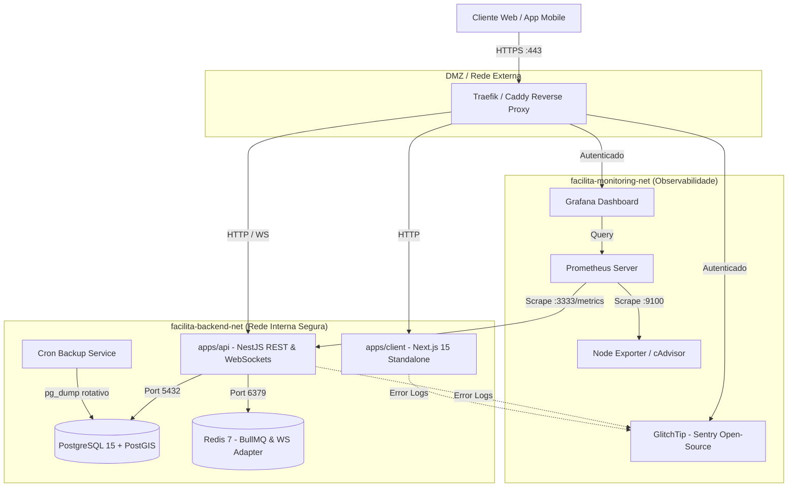
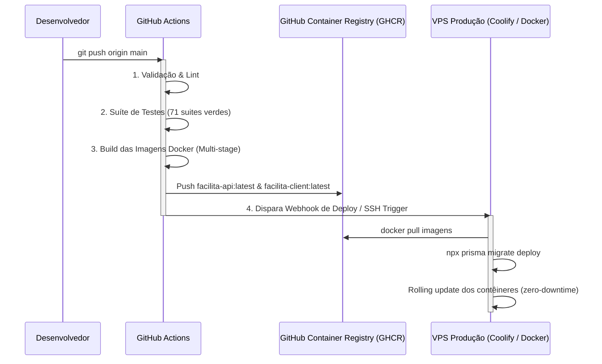

# 🏛️ FACILITA — ARQUITETURA DE INFRAESTRUTURA ENTERPRISE & GUIA OPERACIONAL

Este documento detalha o desenho técnico da infraestrutura corporativa do **FACILITA**, dimensionada para alta disponibilidade, segurança e escalabilidade com **custo mínimo de operação ($0 de SaaS adicional)**, utilizando servidores dedicados/VPS e a stack open-source moderna.

---

## 📑 Sumário

1. [Princípios Arquiteturais & Premissas de Custo](#1-princípios-arquiteturais--premissas-de-custo)
2. [Topologia do Sistema no Servidor](#2-topologia-do-sistema-no-servidor)
3. [Estratégia de Containerização (Monorepo)](#3-estratégia-de-containerização-monorepo)
4. [Banco de Dados & Cache em Produção](#4-banco-de-dados--cache-em-produção)
5. [Rotina de Backup Local com Rotação de 7 Dias](#5-rotina-de-backup-local-com-rotação-de-7-dias)
6. [Observabilidade 100% Self-Hosted](#6-observabilidade-100-self-hosted)
7. [Esteira de CI/CD (GitHub Actions + GHCR)](#7-esteira-de-cicd-github-actions--ghcr)
8. [Manual Operacional: Provisionamento do Zero](#8-manual-operacional-provisionamento-do-zero)

---

## 1. Princípios Arquiteturais & Premissas de Custo

* **Custo Fixo & Previsível:** Ao invés de serviços proprietários com taxas ocultas por requisição ou tráfego (como AWS NAT Gateway, RDS Multi-AZ ou Datadog), a infraestrutura roda consolidada em uma VPS de alta performance (ex: Hetzner CPX31/CCX13 ou DigitalOcean Droplet de 4 a 8 vCPUs / 8 a 16 GB RAM por ~€12 a $24/mês).
* **Isolamento e Resiliência:** Separação estrita em redes Docker internas (`facilita-backend-net`, `facilita-monitoring-net`), expondo apenas a porta HTTPS (443) para a internet.
* **Compatibilidade Padrão Enterprise:** Adoção de protocolos de mercado (Sentry SDK, Prometheus Scrape, Docker Engine, Prisma Migrations), permitindo migração futura para Kubernetes ou nuvem gerenciada sem alteração de código.

---

## 2. Topologia do Sistema no Servidor



---

## 3. Estratégia de Containerização (Monorepo)

O monorepo utiliza **Turborepo** e **npm workspaces**. Para garantir builds rápidos e imagens compactas em produção (< 180MB):

### 3.1 Backend (`apps/api`) — Multi-Stage Build
1. **Base:** Node.js 20 Alpine com `libc6-compat` e ferramentas de compilação essenciais.
2. **Pruner:** Utilização do `npx turbo prune api --docker` para isolar apenas as dependências do `apps/api` e pacotes compartilhados (`@facilita/contracts`, `@facilita/database`, `@facilita/event-bus`).
3. **Builder:** Execução do `npx prisma generate` e compilação do TypeScript com `nest build`.
4. **Runner:** Imagem enxuta de produção sem `devDependencies`, rodando com usuário sem privilégios (`node:node`).

### 3.2 Frontend Web (`apps/client`) — Standalone Next.js
1. Utilização da flag `output: 'standalone'` no `next.config.js`.
2. O Next.js copia automaticamente apenas os módulos Node necessários para a pasta `.next/standalone`.
3. Os assets estáticos (`.next/static` e `public/`) são servidos com cache agressivo no proxy reverso.

---

## 4. Banco de Dados & Cache em Produção

### 4.1 PostgreSQL 15 com PostGIS
* **Imagem:** `postgis/postgis:15-3.3` (necessário para buscas espaciais de matching de prestadores por raio em km).
* **Volume:** `postgres_data:/var/lib/postgresql/data` mapeado em disco SSD local.
* **Conexões & Pool:** Configuração de `max_connections = 150` e alocação de `shared_buffers = 25% da RAM`.
* **Migrações:** Executadas antes da subida da API via `npx prisma migrate deploy` em container efêmero.

### 4.2 Redis 7
* **Imagem:** `redis:7-alpine`.
* **Persistência:** AOF (Append-Only File) e RDB snapshots ativados para garantir integridade das filas BullMQ e sessões de WebSocket.
* **Volume:** `redis_data:/data`.

---

## 5. Rotina de Backup Local com Rotação de 7 Dias

Um container de serviço leve (`facilita-backup`) executa diariamente às 03:00 (BRT) o dump completo do PostgreSQL com compressão gzip e retenção automática de exatamente 7 dias:

### Script de Execução (`scripts/backup-postgres.sh`)
```bash
#!/bin/sh
set -e

BACKUP_DIR="/backups"
TIMESTAMP=$(date +"%Y%m%d_%H%M%S")
FILENAME="$BACKUP_DIR/facilita_db_$TIMESTAMP.sql.gz"

mkdir -p "$BACKUP_DIR"

echo "[$(date)] Iniciando backup do banco de dados..."
pg_dump -h db -U "$POSTGRES_USER" -d "$POSTGRES_DB" | gzip > "$FILENAME"
echo "[$(date)] Backup concluído: $FILENAME ($(du -h $FILENAME | cut -f1))"

# Rotação: Manter apenas os últimos 7 dias (remove arquivos com mais de 7 dias)
find "$BACKUP_DIR" -name "facilita_db_*.sql.gz" -mtime +7 -exec rm {} \;
echo "[$(date)] Rotação de 7 dias aplicada com sucesso."
```

---

## 6. Observabilidade 100% Self-Hosted

| Componente | Função | Custo SaaS Alternativo | Custo no VPS |
| :--- | :--- | :--- | :--- |
| **GlitchTip** | Rastreio de exceções e erros de frontend/backend (100% compatível com `@sentry/node` e `@sentry/nextjs`) | ~$29/mês (Sentry Team) | **$0** |
| **Prometheus** | Coleta periódica de métricas da API, consumo de CPU/RAM e latência de rotas | ~$150/mês (Datadog APM) | **$0** |
| **Grafana** | Painéis visuais para monitorar saúde dos contêineres, transações e filas | ~$49/mês (Grafana Cloud Pro) | **$0** |
| **cAdvisor / Node Exporter** | Métricas de uso de hardware e saúde de containers | Incluso no SaaS | **$0** |

---

## 7. Esteira de CI/CD (GitHub Actions + GHCR)

O fluxo automatizado de integração e entrega contínua opera em duas fases:



---

## 8. Manual Operacional: Provisionamento do Zero

### 8.1 Preparação do Servidor (Ubuntu 22.04 / 24.04 LTS)
```bash
# 1. Atualizar pacotes
sudo apt update && sudo apt upgrade -y

# 2. Instalar Docker e Docker Compose
curl -fsSL https://get.docker.com -o get-docker.sh
sudo sh get-docker.sh
sudo usermod -aG docker $USER

# 3. Configurar Firewall (UFW)
sudo ufw allow OpenSSH
sudo ufw allow 80/tcp
sudo ufw allow 443/tcp
sudo ufw enable
```

### 8.2 Instalação do Coolify (Painel de Orquestração com $0 de Licença)
```bash
curl -fsSL https://cdn.coollabs.io/coolify/install.sh | bash
```
* O painel estará disponível em `http://<IP_DO_SERVIDOR>:8000`.
* O Coolify gerencia automaticamente o Traefik, emissão e renovação de certificados SSL Let's Encrypt para os domínios configurados.

### 8.3 Restauração de Desastres (Restore de Backup)
Para restaurar o banco a partir do backup rotativo mais recente:
```bash
# Localizar o arquivo mais recente
LATEST_BACKUP=$(ls -t /var/facilita/backups/facilita_db_*.sql.gz | head -1)

# Descompactar e restaurar
gunzip -c "$LATEST_BACKUP" | docker exec -i facilita-postgres psql -U postgres -d facilita
```
