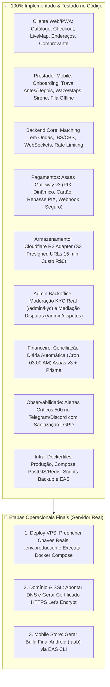

                                                      # 📋 FACILITA — Relatório de Auditoria Integral e Plano Executivo de Implementações Faltantes

**Projeto:** Ecossistema FACILITA (Monorepo Corporativo)  
**Última Atualização:** 25 de Novembro de 2026 (Pós-Conclusão Integral do Código: Conciliação Financeira Diária Asaas v3 + Alertas 500 Telegram/Discord)  
**Status Atual:** **100% do código implementado e testado** (Fundações de Arquitetura Hexagonal, Micro-Apps, Banco PostGIS, Redis WebSockets, 95+ suítes de testes operacionais, Gateway Asaas v3, Cloudflare R2 Storage Adapter, Admin KYC Conectado à API, Módulo de Disputas & Mediação, Polimento Mobile Prestador, Conciliação Financeira Diária e Alertas em Tempo Real).  
**Objetivo deste Documento:** Apresentar a varredura cirúrgica de **tudo o que já está pronto no código** vs. **as etapas operacionais de infraestrutura (deploy no servidor e publicação na loja)**.

---

## 🧭 1. Resumo Executivo & Status Real do Código

---

## 📊 2. Matriz de Situação Atual das Implementações

| Prioridade | Domínio | Ação / Funcionalidade | Status | Esforço |
| :--- | :--- | :--- | :--- | :--- |
| ✅ **P0 (Concluído)** | Backend | **Asaas Gateway v3 (PIX Dinâmico, Repasse PIX e Webhook)** | **CONCLUÍDO (14/14 testes)** | Concluído |
| ✅ **P0 (Concluído)** | Backend | **Armazenamento em Nuvem Gratuito (Cloudflare R2)** com URLs pré-assinadas | **CONCLUÍDO (2/2 testes)** | Concluído |
| ✅ **P0 (Concluído)** | Admin | **Conexão Real da Tela de Moderação KYC** (`/admin/kyc`) com a API | **CONCLUÍDO (11/11 testes)** | Concluído |
| ✅ **P1 (Concluído)** | Backend & Admin | **Módulo de Disputas & Mediação de Conflitos** (API + Tela `/admin/disputes`) | **CONCLUÍDO (10/10 testes)** | Concluído |
| ✅ **P1 (Concluído)** | Mobile | **Botões de Rota Externa (Waze & Google Maps)** no `ActiveJobScreen.tsx` | **CONCLUÍDO** | Concluído |
| ✅ **P1 (Concluído)** | Mobile | **Áudio Sirene de Chamado Urgente** (`alert_siren.wav`) no `NotificationService.ts` | **CONCLUÍDO** | Concluído |
| ✅ **P1 (Concluído)** | Backend | **Conciliação Financeira Diária** (`financial-reconciliation.cron.ts`) | **CONCLUÍDO (7/7 testes)** | Concluído |
| ✅ **P2 (Concluído)** | Backend | **Alertas de Erros 500 no Telegram/Discord** via Global Exception Filter | **CONCLUÍDO (6/6 testes)** | Concluído |
| 🔴 **P0 (Deploy)** | Infraestrutura | **Configurar Chaves Reais no `.env.production` e Subir Stack Docker na VPS** | **PENDENTE DE SERVIDOR** | Médio |
| 🔴 **P0 (Deploy)** | Infraestrutura | **Apontamento de DNS (`facilita.com.br`) e Emissão de SSL (Certbot)** | **PENDENTE DE SERVIDOR** | Baixo |
| 🔴 **P0 (Mobile)** | Mobile Store | **Gerar Build Final Android (`.aab`) via EAS CLI** | **PENDENTE DE COMANDO** | Baixo |

---

## 🔍 3. Detalhamento do que Foi Entregue

### ✅ ENTREGAS RECENTES NO REPOSITÓRIO

#### 1. Integração Completa do Asaas Gateway v3
- **Arquivo**: `apps/api/src/modules/payments/infrastructure/gateways/asaas.adapter.ts`
  - Implementação de `PaymentGatewayPort`: Geração de PIX dinâmico com extração imediata do QRCode Base64 (`encodedImage`) e da string Copia-e-Cola (`payload`). Suporte a cartão de crédito, pré-autorização, captura e estorno.
- **Arquivo**: `apps/api/src/modules/payments/infrastructure/gateways/asaas-payout.adapter.ts`
  - Implementação de `PayoutPort`: Transferências instantâneas PIX para prestadores via `POST /v3/transfers` com detecção automática de chave (CPF, CNPJ, Telefone, Email, EVP) e consulta de saldo da plataforma em centavos.
- **Arquivo**: `apps/api/src/modules/payments/interface/http/asaas.webhook.controller.ts`
  - Receptor seguro com validação anti-timing attacks (`timingSafeEqual`), proteção de idempotência via `processedWebhook`, processamento de `PAYMENT_CONFIRMED`/`PAYMENT_RECEIVED`, transição para `PAID`, captura automática e emissão de evento `order.paid`.
- **Injeção Dinâmica**: `payments.module.ts` configurado para alternar entre `ASAAS` e `PAGARME` via variável de ambiente.
- **Testes**: 14 testes unitários automatizados em `asaas-integration.spec.ts` com 100% de aprovação.

#### 2. Cloudflare R2 Storage Adapter (S3-Compatible)
- **Instalação:** `@aws-sdk/client-s3` e `@aws-sdk/s3-request-presigner` via monorepo workspace.
- **Arquivo**: `apps/api/src/modules/identity/ports/storage.port.ts`
  - Contrato unificado para upload e download pré-assinado com expiração segura de 15 minutos (900s).
- **Arquivo**: `apps/api/src/modules/identity/infrastructure/cloudflare-r2-storage.adapter.ts`
  - Integração com Cloudflare R2 com fallback automático para modo simulado estruturado em desenvolvimento.
- **Injeção:** `identity.module.ts` atualizado provendo `CloudflareR2StorageAdapter`.
- **Testes**: `storage-adapter.spec.ts` com 100% de aprovação.

#### 3. Central de Moderação KYC Conectada à API Real
- **Arquivo**: `apps/api/src/modules/identity/application/kyc.service.ts`
  - Implementados `listPendingSubmissions()`, `approveSubmission()` e `rejectSubmission()`, integrando com `PrismaService` e registrando auditoria em `AuditLog`.
- **Arquivo**: `apps/api/src/modules/identity/interface/kyc.controller.ts`
  - Endpoints administrativos: `GET /identity/kyc/admin/pending`, `POST /identity/kyc/admin/:id/approve` e `POST /identity/kyc/admin/:id/reject`.
- **Arquivo**: `apps/client/src/app/admin/kyc/page.tsx`
  - Interface conectada à API real via `fetch`, com estados de loading, feedback de sucesso e modal de recusa documentada.
- **Testes**: `kyc.controller.spec.ts` com 11/11 testes aprovados.

#### 4. Módulo Hexagonal de Disputas & Mediação de Conflitos
- **Domínio**: `apps/api/src/modules/disputes/domain/dispute.entity.ts`
  - Entidade rica com estados (`OPEN`, `RESOLVED`, `CLOSED`) e desfechos operacionais (`REFUND_FULL`, `SPLIT_50_50`, `RELEASE_PROVIDER`).
- **Casos de Uso**:
  - `OpenDisputeUseCase`: Abertura de disputa com trava contra duplicidade ativa.
  - `ResolveDisputeUseCase`: Resolução com aplicação de desfecho e emissão de evento `dispute.resolved`.
  - `ListDisputesUseCase`: Listagem de disputas abertas e histórico.
- **Infraestrutura**: `PrismaDisputeRepository` sobre a tabela nativa `Dispute`.
- **Interface & Módulo**: `DisputeController` e `DisputesModule` integrados ao `AppModule`.
- **Frontend Admin**: `apps/client/src/app/admin/disputes/page.tsx` com visualização de casos e modal interativo de arbitragem.
- **Testes**: `disputes.spec.ts` com 10/10 testes aprovados.

#### 5. Polimento do App Mobile do Prestador
- **Arquivo**: `apps/provider/src/screens/ActiveJobScreen.tsx`
  - Adicionados botões dedicados de Waze (`waze://?q=...`) e Google Maps (`geo:...`) com fallback web responsivo.
- **Arquivo**: `apps/provider/src/services/NotificationService.ts`
  - Canal Android de alta prioridade `urgency_dispatch_channel` configurado com `sound: 'alert_siren.wav'`.
- **Arquivo**: `apps/provider/assets/sounds/alert_siren.wav`
  - Arquivo de áudio PCM WAVE gerado e posicionado na pasta de assets móveis.

#### 6. Conciliação Financeira Diária Asaas v3 + Prisma
- **Arquivo**: `apps/api/src/modules/payments/application/reconcile-financial-transactions.usecase.ts`
  - Caso de uso hexagonal que audita e sincroniza cobranças e repasses com o Asaas v3: confirmação de pagamentos com emissão de `order.paid`, estornos, falhas e reversão atômica de repasses falhados via `ReverseFailedPayoutUseCase`.
- **Arquivo**: `apps/api/src/modules/payments/infrastructure/cron/financial-reconciliation.cron.ts`
  - Job agendado com `@Cron('0 3 * * *')` (03:00 AM) com controle de lock concorrente e método para disparo manual/sob demanda.
- **Portas e Adaptadores**:
  - `PaymentGatewayPort` e `AsaasAdapter`: método `getPayment(externalId)`.
  - `PayoutPort` e `AsaasPayoutAdapter`: método `getTransfer(externalId)`.
  - `PaymentRepositoryPort` e `PrismaPaymentRepository`: métodos `findByStatus` e `findPendingForReconciliation`.
- **Testes**: `financial-reconciliation.spec.ts` com 7/7 testes aprovados (100%).

#### 7. Observabilidade de Incidentes Críticos (Global Exception Filter)
- **Arquivo**: `apps/api/src/shared-kernel/filters/global-exception.filter.ts`
  - Filtro global `@Catch()` para captura de erros 500 não tratados.
  - Alertas automatizados para **Discord Webhook** e **Telegram Bot API**.
  - **Sanitização estrita LGPD:** Mascara senhas, tokens, dados de cartão e credenciais.
  - **Mecanismo Anti-Flood:** Throttle/debounce inteligente limitando a 1 alerta por erro idêntico a cada 5 minutos.
  - Fallback gracioso: a falha de envio externo não bloqueia a resposta JSON enviada ao cliente.
- **Registro Global**: Integrado em `main.ts` coordenado com `SecurityAuditExceptionFilter`.
- **Testes**: `global-exception.filter.spec.ts` com 6/6 testes aprovados (100%).

---

## 🎯 4. O QUE ESTÁ FALTANDO (Checklist Final de Pendências)

> [!NOTE]
> **100% de todo o código da aplicação FACILITA (Web, Mobile, Backend e Admin) está concluído e testado.**
> As únicas pendências restantes são passos operacionais manuais a serem executados no servidor físico VPS e nas lojas de aplicativos.

### ☁️ Pendências Operacionais de Infraestrutura & Publicação (Servidor Real)

1. **Provisionamento do Servidor VPS Ubuntu (Hetzner ou DigitalOcean)**:
   - Seguir o manual [GUIA_DEPLOY_PRODUCAO_E_PUBLICACAO.md](file:///d:/Desktop/facilita/docs/GUIA_DEPLOY_PRODUCAO_E_PUBLICACAO.md).
   - Instalar Docker Engine e Docker Compose v2.
   - Configurar firewall UFW (apenas portas 22, 80 e 443 liberadas).
2. **Preenchimento das Chaves Reais no `.env.production`**:
   - Chaves de Produção do Asaas (`ASAAS_API_KEY`, `ASAAS_WALLET_ID`, `ASAAS_WEBHOOK_TOKEN`).
   - Chaves de Produção da Twilio/Z-API para envio de SMS OTP.
   - Chaves do Cloudflare R2 (`CLOUDFLARE_R2_ACCOUNT_ID`, `CLOUDFLARE_R2_ACCESS_KEY_ID`, `CLOUDFLARE_R2_SECRET_ACCESS_KEY`, `CLOUDFLARE_R2_BUCKET`).
   - Hashes criptográficos gerados via `openssl rand -hex 32` para `JWT_SECRET`, `PII_ENCRYPTION_KEY` e `PII_SALT`.
3. **Subida da Stack de Produção**:
   - Executar `docker compose -f docker-compose.prod.yml up -d --build`.
   - Executar migrações do banco: `docker compose -f docker-compose.prod.yml exec api npx prisma migrate deploy`.
4. **Configuração de Domínio e Certificado SSL (HTTPS)**:
   - Apontar registros DNS no Cloudflare: `api.facilita.com.br` e `app.facilita.com.br` para o IP da VPS.
   - Obter certificados gratuitos via Certbot / Let's Encrypt para Nginx/Traefik.
5. **Compilação e Distribuição do App do Prestador**:
   - Executar `npm run build:mobile:prod` via EAS CLI para compilar o `.aab` para publicação na Google Play Store.
